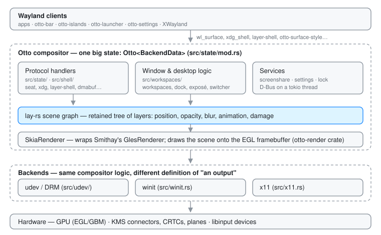

# Otto Developer Guide

Otto is a Wayland compositor built on [Smithay](https://smithay.github.io/smithay/),
rendered with Skia, and driven by a retained scene graph
([lay-rs](https://github.com/nongio/layers)).

If you have written a compositor before, the one structural surprise is that
Otto does not draw windows imperatively each frame. It maintains a **scene
graph**, a tree of layers with positions, opacity, blur and animations, and
hands the whole tree to the renderer as a single render element. Most of
`src/workspaces/` is code that mutates that tree; almost none of it draws.

For what Otto does rather than how, see the
[User Guide](../user/README.md). Contributions of every size are welcome, from
a bug report to a feature: the [issue tracker](https://github.com/nongio/otto/issues)
is the place to start.

## Read these first

| Page | What it covers |
|------|----------------|
| [Project Structure](project-structure.md) | Where everything lives, feature flags, how to build |
| [Architecture Rules](architecture.md) | Crate layers and module boundaries, and how CI checks them |
| [Rendering](rendering.md) | Scene graph → render elements → Skia → screen |
| [Render Loop](render_loop.md) | When Otto wakes up, when it renders, damage tracking |
| [Wayland Protocols](wayland.md) | The one-big-state pattern and how to find any protocol handler |
| [XDG Specifications](xdg-specifications.md) | Every freedesktop/XDG standard Otto implements, and where |
| [The Scene Graph](scene-graph.md) | The layer tree: how it is shaped, how surfaces enter it, how subtrees become KMS planes |
| [Layers](layers.md) | The unit the tree is made of: properties, content closures, transactions, caching, damage |

## Subsystems

| Page | What it covers |
|------|----------------|
| [Scroll Panes](scroll-pane.md) | Scrolling an otto-kit app at display rate by moving subsurfaces, not repainting |
| [Dock](dock-design.md) | The compositor-drawn dock: data flow, layers, magnification |
| [Exposé](expose.md) | The all-windows overview: layout, mirrors, drag-and-drop, multi-output |
| [Window Move](window-move.md) | How interactive window drags are implemented |
| [Vulkan Renderer](vulkan-renderer.md) | Skia on Vulkan: picking it, buffer import, sync files, what is missing |
| [DRM Planes](drm_plane.md) | Handing parts of the scene to display hardware instead of the GPU |
| [Foreign Toplevel](foreign-toplevel.md) | Exposing the window list to taskbars and launchers |
| [Surface Style Protocol](surface-style-protocol.md) | `otto-surface-style-unstable-v1`: letting a client style and animate its own surface |
| [Screen Sharing](screenshare.md) | Portal, PipeWire, wlr-screencopy, window capture |
| [Permissions](permissions.md) | What Flatpak apps cannot reach, the lock screen, and the polkit auth panel |
| [File Previews](file-previews.md) | Thumbnails, the preview column, Peek, the sandboxed decode worker, video |
| [File Icons](file-icons.md) | What goes in the icon box: file types, the icon-name chain, themes, animated previews |
| [Text in Pictures](peek-ocr.md) | Reading the words in a picture: the recogniser, the word cache, selection and copy |
| [File Search](file-search.md) | Find and Recent in otto-files, and the one index both of them ask |
| [Agents](agents.md) | Running coding agents behind the launcher: `otto-agents`, AHP and ACP, permission prompts |
| [Accessibility](accessibility.md) | Key grabs for screen readers, and the shell and kit apps on AT-SPI |
| [Color Scheme](color-scheme-setting.md) | How apps learn whether Otto is in light or dark mode, and the accent colour |
| [Settings D-Bus API](settings-dbus-api.md) | The `org.otto.Settings` wire contract |
| [Shell D-Bus API](shell-dbus-api.md) | The `org.otto.Shell1` wire contract: i3-syntax commands, the tree as JSON, `otto-msg` |
| [RDP Bridge](rdp-virtual-output.md) | Serving a virtual output over RDP (`otto-rdp`) |
| [Debug Action Hook](debug-action-hook.md) | Driving builtin shortcut actions from a script (`$OTTO_ACTION_FILE`) |
| [Versioning & Releases](versioning.md) | One workspace version for the compositor and every component, and how to bump it |
| [Remote-Desktop Indicator](remote-desktop-indicator.md) | The sharing indicator `otto-rdp` publishes while a client is watching |

## Crates

One page per workspace crate: what it is, its internal and external dependencies, and how to develop it. Each crate folder has an `AGENTS.md` that points to its page.

| Crate | What it is |
|-------|------------|
| [otto-render](otto-render.md) | The compositor's render stack: the Skia renderer, its GL and Vulkan plumbing, and the scene render elements |
| [otto-arch](otto-arch.md) | The checker for `architecture.toml` and the affected-crate selection CI runs on |
| [otto-foundations](otto-foundations.md) | The UI-free base: XDG directories, `file://` URIs and name matching, over `std` alone |
| [otto-dbus](otto-dbus.md) | Typed zbus client proxies for Otto's own `org.otto.*` D-Bus interfaces |
| [otto-search](otto-search.md) | File search: one query language over LocalSearch, as a library and the `otto-search` command |
| [otto-agents-client](otto-agents-client.md) | The wire between `otto-agents` and its clients: the socket, session URIs and file URIs |
| [otto-pdf](otto-pdf.md) | Editing PDFs in place (form fields and annotations) through a runtime-loaded PDFium |
| [otto-kit](otto-kit.md) | The toolkit every Otto app is built on, and the drawing half the compositor uses for its own chrome |
| [otto-md-kit](otto-md-kit.md) | Otto's Markdown parser, producing the toolkit's document blocks |
| [otto-media-kit](otto-media-kit.md) | Video playback for Otto apps: a `Player` and view in the library, GStreamer in the sandboxed `otto-media-worker` |
| [otto-agents-kit](otto-agents-kit.md) | The session feed, rows, keys and Ask chat shared by Otto's agent UIs |
| [otto-auth-ui](otto-auth-ui.md) | The password panel shared by the greeter, the lock screen and the polkit agent |
| [otto-peek](otto-peek.md) | Peek, the Space-bar preview, as a library with a sandboxed decode worker |
| [otto-bar](otto-bar.md) | The top menu bar: global app menu, tray, keyboard layout, battery and clock |
| [otto-islands](otto-islands.md) | The dynamic island, the session's notification daemon and the system dialog |
| [otto-launcher](otto-launcher.md) | Otto's keyboard launcher, with Ask and the agents mode |
| [otto-files](otto-files.md) | Otto's file browser, file picker and desk |
| [otto-preview](otto-preview.md) | Studio: one file in a window of its own, with an agent chat and PDF editing |
| [otto-settings](otto-settings.md) | Otto's Settings app |
| [otto-canvas](otto-canvas.md) | The Agents panel in Otto's side canvas |
| [otto-stash](otto-stash.md) | The card that collects selections, files and screen regions to hand to Ask |
| [otto-emoji](otto-emoji.md) | The emoji picker: search or browse, pick one, and it is typed or pasted where the cursor was |
| [otto-lock](otto-lock.md) | Otto's screen locker, backed by PAM |
| [otto-greeter](otto-greeter.md) | Otto's login screen, backed by greetd |
| [otto-authorize](otto-authorize.md) | Otto's polkit authentication agent: the password panel for `pkexec`, system services and protected settings |
| [otto-agents](otto-agents.md) | Otto's agent service: runs ACP agents and serves them over the Agent Host Protocol |
| [otto-rdp](otto-rdp.md) | The RDP bridge that serves an Otto output and forwards remote input |
| [xdg-desktop-portal-otto](xdg-desktop-portal-otto.md) | Otto's xdg-desktop-portal backend: screen sharing, settings, dialogs, screenshots and file chooser |
| [otto-msg](otto-msg.md) | The command-line tool that drives Otto from scripts over `org.otto.Shell1` |
| [otto-input-overlay](otto-input-overlay.md) | On-screen touchpad and key-press overlays for screen recordings |
| [otto-dictate](otto-dictate.md) | A proof of concept: dictation as a Wayland input method, with live text and an equaliser at the caret |
| [apps-manager](apps-manager.md) | A command-line probe that prints the windows Otto lists through `ext_foreign_toplevel_list_v1` |

## Design docs and plans

These describe work that is exploratory, partial, or superseded. Each says so
at the top — check that before trusting the details.

| Page | Status |
|------|--------|
| [otto-kit Roadmap](otto-kit-roadmap.md) | Partially built: gap analysis for the UI toolkit |
| [Tiling Plan](tiling-plan.md) | Mostly built: the tree, the commands and the settings; tabbed/stacked and XWayland are not |
| [Screenshot Portal Plan](screenshot-plan.md) | Partly built: the portal exists and shells out to `grim`; capture inside the compositor is still the plan |
| [AirPlay Screenshare](airplay-screenshare.md) | Exploration only |
| [Vulkan Renderer Plan](vulkan-renderer-plan.md) | Phases 1–3 built; plane scanout on Vulkan is next |

## Specs

`docs/developer/` explains **how things work today**. [`specs/`](../../specs/)
holds the behavioural contracts: what a feature must do, written to be
verified against. Where a subsystem has both, the spec is authoritative for
behaviour and the doc is authoritative for structure. See
[`specs/README.md`](../../specs/README.md).

## Conventions

**Two coordinate spaces, and mixing them causes scale-dependent bugs.**

- *Physical pixels*: raw hardware pixels. Used for layer positions
  (`set_position`, `change_position`) and `output.current_mode().size`.
- *Logical pixels (points)*: physical ÷ scale.
  `output_geometry(output).size` returns these, so it must **not** be used for
  layer positions.

Always take the scale from the output itself —
`output.current_scale().fractional_scale() as f32`. `WorkspacesModel.scale` is
a global fallback and does not belong in geometry code.

Prefer typed geometry: Smithay's `Point`, `Size` and `Rectangle` carry the
space in their type (`Physical` or `Logical`), so mixing the two fails to
compile. Convert between them only at the edges — `to_physical(scale)` /
`to_logical(scale)` with the output's own scale — and hand lay-rs its plain
floats through the helpers in `src/utils/geometry.rs`:

| Helper | From | To |
| --- | --- | --- |
| `PhysicalPoint`, `PhysicalSize` | — | `Point`/`Size<f32, Physical>`, the scene's precision |
| `layer_point` | `PhysicalPoint` | `layers::types::Point` (`set_position`, `hover_layer`) |
| `layer_size` | `PhysicalSize` | fixed taffy `layers::types::Size` |
| `layer_origin`, `layer_center` | a `Layer`'s render bounds | `PhysicalPoint` |
| `layer_contains` | `Layer` + `PhysicalPoint` | inclusive hit test |
| `output_local_physical` | global `Point<f64, Logical>` + output origin + scale | output-local `PhysicalPoint` |

The workspace selector (`src/workspaces/workspace_selector.rs`) is converted;
the rest of the compositor is being moved over in slices. Where a value is
still a bare `f32`/`i32`, suffix physical-pixel variables with `_px`
(`width_px`, `offset_px`) so the space is visible at the call site. A
genuinely one-dimensional length (a gap, a label height) may stay a scalar.
