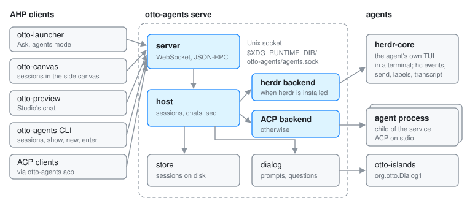

# Agents

**Status: proof of concept.** The service runs real agents and the launcher
talks to it, but the plans in `components/otto-agents/docs/plans/` are ahead of
the code. This page describes what exists today. Sessions in herdr are in the
nightly builds, not in a release yet.

Otto can put a coding agent behind the launcher: type a request instead of an
app name and the answer streams back in the same card.

| Piece | What it is | Where |
|---|---|---|
| **otto-agents** | Headless service that runs agents and publishes their sessions | `components/otto-agents/` ([crate map](otto-agents.md)) |
| **otto-launcher** | Client: *ask* mode sends requests, *agents* mode lists sessions | `components/otto-launcher/src/ask.rs` |
| **otto-islands** | Shows permission requests and questions when no client is watching | `org.otto.Dialog1` |
| **Files "Ask…"** | Files script that opens the launcher with the selection attached | `components/otto-files/scripts/ask` |

The service draws nothing and the launcher stores nothing. A session belongs
to otto-agents and outlives every window that looks at it, so closing the
launcher mid-answer is harmless.

## Architecture



Clients speak **AHP** ([Agent Host Protocol](https://microsoft.github.io/agent-host-protocol/)):
JSON-RPC 2.0, one message per WebSocket text frame (`server.rs`, `rpc.rs`).
The host owns each session and gives every client the same view of it, as a
state snapshot plus an ordered stream of actions, so the launcher can join a
session another client started and see the whole conversation.

A session runs on one of two backends, and clients see no difference:

- **herdr backend** (`herdr.rs`): the agent's own program in a herdr-core
  terminal. See [Sessions in herdr](#sessions-in-herdr).
- **ACP backend** (`acp.rs`): the agent as a child process speaking
  [ACP](https://agentclientprotocol.com) on stdio. Claude Code through its ACP
  adapter is the default agent and uses the existing login.

`backend` in `agents.toml` is `"herdr"` or `"acp"`; unset, it is herdr when
`hc` is on `PATH` (`Config::backend`, `herdr::installed`). `serve --herdr` and
`serve --acp` override it. Settings › Agents › Sessions run in writes the key
(Automatic leaves it unset), and `otto-setup` offers the same choice.

### The transport

The service listens on `$XDG_RUNTIME_DIR/otto-agents/agents.sock`, created
0600 in a 0700 directory. The socket's owner is the whole access check: there
is no authentication inside the protocol. A stale socket is replaced at start
unless a service still answers on it.

`--listen` (`OTTO_AGENTS_LISTEN`) takes a socket path (absolute, or after
`unix:`) or `host:port`. TCP is for development and tests, and logs a warning
since a loopback port is open to every local process. With no runtime
directory the service falls back to `127.0.0.1:4800`, with the same warning.
Clients take `--url` (`OTTO_AGENTS_URL`): `unix:///path`, a bare absolute path
or `ws://host:port`. The socket and URL handling live in
[otto-agents-client](otto-agents-client.md). The launcher uses the upstream
`ahp` and `ahp-ws` crates and does not depend on the service crate.

The spec is vendored read-only under `components/otto-agents/spec/upstream/`
and only `scripts/sync-spec.sh` changes it. Wire types come from `ahp-types` at
the pinned protocol version; `tests/spec_pin.rs` fails if they drift. What the
service covers of the protocol is in
[spec-coverage.md](../../components/otto-agents/docs/spec-coverage.md).

### Running it

```sh
cargo run -p otto-agents -- serve        # on the default socket
cargo run -p otto-agents -- serve --echo # built-in agent that repeats the prompt
components/otto-agents/scripts/ci.sh     # fmt, clippy, tests, spec drift check
systemctl --user enable --now otto-agents
journalctl --user -u otto-agents -f
```

The packaged user unit, `otto-agents.service`, is off by default. It runs with
the user manager's environment, not a login shell's, so an agent found through
`~/.local/bin` or nvm needs a full path in `agents.toml` or
`Environment=PATH=…` via `systemctl --user edit otto-agents`. It is hardened
with `NoNewPrivileges`, `PrivateTmp`, `RestrictSUIDSGID` and
`ProtectSystem=strict` with `ReadWritePaths=%h %t`; `ProtectHome` stays off
because agents work in the home directory.

### Inside the service

The modules are listed in [otto-agents](otto-agents.md#modules). Three rules
hold the design together:

- **One lock, one sequence.** Every mutation goes through `Host::lock`, which
  reduces the action with the same `ahp::reducers` the clients use, stamps it
  with the next `serverSeq` and queues the outgoing envelopes, responses
  included. Clients see snapshots, responses and envelopes in a consistent
  order and reach the host's state by replaying the same reducers.
- **The host never talks to agents.** Each session's backend gets a command
  channel and an event channel, and the host translates `SessionEvent`s into
  AHP actions (`agent.rs`). The echo backend stands in for a real agent in
  tests, so CI needs no model credentials.
- **Sessions outlive the process.** `store.rs` writes one JSON file per session
  under `$XDG_STATE_HOME/otto-agents/sessions/` (`herdr-sessions/` under
  herdr), every second and on exit. The directory is 0700 and each record
  0600, tightened on start if wider. A record holds the session's and chat's
  AHP state without the turns, the agent's own session id (`agentSession`), and
  a `written` flag saying the agent has history. The turns belong to the agent:
  see [The agent's history is the session](#the-agents-history-is-the-session).

## Sessions in herdr

The design is
[plan 0016](../../components/otto-agents/docs/plans/0016-herdr-sessions.md).
[herdr](https://herdr.dev) is a terminal workspace for coding agents. Its
runtime, herdr-core, keeps terminals alive with no window attached and knows
which agent runs in each and what it is doing; herdr-app is its window. Under
the herdr backend every session is the agent's own program in a herdr-core
terminal: Claude Code, pi or OpenCode (`Harness`). otto-agents mirrors it over
AHP to Ask, Sessions and Studio and sends what Otto does back to the terminal.
ACP and a live TUI cannot share one agent, so here the agent is its TUI and
the backend reads and drives it from outside.

The backend talks to herdr-core over its API (`herdr_core.rs`): JSON-RPC 2.0,
one message per line, on `$XDG_RUNTIME_DIR/herdr-core/<session>.sock`
(`HC_SESSION`, else `default`). `call` shares one connection per process,
`subscribe` opens its own for `events.subscribe` (a snapshot, then each change),
and `label` sets terminal labels. The only `hc` invocation is
`hc server start`, when the socket does not answer yet. Placing and focusing
tabs goes through `herdr-app do …`.

When the service starts, it installs
[herdr's own integration](https://herdr.dev/tui/docs/integrations/) for each
harness its agents run, wherever `herdr integration status` doesn't list it as
current (`HerdrBackend::install_integrations`). With it, pi and OpenCode report
whether they are working or waiting, so herdr doesn't have to read it off the
screen. OpenCode stays blocked while a permission waits. Every agent also
reports its session, so herdr can resume it after a restart.

| | ACP backend | herdr backend |
|---|---|---|
| Runs the agent | otto-agents, child process | herdr-core, `terminal.run` |
| Interface | Otto's chat | the agent's TUI, and Otto's chat |
| Conversation and tool lines | ACP updates | the agent's transcript |
| State and turns | ACP turns | `events.subscribe` (status, turn count) and the transcript |
| Questions | ACP elicitation | `ask` MCP tool via labels (Claude Code) |
| Permissions | ACP permission requests | `PermissionRequest` hook via labels (Claude Code) |
| Otto → agent | ACP requests | `terminal.send`, `terminal.interrupt`, `terminal.kill` |
| Survives the service and Otto's windows | no | yes |

### Which agents

Every `[[agents]]` entry whose command runs Claude Code, pi or OpenCode,
directly or as the package `npx` (or `bunx`, `pnpx`, `uvx`) starts, is offered
(`Harness::of_agent`); the rest (Codex, Hermes, Gemini) are left out and
logged. A default agent, Otto on Claude Code with id `claude`, comes first
unless an entry with that id replaces it. The backend reads `id`, `name`,
`description`, `model`, `mode`, `folder`, `agent`, `skills`, `colour` and
`space`; `command` is the agent's program with no `args`, and `permissions`,
`env`, `config`, `enter` and `enter_new` are ignored.

### How sessions start

A session starts with `terminal.run` (`keep`, no wait), labelled
`otto.session`, `otto.agent` and `otto.harness`, with the agent's environment
passed in the call. Command lines per harness:

| Harness | New | Taken up again | Also |
|---|---|---|---|
| Claude Code | `--session-id <uuid>` | `--resume <uuid>` | `--permission-mode`, `--model`, `--mcp-config`, `--append-system-prompt`, `--settings` (the hook), `--agents`/`--agent`, plugin args with `skills = "claude"` |
| pi | `--session-id <id>` | same | `--model`, `--append-system-prompt` |
| OpenCode | `-s <id>`, on a session made first with `opencode import` | same | `-m`, `--auto` when `mode = "auto"`, `--agent`, `OPENCODE_CONFIG_CONTENT` in the environment |

What a client creates a session with in `_meta.otto` (Studio's document tools
as `mcpServers`, its `instructions`, the plugin `agent` to run as) reaches
Claude through `--mcp-config` (beside `ask`), `--append-system-prompt` and
`--agents`, and OpenCode through `OPENCODE_CONFIG_CONTENT`. pi has no MCP, so it
gets the instructions but no document tools. The service stores all of it with
the session, so a session started again after a restart has it too.

### herdr is the source of truth

`watch_sessions` subscribes to every terminal. A terminal labelled
`otto.session=<id>`, running or finished, is a session; when the last terminal
of one is removed, the session leaves Otto. A Claude Code started by hand in
herdr is taken up too: its id and folder come from
`~/.claude/sessions/<pid>.json`, and its terminal gets Otto's labels. A stored
session herdr no longer has is hidden, not deleted.

A finished terminal is a dormant session: its summary carries
`_meta.otto.running = false`, clients draw the dormant ring
(`Activity::Dormant` in otto-agents-kit), and opening it starts the agent
again. Closing every Otto window or restarting the service leaves agents
running. `forget` kills and removes the session's terminals, except a shell
where Claude was started by hand, which only loses its labels.

### Where sessions show

A session's terminal carries `herdr.space` and `herdr.tab`, which herdr-app
uses to place it. The space is the one whose folder is the session's; with
none, `herdr-app do space.new` makes one, named after the agent's `space` or
the folder. The session's `otto.terminal` is `otto-agents herdr-show <id>` with
`window = "herdr-app"`, so Ctrl+O runs it and focuses herdr-app without
releasing the session. `herdr::show` opens herdr-app if it is closed, gives a
pane-less terminal a tab (`terminal.keep`) and focuses it (`agent.focus`); a
session that is not running is opened through the service first, which starts
it.

### State, turns and tool lines

- **Readiness.** herdr reports a `status` (`working`, `idle`, `done`,
  `blocked`, `error`) for Claude Code only. Prompts are held until the agent is
  ready: herdr says `idle`/`done`, or after 20 s (Claude), 3 s (pi), or once
  OpenCode's footer shows on screen (`terminal.read`, up to 30 s).
- **Prompts.** A prompt from Ask is typed in with `terminal.send`, only while
  the agent is the program in front; attachments go as `@/path` mentions. Stop
  is `terminal.interrupt`. A prompt typed in the terminal itself gets a turn in
  the chat like one sent from Otto.
- **Turn ends.** `terminal.send` returns herdr's turn count when the prompt
  went in. The transcript ends the turn (Claude's `end_turn`); when herdr's
  count moves past the one the prompt got, the transcript has 3 s to say so
  first. A turn with a question or permission waiting does not end.
- **Conversation.** It comes from the agent's transcript: Claude's
  `~/.claude/projects/<cwd>/<uuid>.jsonl`, pi's JSONL under
  `~/.pi/agent/sessions`, OpenCode's SQLite database (read with the `sqlite3`
  CLI). pi's and OpenCode's are turned into Claude's shape, and a session taken
  up again loads its history from it (`SessionEvent::HistoryLoaded`).
- **Tool lines.** herdr carries no tool calls. A transcript `tool_use` block
  shows as a running tool line (`ToolCallStarted`) and its `tool_result`
  completes it. Claude writes a call before its permission hook asks about it,
  so a Claude tool call waits 1 s before it shows: a permission request with
  the same tool and input claims it, and the call shows as the permission
  question instead.

### Questions and permissions

For Claude Code, a session starts with two hidden commands of this binary
(`herdr_tools.rs`), both running inside the session's terminal:

- `otto-agents herdr-ask`: a stdio MCP server whose one tool, `ask`
  (`mcp__otto__ask`), takes `AskUserQuestion`'s input. `AskUserQuestion` itself
  is disallowed.
- `otto-agents herdr-permission`: Claude's `PermissionRequest` hook, given
  600 s by Claude; it gives up after 540 s so Claude can ask in the terminal.

Both talk to Otto through labels on their terminal, one pair per request so
several wait side by side:

| Request | Answer |
|---|---|
| `otto.ask.<id>` `{id, questions}` | `otto.ask-answer.<id>` `{id, answers}` |
| `otto.permission.<id>` `{id, tool_name, tool_input, cwd, suggestions}` | `otto.permission-answer.<id>` `{id, allow, always}` |

The backend sees a request label arrive through its subscription, raises it in
the chat as an input request or a permission question (which reaches Ask or
the island like any other, see below), and writes the answer label. A
permission card offers Claude's `permission_suggestions` ("don't ask again")
beside allow and deny. When a request label goes before Otto answered, the
backend sends `SessionEvent::RequestWithdrawn` and the card and dialog come
down. Both commands clear their labels when the wait ends or they are
signalled. pi and OpenCode ask in their own terminals.

### Not there yet

herdr-core is not packaged with Otto; it is installed from herdr.dev. Labels
are not authenticated: any herdr terminal can write another's, so one session
could answer another's question. The plan's open questions list the rest.

## The agent's history is the session

The agent keeps the history (for Claude,
`~/.claude/projects/<cwd-slug>/<agent-session>.jsonl`), and the host's chat is
a projection of it, rebuilt whenever opening the session starts its agent. A
session continued outside the host, for example in a terminal through Ctrl+O,
comes back whole the next time it is opened in Ask.

Subscribing to a chat opens it: when the agent is not running and the session
has an `agentSession`, the host starts it (`load_for` in `host.rs`) and the
turns follow once it is up. An agent already running keeps the chat it is
writing.

On the ACP backend, opening a session prefers `session/load` over
`session/resume` (`open_session` in `acp.rs`). `load` replays the history as
`session/update` notifications; `resume` returns nothing and is UNSTABLE in the
ACP schema, so it stays as a fallback for agents without `loadSession`. Neither
spends tokens. A `Replay` collects the updates while the load is in flight and
the session reports them as `SessionEvent::HistoryLoaded`. The host applies
`chat/truncated` and then `chat/turnsLoaded` with the rebuilt turns
(`rebuild_chat`, `history_turn`), ordinary actions every client reconciles as
usual. The replay has no turn markers, so a turn runs from one user message to
the next, and a replayed tool call is recorded as completed with its title and
outcome.

## Pictures

Pictures come from tools (Claude reading a JPEG, a browser screenshot) as
`ContentBlock::Image` in the tool call's content, or rarely in
`agent_message_chunk`. Both end in `SessionEvent::MessageImage`, so the picture
sits in the answer, not in the tool line. Each session remembers the
`(tool_call_id, path)` pairs it sent, so a repeated update shows a picture once.

AHP carries state, not payloads, so `images.rs` writes the bytes under
`$XDG_CACHE_HOME/otto/agents/images` and the chat gets a `contentRef` part
(the `file://` URI, size, media type):

- Files are named `<label>-<digest>.<ext>` (FNV-1a over the bytes): the same
  picture lands on the same file, and the label rides in the name because
  `contentRef` has no caption field.
- The cache is trimmed to 128 MiB, oldest first, so a client must cope with a
  missing file; the launcher draws its name instead.
- A `ResourceLink` to a `file://` picture is not copied; the chat points at it.
- Only bitmaps are taken (PNG, JPEG, GIF, WebP, BMP, AVIF, HEIF); SVG is
  refused. Pictures in reasoning are dropped.

## The launcher as a client

`components/otto-launcher/src/ask.rs` is the whole client. The launcher's loop
has no async runtime, so the connection lives on a thread with a
current-thread tokio runtime that wakes the loop through a polled socket, the
same `poll_fd`/`pump` shape the window list uses. It connects as soon as the
launcher opens. The UI behaviour (status lines, keys, the log) is specified in
[`specs/launcher.md`](../../specs/launcher.md) and the code is mapped in
[otto-launcher](otto-launcher.md).

| Invocation | Mode |
|---|---|
| `otto-launcher --ask` (alias `otto-ask`) | Type a request for an agent |
| `otto-launcher --ask --file PATH…` | The same, with files attached to the first request |
| `otto-launcher --agents` | List the service's sessions; Return opens one |
| `otto-launcher --session ID` | Follow a session by URI or id prefix |

**It queues, it never waits.** The launcher calls `createSession`, subscribes
to the session and its chat, then dispatches `chat/pendingMessageSet`. The
service starts each queued request once the agent is up and the previous turn
has ended, so the card can close at any moment. Subscribing before queueing
guarantees every change arrives after the snapshot it applies to. Follow-ups
queue on the same chat. Ctrl+C cancels a turn; in the session list
Ctrl+Backspace calls `disposeSession`, which stops the agent, deletes the
record and announces `root/sessionRemoved`, leaving the agent's own history
alone.

**Attachments** go as AHP `resource` attachments (`file://` URI and name), and
reach ACP agents as `resource_link` blocks and herdr agents as `@/path`
mentions. Attaching a file shares it (`attached.rs`): the host keeps each
session's `file://` attachments while the service runs, and a
`session/request_permission` of kind `read` is allowed on the spot, with the
agent's "allow once", when every path it names (its `locations`, and string
values under `rawInput` keys containing "path", relative to the session folder,
symlinks followed) is an attached file or inside an attached folder. Anything
else asks as usual: other files, requests naming no path, "always"-only
allows, and every edit, move, delete or command. Nothing is shared between
sessions, and a service restart forgets attachments until a prompt attaches
them again. A message from a chat app (`otto.remote`) attaches nothing:
`otto-agents acp --remote` drops its links and the host ignores them.

**Entering a terminal (ACP).** With an `enter` command configured, the service
publishes `_meta.otto.terminal`: `enter` on its own, `command` wrapped in the
configured `terminal` (or `null`), the folder and the agent's session id.
`{session}` is always the `agentSession`, not the AHP URI. Claude refuses
`--resume` for a session it never wrote and `--session-id` for one it did, so
the service publishes `enter_new` until the session is `written`: given a turn,
replayed on `session/load`, or handed to a terminal. Ctrl+O spawns `command` in
its own process group after `releaseSession`, which cancels a running turn,
withdraws its questions and stops the service's agent, so only the terminal
writes the history. If a process naming the id with a controlling terminal
already exists, the launcher raises its window instead, found by the id in its
app id or title (`--class=otto.agent.s{session}`). `{title}` is the window
name the dock shows. `otto-agents new [agent]` and `otto-agents enter [session]`
do the same from a terminal and `exec` the enter command in place.

**herdr sessions.** When `otto.terminal` carries `window` (`herdr-app`),
Ctrl+O runs `command` and focuses that window without releasing the session:
the agent goes on in the same terminal. A backend that keeps sessions beyond
their agent reports `_meta.otto.running` on each summary; backends that do not
leave it out.

## Where a permission question goes

With `permissions = "ask"` (or under herdr, through the hook) each request goes
to whoever is in front of the person. The rule is in `host.rs`:

1. **It opens in the chat** as a tool call awaiting confirmation, with the
   agent's own options in the agent's order. `dialog::default_option` picks the
   starting option (the narrowest allow, or the narrowest reject when the
   request is `defaultToNo`) and publishes it as `_meta.otto.defaultOption` on
   `chat/toolCallReady`. What the tool would touch goes with it: the first ACP
   `location` and `rawInput` as `tool_input`, and `diff` content as `edits`.
   The adapters' `_meta.permission` hints are honoured (`title`,
   `description`, `defaultToNo`).
2. **A client is subscribed** (usually the launcher): the service waits for
   `chat/toolCallConfirmed`. After `WATCHED_GRACE` (20 s) unanswered it also
   raises the dialog, quietly (`focus: none`) so it does not steal the
   keyboard from the client; the first answer counts. For an agent's question
   the 20 s restart whenever the client changes a draft answer.
3. **Nobody is subscribed**, or the last watcher leaves: `escalate` calls
   `org.otto.Dialog1.PresentQuestions` on otto-islands, the same panel the
   portal uses, non-modal, with an extra **Open in Ask**. A yes or no picks the
   narrowest matching option. Open in Ask starts `otto-ask --session <uri>`
   through `systemd-run --user` (the service's own `WAYLAND_DISPLAY` may be
   stale) and leaves the question in the chat; unanswered there within
   `WATCHED_GRACE`, it goes back to the dialog. Older renderers fall back to
   `PresentQuestion` (multi-selects spelled out) and then `PresentAccess`
   (no Open in Ask, no questions).
4. **The dialog can't be shown**, or is dismissed unanswered, with nobody
   watching: the request is **denied**. A watching client can still answer.

The first answer wins and each question escalates at most once. Cancelling the
turn cancels its open questions with ACP's `cancelled` outcome, not a refusal;
a dropped reply channel denies. The dialog's sentences come from the Fluent
catalogue (`agents-permission-*`) through the service's `i18n` module, since
the service composes them. `org.otto.Dialog1` cannot withdraw a prompt from the
ACP path, so a dialog answered first in the launcher stays up with an answer
that no longer counts; the herdr path takes its dialog down on
`RequestWithdrawn`.

**Modes first.** An agent's modes (Claude's Manual, Accept edits, Plan and
Auto) carry its own sandboxing and are the recommended way to loosen or
tighten it: `mode` in `agents.toml`, or Shift+Tab in Ask. Permission questions
are what the agent still asks in its mode. `permissions = "allow"` or `"deny"`
answers every question the same way.

**What the service does not mediate.** It advertises no `fs/*` or `terminal/*`
client capability, so every file and shell operation runs inside the agent
under its own permission engine. The dialog tells the agent which of its own
options the person picked; nothing stops an agent that ignores the answer.

## Where an agent's question goes

Agents also ask outright: Claude's AskUserQuestion (or, under herdr, the `ask`
tool), or an MCP server's form. Over ACP the service declares form elicitation,
which turns AskUserQuestion on, and `elicitation.rs` turns each
`elicitation/create` into an AHP input request:

- Each schema field becomes a question keyed by its name: enums as single or
  multi selects, strings, numbers, integers and booleans as their own kinds.
  AskUserQuestion's "Other" field is folded into its select as free-form input.
- The request opens in the active turn (`chat/inputRequested`) and is mirrored
  into the session's `inputNeeded`. A URL-mode elicitation, or one outside a
  turn, is declined.
- Clients answer with `chat/inputAnswerChanged` and `chat/inputCompleted`; the
  host checks each answer fits and an accept answers every required question.
- With nobody watching it escalates like a permission request. The dialog asks
  select questions itself, one page each ("2 of 3", Next, Back), multi-select
  options as toggles, each option's description under its label. Optional
  questions of other kinds are left out; a required one makes the dialog only
  list the questions, with **Skip** and **Open in Ask**. Skip or dismiss
  declines; a dialog that can't be shown leaves the question in the chat.
- The service sends only content (who asks, questions, options, the multi
  flag, the agent's message, Open in Ask); otto-islands owns and localises the
  button words. Who asks is a handle: the provider id (`@claude`), else a slug
  of the display name, else `@agent`. A generic message ("Please answer the
  following questions") is dropped.
- Cancelling or ending the turn cancels its open questions, and a restarted
  session drops the ones its earlier agent was waiting on.

## Skills and plugins

Otto ships a plugin, `/usr/share/otto/plugins/otto/`, in the
[Open Plugins](https://open-plugins.com/) shape: `.claude-plugin/plugin.json`,
`skills/*/SKILL.md` (configuring the desktop, using it through `otto-msg` and
the island, writing a Files command) and an agent, `agents/otto.md`. A person's
plugins under `$XDG_DATA_HOME/otto/plugins/` are searched first and shadow
packaged ones of the same name. `OTTO_AGENTS_PLUGINS` replaces the search path
for development and logs a warning, since it trusts any directory.
`skills.rs` reads them once at startup.

`skills` in `agents.toml` picks the route, and is off unless set:

- **`skills = "claude"`**: over ACP the service passes the plugin directories
  in `_meta.claudeCode.options.plugins` and a short preamble in
  `systemPrompt.append` (appended to the `claude_code` preset, so Claude's own
  safety text stays), read on `session/new`, `load` and `resume`. Under herdr
  each plugin goes on Claude's command line as `--plugin-dir`, with no
  preamble. Claude loads the skills and
  `agents/` itself, and honours each skill's `allowed-tools`.
- **`false`** (the default): the session carries nothing. `otto-agents plugins
  install` links each skill into `~/.agents/skills/<name>` (`--dir` for
  another), which Copilot, Codex and Claude read; Hermes is pointed there with
  `skills.external_dirs`. Links point at the skill's own directory, so upgrades
  reach them, and anything else at a link's path is left alone.
  `plugins status` shows what is linked. `skills` is an alias for `plugins`.

Any other value (`skills = true` among them) is refused (`config.rs`).
Whatever was given goes to clients as AHP customizations: a
`PluginCustomization` per plugin with `SkillCustomization` and
`AgentCustomization` children, on `AgentInfo.customizations` and each
session's `SessionState.customizations`. They are read-only, and toggling is
refused. An agent with `skills` off publishes none. The launcher completes
skill names from them (`/otto-h` + Tab).

### The plugin's agent

`agents/otto.md` is a Claude Code plugin agent: YAML frontmatter (`name`,
`description`, `tools`, `skills`, optionally `model`) and a system prompt for a
helper that answers questions about the desktop, changes settings and acts on
the desktop, working from the `otto-help` skill. A plugin with `agents/` and no
`skills/` is still a plugin.

`agent = "otto"` runs a session as it. Over ACP that is `--agent otto:otto` in
`_meta.claudeCode.options.extraArgs`; under herdr, `--agents`/`--agent` on
Claude's command line. It needs `skills = "claude"`; an unknown name is logged
and the entry runs as itself. The agent file's `allowed-tools` holds for the
whole session (a skill's only for turns it is loaded in), and the `otto` agent
allows the settings bus there: `busctl --user list` and calls to
`org.otto.Settings`, nothing else. Dialogs from an agent running as `otto`
carry Otto's icon (theme name `otto-files`) instead of `system-run` or
`dialog-question` (`dialog::agent_icon`, carried by `Backend::icon`).

### The Otto agent on every harness

One file, `resources/plugins/otto/agents/otto.md`, is rendered by
`otto-agents plugins install` for each harness that cannot load it as is
(`vendors.rs`). The body is byte-identical everywhere; the frontmatter, a
heading where a plain file needs one, and the location differ. Selection is per
launch from `agents.toml`, so a harness started by hand is not turned into Otto.

| Harness | Version checked | File written | Dialect | Selected by |
|---|---|---|---|---|
| Claude Code | claude-agent-acp 0.79 | none: reads the plugin's own file | Claude plugin agent | `agent = "otto"` → `--agent otto:otto` |
| OpenCode | 1.18.31 | `~/.config/opencode/agents/otto.md` | frontmatter `description`, `mode: primary` | `env = { OPENCODE_CONFIG_CONTENT = '{"default_agent":"otto"}' }` |
| Hermes | 0.16.0 | `~/.hermes/profiles/otto/SOUL.md` | plain: the identity slot of its prompt | `args = ["-p", "otto", "acp"]` |
| Codex | codex-acp 1.12.0 | `~/.local/share/otto/agents/codex/otto.md` and `otto.json` | plain, plus a `CODEX_CONFIG` object | `env = { CODEX_CONFIG = "{file:~/.local/share/otto/agents/codex/otto.json}" }` |
| pi | 1.4.0, pi-acp 0.0.34 | `~/.local/share/otto/agents/pi/otto.md`, `otto.question.ts` and the wrapper `otto-pi` | plain | `env = { PI_ACP_PI_COMMAND = "~/.local/share/otto/agents/pi/otto-pi" }` |

Why each looks the way it does:

- **OpenCode**: `opencode acp` has no `--agent`, but `default_agent` in
  `OPENCODE_CONFIG_CONTENT` (a per-process config merge) picks what its ACP
  server starts as. Its `tools` frontmatter can only deny, so it is not
  rendered.
- **Hermes**: `-p` makes the profile directory its home, where `SOUL.md`
  replaces only the identity paragraph; `hermes acp` ignores
  `agent.system_prompt`. The default `~/.hermes/SOUL.md` is never touched; a
  missing profile is reported with the `hermes profile create` line.
- **Codex**: codex-acp takes its session config as one JSON object in
  `CODEX_CONFIG`, rendered with `developer_instructions` (appended, unlike
  `model_instructions_file`). The service expands `{file:<path>}` and `~` in
  `args` and `env` (`config::expand_args`, `config::expand_env`). Use
  `@agentclientprotocol/codex-acp`, not the archived `@zed-industries` one.
- **pi**: pi-acp spawns `pi --mode rpc` without extra arguments but honours
  `PI_ACP_PI_COMMAND`, so the wrapper adds `--append-system-prompt <file>` and
  `-e otto.question.ts`. That `question` tool's `ctx.ui.select` reaches Otto as
  a permission request whose `allow_once` options are the answers, and
  `dialog::is_choice` has the island ask it as a choice; there is no free-text
  answer. pi's thinking level is the `thought_level` option, set with `config`.

Every rendered file carries `rendered by otto-agents from <source>`. A file
without it is left alone, with a line saying so; one with it is rewritten only
when the rendering changed. A harness whose directory is missing is skipped.
`--only <harness>` renders for one harness and skips the skills; `--home <dir>`
writes under another root. `plugins status` reports each file as `current`,
`stale` or `not there`.

## Configuration

`~/.config/otto/agents.toml`, after `/etc/otto/agents.toml`; the last file that
lists agents wins. With no file, `claude` runs through
`npx -y @agentclientprotocol/claude-agent-acp@0.79.0`, a pinned adapter. The
first agent listed is the default for clients and `createSession`. The user
side is in the [user guide](../user/agents.md).

```toml
backend = "herdr"                        # or "acp"; unset: herdr when hc is on PATH
terminal = ["ghostty", "--class=otto.agent.s{session}", "--title={title}", "--working-directory={cwd}", "-e"]

[[agents]]
id = "claude"
name = "Claude"
description = "Anthropic's coding agent"
command = "claude-agent-acp"
model = "haiku"                          # the agent's own name for it
mode = "acceptEdits"                     # one of the agent's own mode ids
permissions = "ask"                      # or "allow"; "deny" is the default (ACP)
folder = "~/dev"                         # where this agent's sessions start
enter = ["claude", "--resume", "{session}"]
enter_new = ["claude", "--session-id", "{session}"]
skills = "claude"                        # "claude" or false (the default)
agent = "otto"                           # a plugin agent to run as (needs skills = "claude")
colour = "orange"                        # `color` works too
config = { collaboration_mode = "plan" } # the agent's own session options (ACP)
space = "Work"                           # herdr only: the space made for its sessions
```

Under herdr see [Which agents](#which-agents) for the keys that count;
`terminal`, `enter` and `enter_new` go unused there.

| Key | Meaning |
|---|---|
| `folder` | Where sessions start when the client names none, published as `_meta.otto.folders.<id>`. It is the agent's reach, so set it narrowly. Ask falls back to `$XDG_STATE_HOME/otto/ask`; `createSession` refuses a request with no folder. |
| `mode` | Mode id every new session starts in. Over ACP the service reads the agent's list from `session/new` and only sends `session/set_mode` for an id on it. Modes are published as `_meta.otto.modes` (`current`, `available`), kept in the record, and switched with the `setMode` request; the agent's own answer moves `current`, so a change made in a terminal shows up too. Under herdr it is Claude's `--permission-mode` and OpenCode's `--auto`. |
| `colour` | One of otto-kit's `Frosted` materials in lower case (`red`, `orange`, `amber`, `yellow`, `lime`, `green`, `teal`, `cyan`, `blue`, `indigo`, `violet`, `magenta`); anything else is an error. Published as `_meta.otto.colours` on the root state. |
| `config` | The agent's session config options by its own ids, set with `session/set_config_option` once the model is settled. Codex needs `collaboration_mode = "plan"` for its `request_user_input` tool. A refused option is logged and skipped. |
| `agent`, `skills` | See [Skills and plugins](#skills-and-plugins). |

## Testing

[`components/otto-agents/docs/testing.md`](../../components/otto-agents/docs/testing.md)
has the full table. The echo backend and an in-memory fake ACP agent keep
every automated test free of model credentials. `tests/handshake.rs` drives a
real server with the upstream `ahp` client, so passing means interoperability.
`tests/spec_pin.rs` and `scripts/sync-spec.sh --check` catch spec drift. The
launcher's live tests are `#[ignore]`d and run against `otto-agents serve
--echo`.

## Read next

- [Plans](../../components/otto-agents/docs/plans/README.md), one per milestone:
  [0010](../../components/otto-agents/docs/plans/0010-poc.md) the proof of
  concept, [0011](../../components/otto-agents/docs/plans/0011-launcher-ask-v2.md)
  the launcher's ask mode,
  [0016](../../components/otto-agents/docs/plans/0016-herdr-sessions.md)
  sessions in herdr.
- [otto-agents](otto-agents.md), [otto-agents-client](otto-agents-client.md),
  [otto-agents-kit](otto-agents-kit.md): the crates.
- [`specs/launcher.md`](../../specs/launcher.md) and
  [`specs/portal-access-dialog.md`](../../specs/portal-access-dialog.md).
