# Architecture rules

Otto's structure is enforced, not just described. Each kind of rule sits
where the strongest available tool can check it:

| Rule | Where | Checked by |
| --- | --- | --- |
| A crate can only use what its manifest lists; no dependency cycles | `Cargo.toml` | the compiler, cargo |
| Which Otto crate may depend on which (layers) | `architecture.toml` | `cargo run -p otto-arch` |
| Which compositor module may reach into which | `architecture.toml` | `cargo run -p otto-arch` |
| Code that has exactly one home (XDG lookups) | `architecture.toml` | `cargo run -p otto-arch` |
| Which crates may link Smithay, the Wayland server, GStreamer, PipeWire; no OpenSSL | `deny.toml` | `cargo deny --workspace check bans -D unused-wrapper` |
| APIs nobody calls directly | `clippy.toml` | `cargo clippy` |
| What a module exposes | the code: `pub(crate)`, sealed traits, newtypes | the compiler |

CI runs both in the `architecture` job, which needs no system libraries and
fails before the compositor is built. `cargo test -p otto-arch` runs the
check, along with the checker's own tests.

Run cargo-deny with `--workspace`: the root manifest is also the
compositor's package, and without the flag cargo-deny judges only the
compositor's graph and passes.

## Crate layers

Every workspace member belongs to one layer in `architecture.toml`, and a
layer lists the layers it may use. A dependency points down, never up and
never sideways into an app. Dev-dependencies are exempt, so a test can drive
an app.

- **foundation**: no UI, no runtime. `otto-foundations` (XDG dirs, URIs,
  matching) and `otto-dbus` (interface definitions).
- **service**: clients of system services without a toolkit: `otto-search`,
  `otto-agents-client`.
- **toolkit**: `otto-kit`.
- **kit**: feature libraries shared by several apps. A kit may use another
  kit.
- **app**: programs. Nothing depends on an app; code two apps share moves
  down into a kit.
- **compositor**: `otto`. It draws with the same toolkit as the apps
  (titlebars, text, icons, theme), so it may use `otto-kit`; it never uses a
  kit or an app.
- **sample** and **tool**: standalone.

A layer can also forbid third-party crates (`forbid_deps`), judged on the
resolved graph, so a crate pulled in through another dependency counts too:
the foundation and service layers stay free of Skia, the scene graph and
Wayland. The error names the chain that brings the crate in.

```mermaid
flowchart BT
  subgraph foundation["foundation"]
    otto_foundations[otto-foundations]
    otto_dbus[otto-dbus]
  end
  subgraph service["service"]
    otto_search[otto-search]
    otto_agents_client[otto-agents-client]
  end
  subgraph toolkit["toolkit"]
    otto_kit[otto-kit]
  end
  subgraph kit["kit"]
    otto_md_kit[otto-md-kit]
    otto_media_kit[otto-media-kit]
    otto_auth_ui[otto-auth-ui]
    otto_peek[otto-peek]
    otto_agents_kit[otto-agents-kit]
  end
  subgraph app["app"]
    otto_bar[otto-bar]
    otto_islands[otto-islands]
    otto_launcher[otto-launcher]
    otto_emoji[otto-emoji]
    otto_settings[otto-settings]
    otto_files[otto-files]
    otto_preview[otto-preview]
    otto_stash[otto-stash]
    otto_canvas[otto-canvas]
    otto_greeter[otto-greeter]
    otto_lock[otto-lock]
    otto_authorize[otto-authorize]
    otto_input_overlay[otto-input-overlay]
    otto_dictate[otto-dictate]
    otto_msg[otto-msg]
    otto_agents[otto-agents]
    otto_rdp[otto-rdp]
    xdg_desktop_portal_otto[xdg-desktop-portal-otto]
    apps_manager[apps-manager]
  end
  subgraph compositor["compositor"]
    otto[otto]
  end
  otto --> otto_kit
  otto_agents --> otto_agents_client
  otto_agents --> otto_dbus
  otto_agents --> otto_foundations
  otto_agents_client --> otto_foundations
  otto_agents_kit --> otto_agents_client
  otto_agents_kit --> otto_kit
  otto_agents_kit --> otto_md_kit
  otto_auth_ui --> otto_kit
  otto_authorize --> otto_auth_ui
  otto_authorize --> otto_kit
  otto_bar --> otto_kit
  otto_canvas --> otto_agents_kit
  otto_canvas --> otto_kit
  otto_dictate --> otto_kit
  otto_emoji --> otto_kit
  otto_files --> otto_kit
  otto_files --> otto_media_kit
  otto_files --> otto_peek
  otto_files --> otto_search
  otto_greeter --> otto_auth_ui
  otto_greeter --> otto_kit
  otto_input_overlay --> otto_kit
  otto_islands --> otto_kit
  otto_kit --> otto_dbus
  otto_kit --> otto_foundations
  otto_launcher --> otto_agents_kit
  otto_launcher --> otto_kit
  otto_launcher --> otto_peek
  otto_lock --> otto_auth_ui
  otto_lock --> otto_kit
  otto_md_kit --> otto_kit
  otto_media_kit --> otto_kit
  otto_msg --> otto_dbus
  otto_peek --> otto_kit
  otto_peek --> otto_md_kit
  otto_peek --> otto_media_kit
  otto_preview --> otto_agents_client
  otto_preview --> otto_agents_kit
  otto_preview --> otto_kit
  otto_preview --> otto_media_kit
  otto_preview --> otto_peek
  otto_rdp --> otto_dbus
  otto_rdp --> otto_foundations
  otto_search --> otto_foundations
  otto_settings --> otto_kit
  otto_settings --> otto_search
  otto_stash --> otto_kit
  otto_stash --> otto_peek
  xdg_desktop_portal_otto --> otto_dbus
  xdg_desktop_portal_otto --> otto_foundations
```

<!-- otto-arch:graph:begin (generated: cargo run -p otto-arch -- --bless) -->

<!-- otto-arch:graph:end -->

## Compositor modules

Inside one crate the compiler draws no boundary, so `otto-arch` parses `src/`
with `syn` and collects each top-level module's `crate::` paths: in code, in
`use` trees and inside macro calls. A name the crate root re-exports
(`crate::Otto`) counts as the module it comes from. Test code counts too: a
test that reaches into a backend couples the same way. A `[[module_rule]]`
forbids one group of modules from naming another:

- **backends-are-leaves**: nothing names `udev`, `winit`, `x11` or
  `headless`, another backend included. A backend drives the shared
  compositor through the `Backend` trait.
- **render-stack-below-window-management**: the renderer does not reach into
  `state`, `shell`, `workspaces` or input.
- **config-is-a-leaf**: `config`, `theme` and `utils` depend on nothing that
  reads them.

`lib.rs` and `main.rs` wire the modules together and are exempt.

## Single-home source patterns

A `[[source_rule]]` is a regular expression that may only match under its
`allowed_in` paths. `#[test]` functions and `#[cfg(test)]` items are skipped,
since a test that saves and restores the environment is not a lookup. Today
there is one rule: the XDG base directories are read only in
`otto_foundations::xdg`.

## Known debt

Code that breaks a rule today is listed under `[[allow]]` in
`architecture.toml`, each entry with the reason it is still there and where
the code belongs. The checker fails on an entry the code no longer needs, so
fixing a violation means deleting its entry, and the list only shrinks.
Source-rule entries carry a match count per file: a new match in a listed
file fails, and a fixed one asks for the count to come down. Add an entry
only with a reason a reviewer would accept.

## Inside a crate: visibility and types

The checks above draw lines between crates and modules. Within a module, the
compiler enforces what the code says:

- Prefer `pub(crate)` or `pub(super)` to `pub` for anything outside a crate's
  intended API. A private module behind a short `pub use` list is a facade
  the rest of the crate cannot get around.
- Seal a trait that other crates should use but not implement.
- Give values with different meanings different types. Smithay's
  `Point<_, Physical>` and `Point<_, Logical>` make mixing the two coordinate
  spaces (see CLAUDE.md) a type error rather than a scaling bug.

## Changing the rules

- **New crate**: add it to its layer in `architecture.toml`, run
  `cargo run -p otto-arch -- --bless` to refresh the graph above, and commit
  both.
- **New dependency on a banned crate**: add the crate to the ban's
  `wrappers` in `deny.toml` and explain the design in the review.
- **New rule**: add it, run the checker, and list each existing violation
  under `[[allow]]` with its reason.
