# Architecture rules

Otto's structure is enforced, not just described. Each kind of rule sits
where the strongest available tool can check it:

| Rule | Where | Checked by |
| --- | --- | --- |
| A crate can only use what its manifest lists; no dependency cycles | `Cargo.toml` | the compiler, cargo |
| Which Otto crate may depend on which (layers) | `architecture.toml` | `cargo run -p otto-arch` |
| Which compositor module may reach into which | `architecture.toml` | `cargo run -p otto-arch` |
| Code that has exactly one home (XDG lookups) | `architecture.toml` | `cargo run -p otto-arch` |
| Which crates may link Smithay, the Wayland server, GStreamer, PipeWire; no OpenSSL | `deny.toml` | `cargo deny --workspace check bans -D unused-wrapper` |
| APIs nobody calls directly | `clippy.toml` | `cargo clippy` |
| What a module exposes | the code: `pub(crate)`, sealed traits, newtypes | the compiler |

CI runs both in the `architecture` job, which needs no system libraries and
fails before the compositor is built. The same tool decides which crates
the rest of CI checks (see [What a change affects](#what-a-change-affects)). `cargo test -p otto-arch` runs the
check, along with the checker's own tests.

Run cargo-deny with `--workspace`: the root manifest is also the
compositor's package, and without the flag cargo-deny judges only the
compositor's graph and passes.

## Crate layers

Every workspace member belongs to one layer in `architecture.toml`, and a
layer lists the layers it may use. A dependency points down, never up and
never sideways into an app. Dev-dependencies are exempt, so a test can drive
an app.

- **foundation**: no UI, no runtime. `otto-foundations` (XDG dirs, URIs,
  matching) and `otto-dbus` (interface definitions).
- **service**: clients of system services without a toolkit: `otto-search`,
  `otto-agents-client`.
- **toolkit**: `otto-kit`.
- **kit**: feature libraries shared by several apps. A kit may use another
  kit.
- **app**: programs. Nothing depends on an app; code two apps share moves
  down into a kit.
- **compositor-core**: the compositor's own libraries under `crates/`, split
  out of it so the compiler holds a boundary the module rules used to:
  `otto-render`, the render stack. It may use foundation only, never the
  toolkit or the compositor.
- **compositor**: `otto`. It draws with the same toolkit as the apps
  (titlebars, text, icons, theme), so it may use `otto-kit`, and it uses its
  compositor-core crates; it never uses a kit or an app.
- **sample** and **tool**: standalone.

A layer can also forbid third-party crates (`forbid_deps`), judged on the
resolved graph, so a crate pulled in through another dependency counts too:
the foundation and service layers stay free of Skia, the scene graph and
Wayland. The error names the chain that brings the crate in.

```mermaid
flowchart BT
  subgraph foundation["foundation"]
    otto_foundations[otto-foundations]
    otto_dbus[otto-dbus]
  end
  subgraph service["service"]
    otto_search[otto-search]
    otto_agents_client[otto-agents-client]
    otto_pdf[otto-pdf]
  end
  subgraph toolkit["toolkit"]
    otto_kit[otto-kit]
  end
  subgraph kit["kit"]
    otto_md_kit[otto-md-kit]
    otto_media_kit[otto-media-kit]
    otto_auth_ui[otto-auth-ui]
    otto_peek[otto-peek]
    otto_agents_kit[otto-agents-kit]
  end
  subgraph app["app"]
    otto_bar[otto-bar]
    otto_islands[otto-islands]
    otto_launcher[otto-launcher]
    otto_emoji[otto-emoji]
    otto_settings[otto-settings]
    otto_files[otto-files]
    otto_preview[otto-preview]
    otto_stash[otto-stash]
    otto_canvas[otto-canvas]
    otto_greeter[otto-greeter]
    otto_lock[otto-lock]
    otto_authorize[otto-authorize]
    otto_input_overlay[otto-input-overlay]
    otto_dictate[otto-dictate]
    otto_msg[otto-msg]
    otto_agents[otto-agents]
    otto_rdp[otto-rdp]
    xdg_desktop_portal_otto[xdg-desktop-portal-otto]
  end
  subgraph compositor-core["compositor-core"]
    otto_render[otto-render]
  end
  subgraph compositor["compositor"]
    otto[otto]
  end
  otto --> otto_kit
  otto --> otto_render
  otto_agents --> otto_agents_client
  otto_agents --> otto_dbus
  otto_agents --> otto_foundations
  otto_agents_client --> otto_foundations
  otto_agents_kit --> otto_agents_client
  otto_agents_kit --> otto_kit
  otto_agents_kit --> otto_md_kit
  otto_auth_ui --> otto_kit
  otto_authorize --> otto_auth_ui
  otto_authorize --> otto_kit
  otto_bar --> otto_kit
  otto_canvas --> otto_agents_kit
  otto_canvas --> otto_kit
  otto_dictate --> otto_kit
  otto_emoji --> otto_kit
  otto_files --> otto_kit
  otto_files --> otto_media_kit
  otto_files --> otto_peek
  otto_files --> otto_search
  otto_greeter --> otto_auth_ui
  otto_greeter --> otto_kit
  otto_input_overlay --> otto_kit
  otto_islands --> otto_kit
  otto_kit --> otto_dbus
  otto_kit --> otto_foundations
  otto_launcher --> otto_agents_kit
  otto_launcher --> otto_kit
  otto_launcher --> otto_peek
  otto_lock --> otto_auth_ui
  otto_lock --> otto_kit
  otto_md_kit --> otto_kit
  otto_media_kit --> otto_kit
  otto_msg --> otto_dbus
  otto_pdf --> otto_foundations
  otto_peek --> otto_kit
  otto_peek --> otto_md_kit
  otto_peek --> otto_media_kit
  otto_preview --> otto_agents_client
  otto_preview --> otto_agents_kit
  otto_preview --> otto_kit
  otto_preview --> otto_media_kit
  otto_preview --> otto_pdf
  otto_preview --> otto_peek
  otto_rdp --> otto_dbus
  otto_rdp --> otto_foundations
  otto_render --> otto_foundations
  otto_search --> otto_foundations
  otto_settings --> otto_kit
  otto_settings --> otto_search
  otto_stash --> otto_kit
  otto_stash --> otto_peek
  xdg_desktop_portal_otto --> otto_dbus
  xdg_desktop_portal_otto --> otto_foundations
```

<!-- otto-arch:graph:begin (generated: cargo run -p otto-arch -- --bless) -->

<!-- otto-arch:graph:end -->

## Compositor modules

Inside one crate the compiler draws no boundary, so `otto-arch` parses `src/`
with `syn` and collects each top-level module's `crate::` paths: in code, in
`use` trees and inside macro calls. A name the crate root re-exports from
one of its own modules (`crate::Otto`) counts as that module. A module it
re-exports from another crate keeps its own name, whether reached as
`crate::renderer::…` or `otto_render::renderer::…`, so a rule's `to` can
still name it. Test code counts too: a
test that reaches into a backend couples the same way. A `[[module_rule]]`
forbids one group of modules from naming another:

- **backends-are-leaves**: nothing names `udev`, `winit`, `x11` or
  `headless`, another backend included. A backend drives the shared
  compositor through the `Backend` trait.
- **config-is-a-leaf**: `config`, `theme` and `utils` depend on nothing that
  reads them, the renderer included.

`lib.rs` and `main.rs` wire the modules together and are exempt.

A boundary that holds can become a crate boundary, which the compiler checks
and no rule needs. The render stack went first: `drawing`, `renderer`,
`render_elements`, `skia_renderer`, `textures_storage`, `render_phase_stats`
and `debug_hooks` are the `otto-render` crate (compositor-core), which cannot
name the compositor at all, so the old render-stack-below-window-management
rule is gone. `lib.rs` re-exports the moved modules under their old paths,
which config-is-a-leaf still names. Settings
the renderer needs are handed in by the compositor (the occlusion-culling
switch is a function `SceneElement::with_engine` takes), not read from
`config`.

## Single-home source patterns

A `[[source_rule]]` is a regular expression that may only match under its
`allowed_in` paths; it is matched over `src/`, `crates/*/src` and
`components/*/src`. `#[test]` functions and `#[cfg(test)]` items are skipped,
since a test that saves and restores the environment is not a lookup. Today
there is one rule: the XDG base directories are read only in
`otto_foundations::xdg`.

## Known debt

Code that breaks a rule today is listed under `[[allow]]` in
`architecture.toml`, each entry with the reason it is still there and where
the code belongs. The checker fails on an entry the code no longer needs, so
fixing a violation means deleting its entry, and the list only shrinks.
Source-rule entries carry a match count per file: a new match in a listed
file fails, and a fixed one asks for the count to come down. Add an entry
only with a reason a reviewer would accept.

## Inside a crate: visibility and types

The checks above draw lines between crates and modules. Within a module, the
compiler enforces what the code says:

- Prefer `pub(crate)` or `pub(super)` to `pub` for anything outside a crate's
  intended API. A private module behind a short `pub use` list is a facade
  the rest of the crate cannot get around.
- Seal a trait that other crates should use but not implement.
- Give values with different meanings different types. Smithay's
  `Point<_, Physical>` and `Point<_, Logical>` make mixing the two coordinate
  spaces (see CLAUDE.md) a type error rather than a scaling bug.

## What a change affects

CI checks only the crates a change reaches. The selection is
[determinator](https://docs.rs/determinator)'s (part of guppy), fed with the
rules in `architecture.toml`:

```sh
cargo run -q -p otto-arch -- affected --base origin/main --explain
cargo run -q -p otto-arch -- affected --base origin/main --test-args | xargs -r cargo test
```

1. **Changed files**: the tree diff from `--base` to `--head`, or to the
   working tree (untracked files included) when `--head` is left out. It is
   the two-dot diff, as CI used before: it lists what differs between the
   two trees, so a stale base can only add files. On a pull request CI's
   checkout is the merge commit, so the working tree is exactly the change
   under test. Renames list both paths.
2. **Two graphs**: `cargo metadata` (full, `--locked`) at the head and at
   the base, which otto-arch checks out in a temporary `git worktree`. Both
   share the cargo registry and git caches, so with a warm cache the pair
   takes about a second and a whole run a few; a cold cache first downloads
   every crate in the lockfile and clones the git dependencies.
3. **File to crate**: a file belongs to the member whose directory is
   nearest to it. The root package's directory is the whole repository, so
   it owns only where its targets live (`src/`, `tests/`, `examples/`); a
   file under `components/x/` is `x`'s.
4. **Files outside every crate** are placed by the `[[affects]]` rules:
   `paths` (anchored at the root; `dir/` is the directory, anything else a
   globset glob where `*` also crosses `/`, as determinator matches), the
   `crates` they reach (`"*"` is every member, `[]` none) and `areas` outside
   the graph (`packaging`). Rules add up with the owning crate, which is how
   a file a crate reads from another's directory is mapped (otto-kit's test
   reads otto-agents' `config.rs`). A changed file no crate and no rule
   covers selects everything; so does a change to `architecture.toml` or to
   otto-arch's own code, so a pull request cannot shrink the checks it is
   judged by. otto-arch translates the rules into determinator path rules,
   in order: every rule that names crates (falling through, so they add
   up), the members' own paths (matched to their nearest member), every
   other covered path (nothing more), and a final `**` that selects
   everything. determinator's default rules are off: the final rule would
   shadow them, and they would ignore `clippy.toml`.
5. **Dependencies**: determinator simulates a Cargo build of every member
   (no features, default features, all features; dev-dependencies on; the
   host platform) in both graphs. A member whose build resolves a different
   package, version, source or feature set is affected: that is how a
   `Cargo.lock` edit is scoped, to the members that actually build what
   changed, not every member the lockfile's union of features connects it
   to.
6. **Dependents**: every member whose build includes an affected member is
   affected too. A dev-dependency affects the member's own tests but stops
   there: nothing that depends on the member builds it.

Any failure (no base, a git or cargo error, a graph guppy cannot read, an
unreadable rules file, even a panic) selects everything, and if otto-arch
cannot even be built, ci.yml's fallback writes the same all-selecting
outputs. The output is `key=value` lines for `$GITHUB_OUTPUT`: `packages`,
the `-p` lists the CI steps take (`clippy_args`, `test_lib_args`,
`test_bins_args`, which leave out crates with steps of their own; the old
workspace-wide lists when everything is affected), the area flags the job
gates read, derived from the crates (`compositor` for otto or otto-render,
`rdp`, `portal`, `files`, `packaging`), and `all`. Each area has a CI job
of its own (compositor, components, rdp, portal), run only when the area is
affected. `--explain` prints on stderr why each crate is in,
as a chain back to the file (`otto-bar <- otto-kit <-
components/otto-kit/src/lib.rs`) or to a changed dependency graph.

The checker keeps the rules honest: a pattern that matches no tracked file
is stale, a tracked file outside every crate and rule fails (a new top-level
file is a decision, not a silent "test everything"), and so does an
`include_str!`, `include_bytes!` or protocol XML a crate embeds from outside
its directory without a rule mapping it to that crate. Files a test reads
at run time through `CARGO_MANIFEST_DIR` are not detected: keep them inside
the crate, or add a rule (otto-files reads `resources/locales/` this way).
Files the packages install from inside a crate's directory (the PAM file,
the portal and agent units, the file browser's icons) need a
`areas = ["packaging"]` rule for the packaging jobs to run when they change.

## Changing the rules

- **New top-level file or directory**: add an `[[affects]]` rule saying
  which crates it reaches; likewise when a crate starts embedding a file
  from outside its own directory, or a package starts installing one from
  inside a crate's.
- **New crate**: add it to its layer in `architecture.toml`, run
  `cargo run -p otto-arch -- --bless` to refresh the graph above, and commit
  both.
- **New dependency on a banned crate**: add the crate to the ban's
  `wrappers` in `deny.toml` and explain the design in the review.
- **New rule**: add it, run the checker, and list each existing violation
  under `[[allow]]` with its reason.
