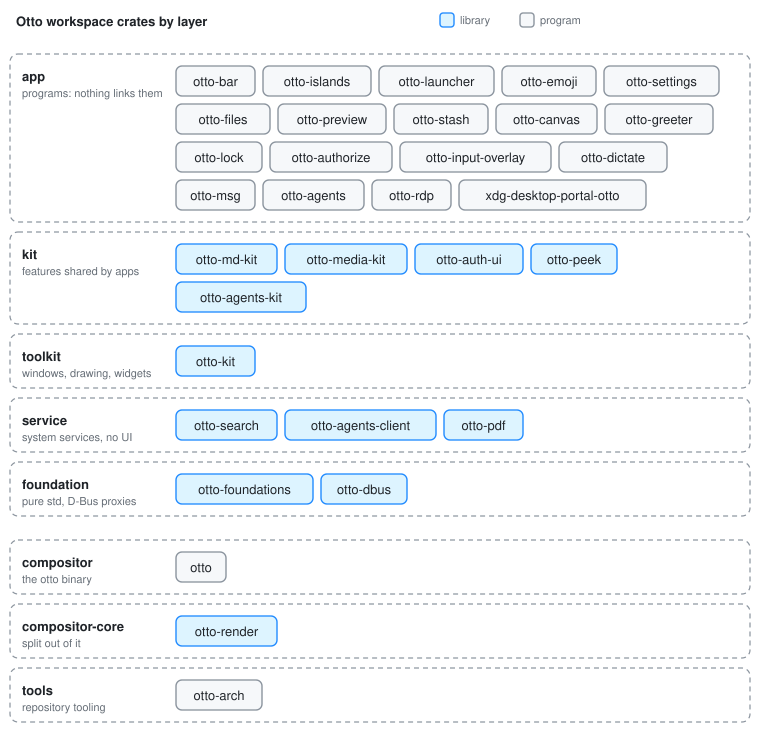

# Otto Components

Otto is one Cargo workspace. The compositor is the root crate; everything
else is a library or a program in `components/`, `crates/` or `tools/`. Each
crate has a page here that explains how it is built, with a diagram, and a
folder with an `AGENTS.md` holding the working notes: dependencies, how to
build, run and test it, and its rules.

Every crate belongs to one layer of [`architecture.toml`](../../architecture.toml),
and a layer may only use the layers it names. `cargo run -p otto-arch` checks
this in CI; [Architecture Rules](architecture.md) explains the rules and draws
the full dependency graph.

## Programs

The **app** layer: Wayland clients, daemons and the portal backend. Nothing
depends on an app.

| Crate | What it is |
|-------|------------|
| [otto-bar](otto-bar.md) | The top menu bar: global app menu, tray, keyboard layout, battery and clock |
| [otto-islands](otto-islands.md) | The dynamic island, the session's notification daemon and the system dialog |
| [otto-launcher](otto-launcher.md) | The keyboard launcher, with Ask and the agents mode |
| [otto-emoji](otto-emoji.md) | The emoji picker: search or browse, and the pick is typed where the cursor was |
| [otto-settings](otto-settings.md) | The Settings app |
| [otto-files](otto-files.md) | The file browser, file picker and desk |
| [otto-preview](otto-preview.md) | Studio: one file in a window of its own, with an agent chat and PDF editing |
| [otto-stash](otto-stash.md) | The card that collects selections, files and screen regions to hand to Ask |
| [otto-canvas](otto-canvas.md) | The Agents panel in the side canvas |
| [otto-greeter](otto-greeter.md) | The login screen, backed by greetd |
| [otto-lock](otto-lock.md) | The screen locker: holds the `ext-session-lock-v1` lock and checks PAM |
| [otto-authorize](otto-authorize.md) | The polkit authentication agent: the password panel for `pkexec`, system services and protected settings |
| [otto-input-overlay](otto-input-overlay.md) | On-screen touchpad and key-press overlays for screen recordings |
| [otto-dictate](otto-dictate.md) | A proof of concept: dictation as a Wayland input method |
| [otto-msg](otto-msg.md) | The command-line client of `org.otto.Shell1`: commands, the tree as JSON, events |
| [otto-agents](otto-agents.md) | The agent service: runs ACP agents and serves them over the Agent Host Protocol |
| [otto-rdp](otto-rdp.md) | The RDP bridge that serves an output and forwards remote input |
| [xdg-desktop-portal-otto](xdg-desktop-portal-otto.md) | The xdg-desktop-portal backend: screen sharing, settings, dialogs, screenshots and file chooser |

## Libraries

From the top of the stack down. A **kit** may use the toolkit, the services
and the foundation; the **toolkit** and the **services** use only the
foundation; the **foundation** uses nothing in the workspace.

| Layer | Crate | What it is |
|-------|-------|------------|
| kit | [otto-md-kit](otto-md-kit.md) | The Markdown parser, producing the toolkit's document blocks |
| kit | [otto-media-kit](otto-media-kit.md) | Video playback: a `Player` and view, GStreamer in a sandboxed worker |
| kit | [otto-auth-ui](otto-auth-ui.md) | The password panel shared by the greeter, the lock screen and the polkit agent |
| kit | [otto-peek](otto-peek.md) | Peek, the Space-bar preview, with a sandboxed decode worker |
| kit | [otto-agents-kit](otto-agents-kit.md) | The session feed, Ask chat, log and keys shared by the agent UIs |
| toolkit | [otto-kit](otto-kit.md) | The toolkit every app is built on, and the drawing half of the compositor's chrome. Its widgets, pictured: [otto-kit library](otto-kit-library.md) |
| service | [otto-search](otto-search.md) | File search: one query language over LocalSearch, as a library and a command |
| service | [otto-agents-client](otto-agents-client.md) | The wire between `otto-agents` and its clients: socket, session and file URIs |
| service | [otto-pdf](otto-pdf.md) | Editing PDFs in place through a runtime-loaded PDFium |
| foundation | [otto-foundations](otto-foundations.md) | XDG directories, `file://` URIs and name matching, over `std` alone |
| foundation | [otto-dbus](otto-dbus.md) | Typed client proxies for Otto's own `org.otto.*` D-Bus interfaces |

## The compositor and the tooling

| Layer | Crate | What it is |
|-------|-------|------------|
| compositor | `otto` (the root crate) | The compositor. It may use the toolkit to draw its own chrome, but no kit or app. Start at [Project Structure](project-structure.md) |
| compositor-core | [otto-render](otto-render.md) | The render stack: the Skia renderer, its GL and Vulkan plumbing, and the scene render elements |
| tools | [otto-arch](architecture.md) | The checker for `architecture.toml`, and the affected-crate selection CI runs on |

## Adding a crate

A new crate goes into one layer of `architecture.toml`, gets an `AGENTS.md`,
and takes its version from the workspace (see [Versioning](versioning.md)).
Give it a page here too: a `docs/developer/<crate>.md` with a diagram in
`diagrams/`, a row in the tables above, and an entry in
`website/build-docs.sh` so the site publishes it.
