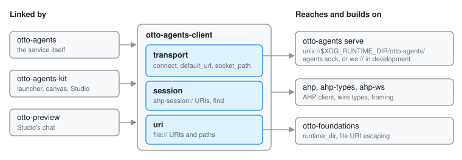

# otto-agents-client: the wire to the agent service

`components/otto-agents-client/` holds what [otto-agents](otto-agents.md) and
its clients have to agree on: where the service's socket is, how a URL names
it, how an AHP transport is opened over it, what a session URI looks like, and
how a `file://` URI maps to a path. It is a small library with no process,
no UI and nothing of the service's own logic in it. It sits in the **service**
layer of `architecture.toml`, which may use only the foundation layer and must
stay free of Skia, lay-rs and the Wayland client crates. Because it is a leaf,
the UI crates can link it without linking the service.

## Modules

| Module | What it does |
|--------|--------------|
| `transport` | `SOCKET_PATH` (`otto-agents/agents.sock` under the runtime directory), `default_socket_path`, `default_url`, `socket_path` (which socket a URL names, if any) and `connect`, which returns an `ahp::BoxedTransport` |
| `session` | `SESSION_SCHEME` (`ahp-session:/`), `session_id`, and `find`, which picks one session out of a list by full URI, id or id prefix, or the newest with no query, and says why when it cannot (`NoSession`) |
| `uri` | `from_path` and `to_path` between local paths and absolute `file://` URIs, with `otto_foundations::uri`'s escaping and its strict decoder |

`lib.rs` re-exports `connect`, `default_url`, `runtime_dir` and `socket_path`.

## The transport

A URL is `unix:///path/to/agents.sock`, a bare absolute path, or `ws://`.
`default_url` is the socket in `$XDG_RUNTIME_DIR` (resolved by
`otto_foundations::xdg::runtime_dir`), and `ws://127.0.0.1:4800` only when there
is no runtime directory. Clients use it unless `OTTO_AGENTS_URL` names
another service.

Over a Unix socket, `connect` runs the WebSocket handshake with
`tokio-tungstenite` (with `localhost` as the nominal host) and wraps the stream
in a private `UnixWebSocket` transport that frames messages the way `ahp-ws`
frames its TCP one: one JSON-RPC message per text frame, with pings answered
underneath. Any other URL goes to `ahp_ws::WebSocketTransport`. The socket's
directory, readable only by the user, is the access check; a loopback `ws://`
URL is for development and tests.

`to_path` refuses a relative URI and a truncated or malformed escape, so a
folder means the same thing on both sides of the socket.

## Who links it

- [otto-agents](otto-agents.md): its `client`, `uri` and terminal commands
  re-export or use these modules.
- [otto-agents-kit](otto-agents-kit.md): the session feed and the Ask chat
  connect through it, for the launcher, the side canvas and Studio.
- `otto-preview` (Studio), directly as well as through the kit.

It depends on `otto-foundations` and on `ahp`, `ahp-types` and `ahp-ws`, pinned
to the same version as `otto-agents`. Those pins are the wire between the two,
so they move together.

## Going deeper

- [Agents](agents.md#the-transport): the socket, `--listen` and `--url`, and
  why there is no authentication inside the protocol.
- [`components/otto-agents-client/AGENTS.md`](../../components/otto-agents-client/AGENTS.md):
  tests and rules.
