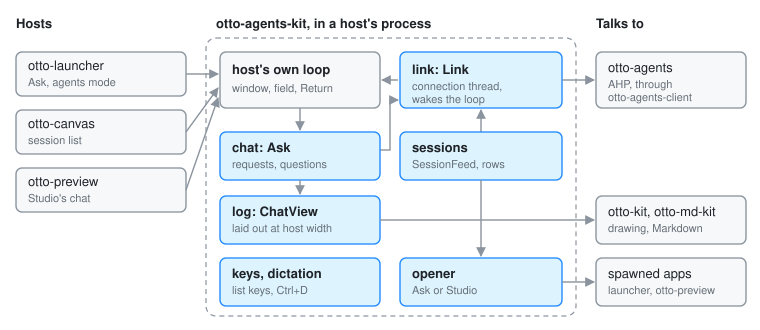

# otto-agents-kit

**User guide:** [Ask and Agents](../user/agents.md)\
**Specs:** [Launcher](../../specs/launcher.md), [Dictation](../../specs/dictation.md), [Preview](../../specs/preview-app.md)

`components/otto-agents-kit/` holds what Otto's agent interfaces have in
common: the feed of [otto-agents](otto-agents.md) sessions and the rows that
show them, the keys that walk a list and edit its field, the Ask chat, and the
log the chat is drawn in. It is a library in the **kit** layer of
`architecture.toml`. It has no process of its own: it runs inside each host,
which keeps its own window and field and talks to the service through the kit.
The hosts are [otto-launcher](otto-launcher.md) (Ask and agents mode),
[otto-canvas](otto-canvas.md) (the side canvas's session list) and
`otto-preview` (Studio's chat beside a document).

## Modules

| Module | What it does |
|--------|--------------|
| `link` | `Link`, the connection thread. A host's loop is not async, so `Link` runs the AHP client on a thread with its own current-thread tokio runtime, sends updates over a channel and wakes the loop through a socket the loop polls (`Link::poll_fd`) |
| `sessions` | `SessionFeed`, which lists the agents and sessions and lists them again whenever the service announces a change, until it is dropped; and `session_items`, which turns sessions into rows (title, agent, activity, folder) |
| `opener` | Where a picked session opens: in Ask, or in Studio beside the file named by `otto.app` and `otto.subject` in the session's `_meta` |
| `chat` | `Ask`, the conversation: queueing requests on a session's chat, attachments and stashed items, permission requests, the agent's questions (`chat::input`), modes, and handing a session to its terminal |
| `log` | The chat's log: laid out at the host's width (`layout`), painted a band at a time (`paint::LogPainter`), selectable (`selection`), and kept between events by `view::ChatView`, a `ScrollContent` the host puts in its own scroll pane |
| `keys` | The keys a field over a list answers to: `list_step`, `wrap`, `edit_field`, `copy_to_clipboard`. Each host checks its own keys (Enter, Escape) first |
| `dictation` | Ctrl+D dictation into a host's field. Built only with the `dictation` feature |

`item` and `rows` are re-exports of `otto_kit::components::item_list`, which
the settings sidebar search uses too.

## How a host uses it

The host owns its window, its `TextInput` field and its main loop. It starts
a `SessionFeed` or an `Ask` (each with a `Link` inside), adds their
`poll_fd` to the file descriptors its loop waits on, and takes the updates
when the loop wakes. The kit never draws into a scene: the rows and the log
paint onto a Skia canvas the host hands them, so the same code paints into the
launcher's card, a canvas item and a plain otto-kit window.

| Host | What it takes |
|------|---------------|
| otto-launcher | `chat` (whose `Ask` also lists the sessions for agents mode and picks their opener), `log`, `keys`, `dictation`, `rows` |
| otto-canvas | `sessions`, `keys`, `opener`, `rows`; it holds the feed only while the canvas is shown |
| otto-preview | `chat`, `log`, `keys`, `dictation`; it creates its sessions with `otto.app` and `otto.subject` in their `_meta` |

`Ask` queues each request on the session's chat rather than starting a turn,
so a host can close at any moment: the service already owns the request.
[Agents](agents.md#the-launcher-as-a-client) walks through that flow.

## Dependencies

- **Workspace:** `otto-kit` (drawing, text input, scroll panes, the item
  list), `otto-md-kit` (the agent's Markdown in the log),
  [otto-agents-client](otto-agents-client.md) (socket, URIs, connection).
- **External:** `ahp` and `ahp-types`, pinned with otto-agents-client;
  `tokio` on the connection thread; `smithay-client-toolkit` for key events.
- **Feature `dictation`:** turns on `otto-kit/dictation`, which brings in the
  microphone and the speech engine's client. The launcher and Studio enable
  it; the canvas does not.

## Going deeper

- [Agents](agents.md) and [Side canvas](side-canvas.md#sessions-client-and-autostart).
- Specs: [dictation](../../specs/dictation.md), [preview app](../../specs/preview-app.md),
  [launcher](../../specs/launcher.md).
- [`components/otto-agents-kit/AGENTS.md`](../../components/otto-agents-kit/AGENTS.md):
  tests, and the rule that `opener` and Studio's `chat.rs` stay in step.
