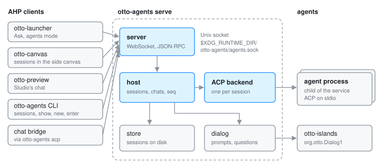

# otto-agents

`components/otto-agents/` is Otto's agent service. It runs coding agents as
child processes that speak the Agent Client Protocol (ACP) on stdio, and serves
their sessions to every client over the Agent Host Protocol (AHP), so the
launcher's Ask, the side canvas and Studio share one synchronised view of each
session. It is in the **app** layer of `architecture.toml`: nothing links it,
and clients reach it over the socket through
[otto-agents-client](otto-agents-client.md). It runs as one long-lived
process, `otto-agents serve`, usually from the `otto-agents.service` systemd
user unit. The same binary also carries terminal commands, an ACP facade and
the chat bridge.

How the service works in depth (the two protocols, the launcher as a client,
where permission requests and agents' questions go, skills, configuration) is
on [Agents](agents.md). This page is the map of the crate.

## Modules

| Module | What it does |
|--------|--------------|
| `server` | The listener: a Unix socket (or TCP for development), WebSocket framing with one JSON-RPC message per text frame, one task per connection |
| `rpc` | JSON-RPC framing and error shapes |
| `host` | The authoritative state: sessions, chats, subscriptions and open questions. Every change goes through one lock, is reduced with `ahp::reducers` and stamped with the next `serverSeq` |
| `agent` | The `Backend` trait the host drives through a command and an event channel, and the echo backend for tests and `serve --echo` |
| `acp` | The real backend: one ACP agent per session, as a child process on stdio |
| `config` | `[[agents]]` and `[bridge]` from `/etc/otto/agents.toml`, then `$XDG_CONFIG_HOME/otto/agents.toml` |
| `store` | One JSON file per session in `$XDG_STATE_HOME/otto-agents/sessions/`, so sessions outlive a restart |
| `dialog` | Permission and question prompts, escalated to otto-islands over `org.otto.Dialog1` when no client answers |
| `elicitation` | ACP form elicitations turned into AHP input requests |
| `attached` | What a session's prompts attached, and the reads of those files that need no second permission |
| `images` | Pictures agents send, written to `$XDG_CACHE_HOME/otto/agents/images` so they travel as `file://` URIs |
| `i18n` | The service's own dialog sentences, from the shared Fluent catalogues |
| `skills`, `vendors` | Otto's plugins and skills, and the plugin's agent written in each harness's own dialect, for `plugins install` |
| `facade` | `otto-agents acp`: the service presented as one ACP agent on stdin and stdout |
| `cli` | The terminal commands and `bridge` |
| `client`, `uri`, `xdg` | Thin re-exports of `otto-agents-client` and `otto-foundations` |

## Commands

`main.rs` defines the subcommands. `serve` (the default) runs the service; the
rest are clients of a running one, reached at `OTTO_AGENTS_URL` or the default
socket:

| Command | What it does |
|---------|--------------|
| `serve [--echo] [--listen ADDR]` | Run the service; `--echo` uses the built-in echo agent |
| `sessions`, `show [--follow]` | List sessions, print a transcript |
| `new`, `enter` | Start or take up a session in the agent's own terminal interface. `enter` sends `releaseSession` and then replaces itself with the agent's command |
| `forget` | Remove stored sessions |
| `doctor` | Check what stops Ask working, such as a missing dialog renderer |
| `acp` | The ACP facade, for chat bridges and editors |
| `bridge` | Replace itself with the command `[bridge]` in `agents.toml` names |
| `plugins install` | Link the desktop's skills into `~/.agents/skills` and write the plugin's agent for each harness |

## How it runs

- **One process, one tokio runtime.** The server task accepts connections on
  `$XDG_RUNTIME_DIR/otto-agents/agents.sock`. The socket's owner-only directory
  is the access check; there is no authentication inside the protocol.
- **One child per session.** The ACP backend starts the agent command
  configured in `agents.toml` for each session and talks to it on stdio. The
  host never talks to agents itself; it translates backend events into AHP
  actions.
- **D-Bus is outbound only.** The service owns no bus name. It calls
  `org.otto.Dialog1` on otto-islands through the [otto-dbus](otto-dbus.md)
  proxy to ask the person, and a request nobody can be asked is denied.
- **systemd units.** `otto-agents.service` (off by default) runs `serve`,
  hardened with `ProtectSystem=strict` and `ReadWritePaths=%h %t`.
  `otto-agents-bridge.service` runs `bridge`, wants the service, and is turned
  on and off from Settings.

## Dependencies

- **Workspace:** `otto-agents-client` (socket, URIs), `otto-dbus` (the dialog
  proxy), `otto-foundations` (XDG directories).
- **External:** `ahp`, `ahp-types` and `ahp-ws`, pinned to the protocol
  version of the vendored spec in `spec/upstream/` (`tests/spec_pin.rs`
  enforces it); `agent-client-protocol` for the agents; `tokio`,
  `tokio-tungstenite` and `zbus`; `fluent-bundle` for the dialog strings.

## Going deeper

- [Agents](agents.md): the architecture and every flow in detail.
- [otto-agents-client](otto-agents-client.md) and
  [otto-agents-kit](otto-agents-kit.md): the client side.
- [`components/otto-agents/README.md`](../../components/otto-agents/README.md):
  commands, `agents.toml`, the chat bridge.
- [`docs/plans/`](../../components/otto-agents/docs/plans/README.md),
  [spec coverage](../../components/otto-agents/docs/spec-coverage.md) and
  [testing](../../components/otto-agents/docs/testing.md).
- [`components/otto-agents/AGENTS.md`](../../components/otto-agents/AGENTS.md):
  build, test and the rules for the vendored spec.
