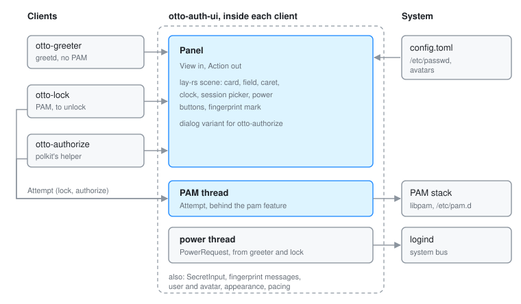

# otto-auth-ui

**User guide:** [Lock Screen](../user/lock-screen.md), [Login Greeter](../user/login-greeter.md)\
**Specs:** [Lock Screen](../../specs/lock-screen.md), [Login Mode](../../specs/login-mode.md)

otto-auth-ui is the panel Otto draws whenever it needs to know who is at the
keyboard: the login screen, the lock screen and the polkit password dialog all
show it. It lives in `components/otto-auth-ui/` and sits in the **kit** layer
of `architecture.toml`. It is a library and runs no process of its own. Its
three clients are [otto-greeter](otto-greeter.md), [otto-lock](otto-lock.md)
and [otto-authorize](otto-authorize.md).

## The split

The drawing knows nothing of greetd or PAM. A client translates whatever
conversation it is having into a `View` (who is being authenticated, the
prompt, the field, a status line, the session name, whether to offer the
power buttons) and hands it to `Panel::update`. A click is resolved with
`Panel::action_at`, which returns an `Action` (cycle the session, a power
button, use the password instead of the fingerprint reader, Cancel), so no
client duplicates the layout. What differs between clients, the protocol and
the session picker, stays in the client.

The one piece of conversation that does live here is PAM, because otto-lock
and otto-authorize need it word for word. It sits behind the `pam` feature,
which is off by default so the greeter never links libpam.

## Modules

| Module | What it does |
|--------|--------------|
| `panel` | The panel as a `lay-rs` scene: card, field, caret, clock, status line, session picker, power buttons and the fingerprint mark. Lays out in logical points, draws, and hit-tests. `Panel::new_dialog` builds the card alone over a dimmed screen with a reason line and Cancel, for otto-authorize. |
| `pam` | The PAM conversation on a thread of its own (`pam` feature). `Attempt::start` runs a `Service` stack; `Attempt::with_conversation` runs any other conversation the same way, which is how otto-authorize relays polkit's helper. The panel polls it with `Attempt::poll` and answers with `Attempt::answer`. |
| `secret` | `SecretInput`, the field's buffer. Reserved in full up front and never grown, and wiped whenever anything leaves it. |
| `reader` | Recognises `pam_fprintd`'s request for a finger and its no-match report, and says them again from Otto's own catalogues in the panel's locale. |
| `power` | Suspend, restart and shut down, asked of logind (`org.freedesktop.login1.Manager`) on the system bus from a thread of its own. polkit decides whether the user may. |
| `user` | The user's display name from `/etc/passwd` and the avatar from the usual locations; a suggested login name for the greeter. |
| `appearance` | Wallpaper, background, accent, font and colour scheme, read straight from Otto's `config.toml` (system, then the user's). |
| `pacing` | `frame_in_flight` bounds how long a client trusts frame callbacks; `Clock` notices the minute turn so the clock is redrawn. |

## How it runs

Everything happens inside the client's otto-kit event loop. The panel is a
retained `lay-rs` tree: the frosted card is a background-blur layer, and state
changes become property changes with transitions, so the engine repaints only
what changed. The fingerprint mark is a Lottie animation
(`assets/touch_id.json`) played through otto-kit, held still while a finger is
awaited and drawn in only once one is recognised.

PAM and logind calls block, sometimes for a long time: `pam_fprintd` holds the
conversation until a finger touches the reader. Both therefore run on threads
of their own and talk to the main thread through channels. The PAM thread
wakes the app loop when it has something to say, so the panel keeps drawing
while a module waits.

Typed secrets stay in `SecretInput` and `Zeroizing` buffers from the field to
the conversation. The capacity is fixed because a growing `String` would free
an unwiped copy.

## Dependencies

`otto-kit` for typography, theme colours, the avatar component, the Lottie
player, i18n and the XDG config paths. `laye-rs` and `taffy` for the scene,
Skia (with `svg` and `skottie`) to draw it, `zbus` for logind, `zeroize` for
the secrets, `chrono` for the localised clock. libpam through `libc` only with
the `pam` feature.

## Going deeper

- [Permissions](permissions.md) for how Otto uses polkit and the lock screen.
- Specs: [lock screen](../../specs/lock-screen.md),
  [login mode](../../specs/login-mode.md).
- `cargo run -p otto-auth-ui --example preview -- /tmp/panel` renders every
  panel state to PNGs. Build and test notes are in
  [AGENTS.md](../../components/otto-auth-ui/AGENTS.md).
