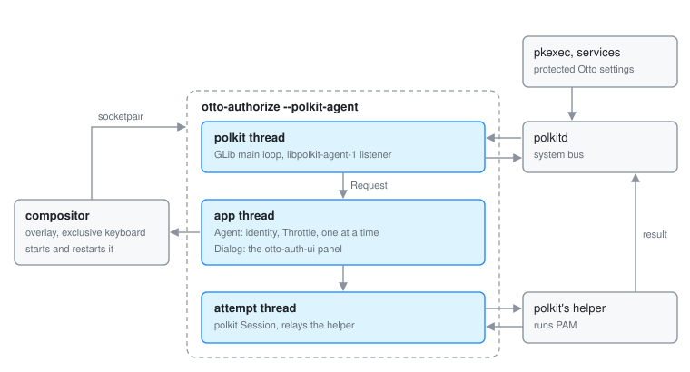

# otto-authorize: the session's polkit agent

otto-authorize is the session's polkit authentication agent. When a program
asks polkit for something that needs a password (`pkexec`, a system service's
action, a protected Otto setting), polkitd asks the agent registered for the
session, and otto-authorize puts up Otto's password panel as a dialog. It
lives in `components/otto-authorize/` and sits in the **app** layer of
`architecture.toml`. It runs as one process per session, started and kept
running by the compositor as `otto-authorize --polkit-agent`.

The agent never decides the answer. The password goes to polkit's own setuid
helper, which runs PAM and reports to polkitd itself. All this process can do
on its own is cancel. How Otto uses polkit as a whole, including the protected
settings, is on [Permissions](permissions.md).

## Modules

| Module | What it does |
|--------|--------------|
| `main.rs` | Checks for `--polkit-agent` (without it, prints a hint and exits with status 2) and starts the agent. |
| `polkit/mod.rs` | The agent on the app thread: takes requests from the listener, picks the identity, applies the `Throttle`, opens one dialog at a time and answers polkitd once the dialog has a verdict. |
| `polkit/listener.rs` | A subclass of `libpolkit-agent-1`'s listener (through `polkit-agent-rs`). Registers for the logind session and turns polkitd's `BeginAuthentication` and `CancelAuthentication` into `Request`s. |
| `polkit/session.rs` | Relays one attempt's conversation with polkit's helper through the library's `Session`, between the helper's signals and the dialog's answers. |
| `dialog.rs` | The dialog: an `otto-auth-ui` panel built with `Panel::new_dialog` on a full-screen `wlr-layer-shell` overlay with exclusive keyboard focus, and the conversation behind it. |

## How it runs

The process has three kinds of thread.

- **The polkit thread** runs a GLib main loop for `libpolkit-agent-1`. It
  registers the agent at `/org/otto/PolicyKit1/AuthenticationAgent` for the
  session named by `XDG_SESSION_ID` (or the session of the process, when that
  is unset). If polkit already has an agent for that session, the process
  exits cleanly and the compositor does not start it again. Each request goes
  to the app thread over a channel, with a wakeup; polkitd's reply waits on a
  one-shot channel.
- **The app thread** is an otto-kit event loop. For a request it picks who to
  authenticate as (the session's own user if polkit would accept them, else
  root, else the first user offered), names the program that asked from the
  `polkit.subject-pid` detail, and shows the dialog with polkit's message and
  that program's name as the reason line.
- **The attempt thread** is started for each attempt through
  `Attempt::with_conversation` in `otto-auth-ui`. It runs the library's
  `Session` for the request's cookie, passes the helper's prompts and messages
  to the panel and the typed answer back.

A request ends on a verdict: confirmed when the helper accepts, cancelled on
Escape, Cancel, polkitd's own cancel or a minute without an answer, failed
after three wrong passwords. Another request arriving while the dialog is up
is cancelled. A program whose requests keep ending unconfirmed is held off by
the `Throttle`, per program and for the whole session, so nothing can keep the
panel on screen.

## Who starts it

The compositor starts it at startup, outside login mode, on a socketpair
(`WAYLAND_SOCKET`) marked as its own component, so the dialog keeps the
keyboard against any other overlay. It restarts it with a back-off if it dies.
`polkit_agent = false` in the config turns it off. See `src/polkit_agent.rs`.

## Dependencies

`otto-auth-ui` with its `pam` feature (for the panel and the conversation
types), `otto-kit`, `smithay-client-toolkit` and `wayland-protocols-wlr` for
the layer surface, `polkit-agent-rs` for polkit, `tokio` only for its one-shot
channel.

## Going deeper

- [Permissions](permissions.md): the auth panel and protected settings.
- [otto-auth-ui](otto-auth-ui.md) for the panel.
- Testing it as the session's own agent, and logging, are in
  [AGENTS.md](../../components/otto-authorize/AGENTS.md).
