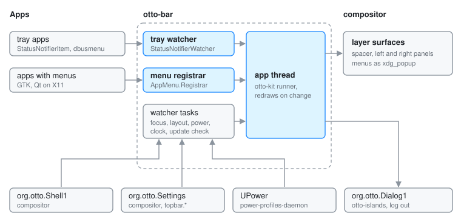

# otto-bar

**User guide:** [Top Bar](../user/topbar.md)\
**Specs:** [Top Bar](../../specs/topbar.md)

otto-bar is the strip along the top of the screen: the Otto menu and the
focused app's menus on the left, and the tray, the keyboard layout, the
battery and the clock on the right. It lives in `components/otto-bar/` and
sits in the `app` layer of `architecture.toml`, so nothing links it. It runs
as its own process, an otto-kit app started by the compositor from an
`exec_once` entry in the shipped config. On the session bus it is both a
client of the compositor and the host other apps register their tray icons
and menus with.

## Modules

| Module | What it does |
|--------|--------------|
| `main.rs` | Starts logging, picks the language from the desktop, starts the update check and hands `TopBarApp` to otto-kit's `AppRunner` on a two-worker tokio runtime. |
| `app.rs` | The app: creates the surfaces, opens and closes every menu, handles pointer and keyboard input, builds the accessibility tree, and picks up changes from the watchers in `on_update`. |
| `bar.rs` | Draws the left panel (Otto mark, app name, menus) and the right panel (tray, layout, battery, clock), packed right to left. |
| `appmenu.rs` | The global menu: follows the focused window and serves `com.canonical.AppMenu.Registrar`. |
| `dbusmenu.rs` | Client for `com.canonical.dbusmenu`, used by app menus and tray menus. |
| `tray.rs` | Serves `org.kde.StatusNotifierWatcher` and follows each registered `StatusNotifierItem`. |
| `keyboard_layout.rs` | The layout indicator and its menu, from `GetInputs` and `InputChanged` on `org.otto.Shell1`. |
| `power.rs`, `battery.rs` | Battery state from UPower (sysfs when UPower is absent), CPU frequency and governor from sysfs, power profiles; `battery.rs` draws the glyph. |
| `clock.rs` | The clock, following `topbar.show_clock` and `topbar.clock_format`. |
| `logout.rs` | Asks through `org.otto.Dialog1`, then sends the compositor its `logout` command. |
| `update.rs` | Asks a version endpoint whether a newer release is out, and adds an entry to the Otto menu when it is. |
| `config.rs`, `settings.rs` | Read `otto-bar.toml`; share the value handling for `org.otto.Settings`. |

## How it runs

**Surfaces.** Three `wlr-layer-shell` surfaces on the top layer. A
one-pixel spacer spans the whole top edge and only reserves the exclusive
zone that pushes maximised windows down. The left and right panels are
corner-anchored and reserve nothing; their material and size animation go
through the [surface style protocol](surface-style-protocol.md). Every menu
is an `xdg_popup` on one of the panels, built with otto-kit's `ContextMenu`.
While a menu is open the panel takes the keyboard exclusively, so the menu
can be driven with the arrow keys.

**Threads.** Drawing and input run on the otto-kit app thread. Each source of
state (tray, app menu, power, keyboard layout, clock settings, update check)
is a tokio task that writes into a shared static behind a mutex, bumps a
generation counter and wakes the app thread. `on_update` compares the
counters and redraws or refreshes an open menu only when one moved. A
separate Wayland connection from otto-kit's focus watcher binds
`zwlr_foreign_toplevel_manager_v1` for the focused app's name.

**The global menu.** `appmenu.rs` takes the focused window from
`org.otto.Shell1` (`GetTree` at start, then `WindowChanged`) and finds its
menu one of three ways: the `otto_appmenu` entry the compositor records for
Wayland Qt apps that speak `org_kde_kwin_appmenu`, the X11 window id
registered with the registrar the bar serves (GTK through
`appmenu-gtk-module`, Qt on xcb), or the process id behind a registration.
With `topbar.show_app_menu` off the bar releases the registrar name, so apps
keep their menus in their own windows.

**Names it owns.** `org.kde.StatusNotifierWatcher` and
`com.canonical.AppMenu.Registrar`, both requested without allowing
replacement. A second bar on the same bus gets neither.

**Names it calls.**

- `org.otto.Shell1`: the focused window, the input devices, and commands
  such as minimise and quit for the app menu. See
  [Shell D-Bus API](shell-dbus-api.md).
- `org.otto.Settings`: the `topbar.*` settings, followed through `Changed`.
  See [Settings D-Bus API](settings-dbus-api.md).
- `org.otto.Dialog1` on otto-islands, for the log-out question. Without
  otto-islands the logout goes ahead.
- UPower and power-profiles-daemon on the system bus.
- Each tray item's `StatusNotifierItem` and `com.canonical.dbusmenu`.

**Files.** `otto-bar.toml` from `/etc/otto/`, `~/.config/otto/` and the
working directory, for the battery and the clock fallback (see the
[README](../../components/otto-bar/README.md)). The update check keeps its
counting state in `$XDG_STATE_HOME/otto/update-check`.

## Dependencies

`otto-kit` for the runner, surfaces, menus, typography, theme, i18n and the
`org.otto.*` proxies it re-exports from [otto-dbus](otto-dbus.md). zbus on
tokio for the bus, `ureq` for the update check, `chrono` for the clock. The
colour scheme reaches it through otto-kit, and the panels repaint in
`on_theme_changed` (see [Color Scheme](color-scheme-setting.md)). Both panels
publish an accessible tree through otto-kit once an assistive technology
attaches (see [Accessibility](accessibility.md)).

## Going deeper

- Spec: [top bar](../../specs/topbar.md). User guide: [Top bar](../user/topbar.md).
- [Shell D-Bus API](shell-dbus-api.md), [Settings D-Bus API](settings-dbus-api.md),
  [otto-islands](otto-islands.md) for the dialog.
- Build, run and test notes: [AGENTS.md](../../components/otto-bar/AGENTS.md).
