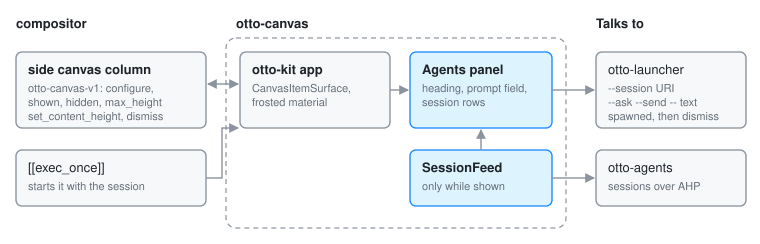

# otto-canvas

**User guide:** [Side Canvas](../user/side-canvas.md), [Ask and Agents](../user/agents.md)\
**Specs:** [Side Canvas](../../specs/side-canvas.md)

`components/otto-canvas/` is the Agents panel in Otto's side canvas: a prompt
field over the list of [otto-agents](otto-agents.md) sessions, in one frosted
item of the column that slides in from the right edge. It is an **app** in
`architecture.toml`, and runs as its own process, an otto-kit app started by
the compositor from `[[exec_once]]` in the shipped config. The compositor owns
the column; otto-canvas is a client that places one item in it through the
`otto-canvas-v1` protocol. It does no agent work itself: it hands each request
and each opened session to [otto-launcher](otto-launcher.md).

The column, its protocol, height sharing and this panel's drawing are
described in depth on [Side canvas](side-canvas.md); this page is the
structural overview.

## How it runs

`src/main.rs` is the whole app, a `Sessions` value run by otto-kit's
`AppRunner`.

- **One canvas item.** On start it creates a `CanvasItemSurface`, tells the
  column its natural height (`set_content_height`), asks for the keyboard on
  show (`set_keyboard_interactivity(on_show)`; on a compositor without that
  request, a click gives it the keyboard) and applies the frosted material
  through the surface style protocol.
- **A connection only while shown.** On `shown` it starts a `SessionFeed`
  from [otto-agents-kit](otto-agents-kit.md), which connects to the service on
  its own thread and lists the sessions again whenever the service announces a
  change. On `hidden` it drops the feed, so a hidden canvas has no
  connection, and clears the prompt.
- **Height.** It grows with its rows up to the share of the column the
  compositor gives it (`max_height`, protocol version 5) and scrolls past
  that with otto-kit's `ScrollView`. Without a share it stops at a fixed
  height.
- **Handing off.** Opening a row asks the session's opener first, so a
  Studio session opens in Studio; otherwise it runs `otto-launcher --session
  <URI>`. Enter with text typed runs `otto-launcher --ask --send -- <text>`,
  and with nothing typed `otto-launcher --ask`. The launcher runs in its own
  process group and is reaped on a thread, and the panel then sends `dismiss`
  so the canvas slides away.

The keys (arrows, Tab, Ctrl+N/P and the page keys to walk the rows, the field
editing keys) and the row painting come from otto-agents-kit, so the panel
behaves like the launcher's agents mode.

## Dependencies

- **Workspace:** `otto-agents-kit` (session feed, rows, keys, opener) and
  `otto-kit` (the app loop, `CanvasItemSurface`, text input, scrolling,
  materials).
- **At run time:** the compositor's `otto-canvas-v1`, a running otto-agents
  for the list, and `otto-launcher` on `$PATH`.

## Going deeper

- [Side canvas](side-canvas.md#sessions-client-and-autostart) and its
  [spec](../../specs/side-canvas.md).
- [Agents](agents.md): the service the panel lists.
- [`components/otto-canvas/AGENTS.md`](../../components/otto-canvas/AGENTS.md):
  running a development build against a dev compositor.
