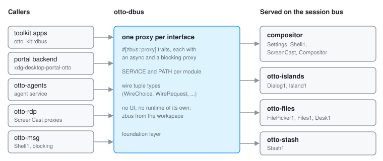

# otto-dbus

Every D-Bus interface Otto calls has one typed client proxy, in
`components/otto-dbus/`: Otto's own `org.otto.*` interfaces and the
freedesktop and tray interfaces Otto's apps use. A caller takes the proxy
from there. It does not declare its own `#[zbus::proxy]` and does not call
`call_method` with a method name in a string. The `dbus-proxies-in-otto-dbus`
rule in `architecture.toml` fails `cargo run -p otto-arch` on a proxy
declared anywhere else.

| Module | Interface | Served by |
|--------|-----------|-----------|
| `settings` | `org.otto.Settings` | compositor, `src/settings_service.rs` ([contract](settings-dbus-api.md)) |
| `shell` | `org.otto.Shell1` | compositor, `src/shell_service.rs` ([contract](shell-dbus-api.md)) |
| `screencast` | `org.otto.ScreenCast`, `.Session`, `.Stream` | compositor, `src/screenshare/dbus_service.rs` |
| `compositor` | `org.otto.Compositor` | compositor, `src/screenshare/dbus_service.rs` ([contract](compositor-dbus-api.md)) |
| `dialog` | `org.otto.Dialog1` | otto-islands, `src/dbus_service.rs` |
| `island` | `org.otto.Island1` | otto-islands, `src/dbus_service.rs` |
| `file_picker` | `org.otto.FilePicker1` | otto-files, `src/dbus.rs` |
| `files` | `org.otto.Files1` | otto-files, `src/files_service.rs` |
| `desk` | `org.otto.Desk1` | otto-files, `src/desk_service.rs` |
| `stash` | `org.otto.Stash1` | otto-stash, `src/dbus.rs` |

The interfaces other software serves:

| Module | Interface | Served by | Called by |
|--------|-----------|-----------|-----------|
| `upower` | `org.freedesktop.UPower.Device` | UPower (system bus) | otto-bar, battery |
| `login1` | `org.freedesktop.login1.Manager` | systemd-logind (system bus) | otto-auth-ui, power buttons |
| `portal_settings` | `org.freedesktop.portal.Settings` | xdg-desktop-portal | otto-kit, `portal_settings.rs` |
| `portal_access` | `org.freedesktop.impl.portal.Access` | other desktops' portal backends | xdg-desktop-portal-otto, dialog fallback |
| `status_notifier_item` | `org.kde.StatusNotifierItem` | tray apps | otto-bar, tray |
| `dbusmenu` | `com.canonical.dbusmenu` | tray apps | otto-bar, tray menus |

Each module also exports the bus name and object path as `SERVICE` and `PATH`,
plus any wire tuple types the interface uses (`WireChoice`, `WireRequest`, …).
An interface with no fixed bus name (`portal_access`, `status_notifier_item`,
`dbusmenu`) has no `SERVICE`; the caller sets the destination per proxy.
zbus generates an async proxy (`SettingsProxy`) and a blocking one
(`SettingsProxyBlocking`) for every interface.

## Who links it

The crate has no UI and no async runtime of its own, so the portal backend,
`otto-agents`, `otto-rdp` and `otto-msg` link it without pulling in Skia.
otto-kit re-exports it as `otto_kit::dbus`, and toolkit apps use that path.

It takes zbus from `[workspace.dependencies]`, like every other member, so
it runs on the same tokio executor as the rest of the workspace.

## Adding an interface

When you write a new `#[interface]` server, add its proxy here in the same
change:

1. Add a module named after the interface. Its doc comment names the
   interface and the file that serves it, and the module exports `SERVICE` and
   `PATH`.
2. Copy the method signatures from the server's `#[interface]` impl. A server
   method returning `zbus::fdo::Result<T>` or `Result<T, SomeFault>` becomes
   `zbus::Result<T>` on the client side. Signals become `#[zbus(signal)]`
   methods on the proxy.
3. Add the module to the table above.

An interface someone else serves gets its proxy here when Otto first calls
it, declaring the methods, properties and signals Otto uses; a second caller
extends the same proxy. The bus itself and the standard
`org.freedesktop.DBus.*` interfaces are already in `zbus::fdo`
(`DBusProxy`), so use those.

Inside otto-kit, the Settings portal has a single shared client,
`portal_settings.rs`, on top of `portal_settings::PortalSettingsProxy`. One
connection and one `SettingChanged` subscription serve the colour scheme,
accent, icon theme, sound theme, appearance keys and locale watchers.
