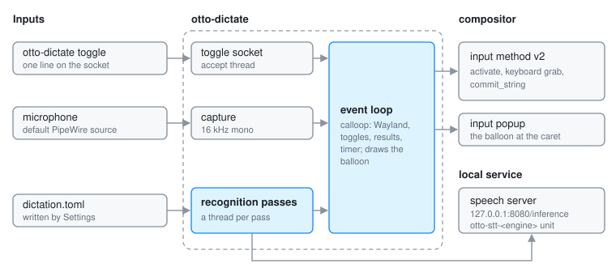

# otto-dictate

**User guide:** [Settings: Dictation](../user/settings.md#dictation)\
**Specs:** [Dictation](../../specs/dictation.md)

otto-dictate is a proof of concept for dictating into any text field. It runs
for the whole session as the seat's Wayland input method and waits.
`otto-dictate toggle` starts listening in the focused field: a balloon under
the caret shows an equaliser and the words heard so far, and when listening
stops the whole text goes into the field as one commit. It lives in
`components/otto-dictate/` and sits in the `app` layer of
`architecture.toml`. Speech is recognised by a separate local speech-to-text
server, not in this process. It is not in the packages:
`engines/install.sh` installs it with an engine and starts it with the
session through `~/.config/autostart`.

## Modules

| Path | What it does |
|------|--------------|
| `src/main.rs` | The input method, the toggle socket, the listening loop and the commit. |
| `src/balloon.rs` | Draws the balloon: the equaliser on the left, settled words bright and the unsettled tail dimmed. |
| `engines/` | `install.sh`, a systemd user unit per engine, the autostart entry, and the Parakeet server source built inside whisper.cpp. See the [engines README](../../components/otto-dictate/engines/README.md). |

The capture, the engine client, word agreement and the equaliser bars are
otto-kit's `dictation` module, shared with the launcher's dictation.

## How it runs

**One loop.** A calloop event loop on a plain `wayland-client` connection,
without otto-kit's app runner. It binds `zwp_input_method_manager_v2` for
the seat, `wl_compositor` and `wl_shm`, and draws the balloon in software into
shared-memory buffers at the scale the compositor prefers for the popup
(`wp_fractional_scale_v1`, shown 1:1 through a `wp_viewport`; 2x until it
says), using otto-kit's `surfaces::ScaledSurface`. Three sources feed the
loop: the Wayland queue, a channel from the toggle socket, and a channel of
recognition results. A timer, faster while listening, steps the equaliser,
redraws the balloon and sends the next recognition pass when one is due.

**The toggle.** `otto-dictate toggle` connects to `otto-dictate.sock` in the
user's runtime directory and writes one line. A thread accepts connections
and gives each a second to send it. There is no fallback outside the runtime
directory.

**Listening.** A toggle with a text field active (the input method has seen
`activate`) starts a dictation:

1. `Engine::from_config` reads `dictation.toml` again, so a change in
   Settings applies to the next dictation.
2. Capture starts: 16 kHz mono from the default PipeWire source, or a WAV
   file named by `OTTO_DICTATE_WAV`.
3. The input method grabs the keyboard and opens an input popup surface,
   which the compositor places at the field's text rectangle.
4. Twice a second, if no pass is in flight, the buffer and the settled text
   so far go to the server on a thread of its own. Words
   two passes agree on are settled; once the buffer is long it is cut at the
   last settled word.
5. Escape discards, Backspace drops the last settled phrase, and any other
   key or a second toggle stops. Stopping sends a final pass, and its text
   goes to the field in one `commit_string`.

The field is never touched while listening. If it loses focus the dictation
is dropped. If another input method holds the seat, otto-dictate tries to
bind again a little later.

**The engine.** An HTTP server on `http://127.0.0.1:8080/inference` with
whisper.cpp's `/inference` API. Three are provided, Parakeet, Whisper and
CrispASR, each a systemd user unit (`otto-stt-<engine>`) that conflicts with
the other two, so one runs at a time.

**Settings.** `~/.config/otto/dictation.toml` (`url`, `language`,
`hotwords_boost`), written by the Dictation pane of
[otto-settings](otto-settings.md), which also switches the engine units.
`OTTO_DICTATE_URL`, `OTTO_DICTATE_LANGUAGE` and `OTTO_DICTATE_HOTWORDS_BOOST`
override it.

## Dependencies

`otto-kit` with its `dictation` feature (PipeWire capture, the `ureq` engine
client, agreement, bars) and Skia through `otto_kit::skia` for the balloon.
`wayland-protocols-misc` for `zwp_input_method_v2`, and
`smithay-client-toolkit` for shared memory and calloop.

## Going deeper

- Spec: [dictation](../../specs/dictation.md), and the
  [settings app spec](../../specs/settings-app.md) for the Dictation pane.
- [Engines README](../../components/otto-dictate/engines/README.md).
- Build, run and test notes: [AGENTS.md](../../components/otto-dictate/AGENTS.md).
