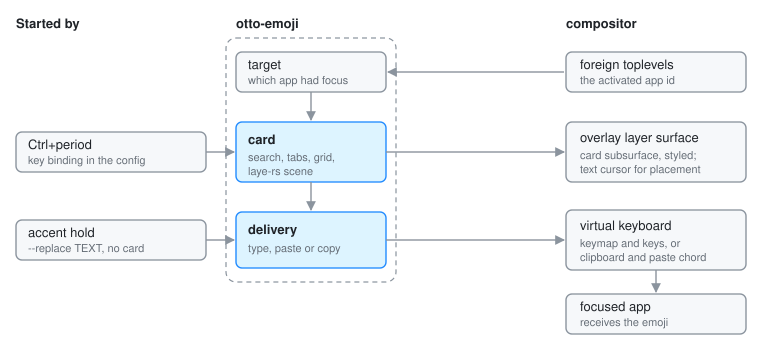

# otto-emoji

otto-emoji is the emoji picker: a card with a search field, category tabs, a
grid and a footer naming the emoji under the pointer and the skin tone in
use. Picking one closes the card and delivers the emoji to the window that
had the keyboard. It lives in `components/otto-emoji/` and sits in the `app`
layer of `architecture.toml`. It is a short-lived process with no daemon: the
shipped config starts it on `Ctrl+period`, and it exits once something is
picked. The compositor also runs it as `otto-emoji --replace` to type the
accented letter chosen when a key is held (see the
[accent hold spec](../../specs/accent-hold.md)).

## Modules

The crate is a binary and a small library. The library holds everything that
needs no screen, so the compositor's end-to-end test `tests/emoji_typing.rs`
and the examples can use it.

| Module | What it does |
|--------|--------------|
| `main.rs` | The picker: command line, surfaces, input, the card's arrival and exit, and delivery of the pick. |
| `view.rs` | The card as a `laye-rs` scene: query field, tabs, grid, footer, and where the card sits relative to the caret. |
| `data.rs` | The emoji table, baked in from `data/emoji.txt`, with skin-tone variants folded onto each base emoji. |
| `search.rs` | Word matching of the query against names, subgroups and groups. |
| `pan.rs` | Sideways swipes through the category panes, settling onto one pane. |
| `recents.rs` | Recent picks and the chosen skin tone, in `$XDG_STATE_HOME/otto/`. |
| `target.rs` | Which app had the keyboard, read from `zwlr_foreign_toplevel_manager_v1`. |
| `typing.rs` | Typing through `zwp_virtual_keyboard_v1`, and the paste chord. |

`data/emoji.txt` is generated from Unicode's `emoji-test.txt` by
`data/regen.py`.

## How it runs

1. **Before the card.** `target.rs` opens its own Wayland connection, lists
   the toplevels and notes the activated one's app id, before the picker's
   own surface can take focus. The picker also asks otto-kit to watch the
   text cursor through `otto_text_cursor_v1`.
2. **The card.** One `wlr-layer-shell` surface on the overlay layer, covering
   the output, with exclusive keyboard interactivity. The card is a
   subsurface of it. With a caret known, the card is a balloon whose beak
   points at it; without one, it is centred. Its frost, corner radius and
   shadow come from the compositor through the
   [surface style protocol](surface-style-protocol.md), and each category pane
   scrolls in an otto-kit `ScrollPane`. The card publishes an accessible tree through
   otto-kit (see [Accessibility](accessibility.md)).
3. **Delivery.** Once the card is gone, the pick takes one of three routes:
   - **Type.** `typing.rs` connects again, uploads a keymap with one key per
     codepoint of the emoji and taps them in order. The compositor forwards
     the keymap and the keys to the window that has the keyboard back.
   - **Paste.** The emoji goes on the clipboard and the paste chord is
     pressed. With `--auto`, the default, this is the route for text outside
     the Basic Multilingual Plane going to anything but a terminal, because
     Chromium-based apps drop those keysyms.
   - **Copy** (`--copy`). The emoji goes on the clipboard and nothing is
     pressed.

   A clipboard offer lives only as long as the client that made it, so after
   a paste or a copy the process stays, with no surface, until the selection
   moves on.

`--insert TEXT` and `--replace TEXT` skip the card and type straight away;
`--replace` presses Backspace first.

## Dependencies

`otto-kit` for the runner, surfaces, frosting, theme, components, clipboard,
focus, accessibility and i18n. `laye-rs` and `taffy` for the scene and its
layout. `xkbcommon` and `memfd` build the keymap the virtual keyboard
uploads. `wayland-protocols-misc` supplies `zwp_virtual_keyboard_v1` and
`wayland-protocols-wlr` the layer shell and foreign toplevel protocols.

## Going deeper

- Spec: [emoji picker](../../specs/emoji-picker.md), and
  [accent hold](../../specs/accent-hold.md) for `--replace`. User guide:
  [Emoji](../user/emoji.md).
- [Scroll pane](scroll-pane.md), [otto-kit](otto-kit.md),
  [otto-launcher](otto-launcher.md) for the card it shares its material with.
- The `preview` and `type` examples, swipe tuning and the table's
  regeneration: [AGENTS.md](../../components/otto-emoji/AGENTS.md).
