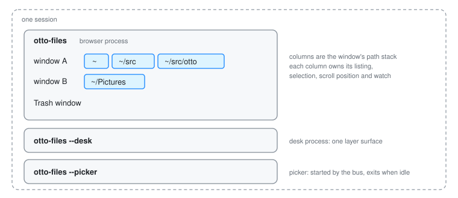

# Files

`otto-files` is how a person sees and handles the files on their disk. One program plays three parts. The **browser** is a document window for navigating folders and acting on files. The **file picker** is the dialog another application gets when it asks to open or save a file through the desktop portal. The **desk** is the Desktop folder drawn as an icon grid between the wallpaper and the windows. All three are ordinary Wayland clients built on otto-kit, running outside the compositor.

This page covers the app's own design: processes, windows, how a folder is read and kept current, and how the picker and the desk fit in. Thumbnails and Peek are in [File Previews](file-previews.md), icons in [File Icons](file-icons.md), Find and Recent in [File Search](file-search.md), text recognition in [Text in Pictures](peek-ocr.md), and how the Miller columns scroll in [Scroll Panes](scroll-pane.md).

## The model

**One view layer, several shells.** Below the chrome, the browser, the Trash window, the picker and the desk are the same code: the same directory model, the same non-blocking reads and watches, the same list, icon and column presentations, the same keyboard handling and the same embedded Peek. A shell decides only what chrome surrounds the listing and what "accept" means. The browser has a sidebar, a header and a path bar. The Trash window drops navigation, since it shows one flat listing. The picker adds an action row whose button answers a portal request. The desk drops everything but the icon grid and draws it on a transparent layer surface.

**A window is a stack of columns, and a column is one directory.** Each window holds a path stack. The column view draws the whole stack side by side; the list and icon views draw its last element. Navigating pushes and pops the stack in every view, so switching views keeps your place. Each column owns its listing, its selection (kept by path, so it survives re-sorts and reloads), its scroll position and its own inotify watch. A column that goes away takes its watch with it, so the set of watched directories is exactly what is on screen.

**The UI thread never touches the disk.** Reading a directory, copying, moving, trashing, thumbnailing and searching all run on worker threads or in other processes. The UI thread starts the work, keeps going, and picks up finished results on its next pass. A stalled network mount costs a spinner, not a frozen window.

## Start to finish: a folder opened and kept current

Someone runs `otto-files ~/Pictures` from a launcher while a Files window is already open.

1. **The new start finds the running one.** Every browser start tries to own `org.otto.FilesWindows1` on the session bus, without queueing. The one already running holds it, so the new start calls its `Open` method with its command line, its working directory and any `XDG_ACTIVATION_TOKEN` it was given, then exits. No second Wayland connection is made.
2. **The owner opens a window.** The call lands in an inbox the UI loop drains. The owner resolves the arguments (a folder, files to select inside their folder, or a search to open on), builds a new browser state with what windows remember between runs, maps a toplevel, and spends the activation token so the window comes forward the way the launcher asked.
3. **The column reads its directory off-thread.** Creating the column starts a worker thread that reads the directory and sends back a finished snapshot. Every read carries a generation number; navigating away bumps it, and a snapshot that arrives late for a column that moved on is simply dropped. That is how a slow read is cancelled without interrupting the worker. When the snapshot lands the worker wakes the UI loop, because a window with nothing animating commits no frames and would otherwise not notice.
4. **The listing is ordered once, not every frame.** Filtering and sorting a large directory is too slow to repeat for every draw and every wheel event. The column keeps the sorted order and recomputes it only when something it depends on changes: a new snapshot, the sort key or direction, hidden files, or the picker's active filter.
5. **The folder changes underneath.** Another program saves a picture into `~/Pictures`. The process has one inotify instance, read by one thread, and debounces bursts so a large copy causes one re-read rather than thousands. The column hears `Modified` and re-reads in place: the snapshot is replaced, while the selection and the scroll position stay. Because the selection is kept by path and the cursor is an index, the cursor is re-derived from the selection after the reload. If the folder itself is deleted or moved away, the column hears `Gone` and the window steps back to the nearest ancestor that still exists.
6. **Two windows on one folder both refresh.** They share the kernel watch, but each column is told of a change on its own.
7. **The window closes.** Closing one window closes only that window, with its Get Info and Open With panels and its Peek. When the last browser or Trash window closes, the process exits and the bus name goes with it; the next start owns it.

## The picker

An application calls the `org.freedesktop.portal.FileChooser` portal. `xdg-desktop-portal` hands that to Otto's portal backend, which converts the request's options into a typed tuple and calls `Present` on `org.otto.FilePicker1`. The session bus starts `otto-files --picker` for that call if it is not already running.

The idle picker parks on its request queue before it ever connects to Wayland. Only when a request arrives does it build a browser in the picker shell, starting in the folder this application last accepted from, and map a window. It imports the requester's `parent_window` through xdg-foreign so the compositor treats it as that window's dialog; when the import fails it asks to be modal instead, which still keeps it out of a tiling layout. The accept button turns the selection, or the folder being viewed and a typed name for a save, into percent-encoded `file://` URIs. The reply goes back as the answer to `Present`, and the portal relays it. If the requester gives up, the portal calls `Close` with the request's handle and the window goes at once.

Requests are served one at a time. A second request queues and reuses the same window when the first is answered. When nothing is left in the queue the process exits, and the bus starts a fresh one next time.

## The desk

The compositor starts `otto-files --desk` when the session's desk setting is on, restarts it with a back-off if it dies, and stops it when the setting goes off. A lock file in the runtime directory keeps it to one desk per session. The desk is a plain `zwlr_layer_shell_v1` client on the bottom layer, with no exclusive zone. Its folder, arrangement, size and position come from the `[desk]` section of the Files config, which it watches and follows live. Settings can ask it over `org.otto.Desk1` to enter edit mode, where the desk moves itself to the top layer, takes the keyboard, and lets the panel be moved and resized with the pointer before writing the result back to the config.

Under `arrange = "free"` each icon sits on a slot of the grid instead of the cell of its index. `desk_slots::arrange` gives every file a slot from the positions saved in `$XDG_STATE_HOME/otto/desk.toml`, and the grid's sections carry the result as a slot map that every hit test, rubber band and drawing goes through. The listing is put in slot order, so the overflow tile's items stay the run at its end. A drag within the desk drops onto a slot rather than the folder, and only the state file changes.

The desk never navigates. Opening a folder from it starts `otto-files` with that folder, and that start hands it to the running browser process exactly as in step 1 above. The picker does the same for a new window.

## Boundaries

- **Browser process.** Owns every browser and Trash window, their path stacks and selections, the running file jobs, and the in-process caches. It owns `org.otto.FilesWindows1` and serves `org.otto.Files1`.
- **Desk process and picker process.** Each runs one window over the same view layer. They share nothing in memory with the browser process. What they do share goes through files and the bus.
- **The undo history** is a file in `$XDG_RUNTIME_DIR`, locked with `flock` for every read-modify-write. A drag from the desk into a browser window is one operation, and Ctrl+Z in any Files window takes back the newest one, whichever process did it. Without a runtime directory, each process keeps its own.
- **`org.otto.Files1`** answers one question for the rest of the desktop: what is selected in the Files window that has the keyboard. otto-stash's shortcut is a compositor keybinding, so Files never sees the key press; otto-stash asks here instead. The browser and desk processes each request the name with queueing, so the bus's list of queued owners is the list of every Files process, and the one holding the keyboard answers.
- **Long jobs** report to the window's status line and, through `org.otto.Island`, to the dynamic island and the dock icon. The island is told to stay quiet while a Files window is in front, since the status line already says the same thing.
- **Peek** runs inside the process as a library. Its decoding happens in a sandboxed worker that is this same binary re-executed, which is why the worker check is the very first thing the program does on start.
- **Search and Recent** go to LocalSearch through otto-search; see [File Search](file-search.md).
- **The command palette** asks providers for commands as plain data. One provider runs executables from the user's `files-scripts` folder, with JSON over stdin and stdout across the process boundary.
- **The compositor** sees ordinary clients. The window's blurred background is a surface style the compositor holds, and the Miller columns are subsurfaces it moves while scrolling ([Scroll Panes](scroll-pane.md)).

## Decisions

**One process for every browser window.** A start that finds Files running hands over its command line and leaves. Windows then share the watcher, the caches and the undo stack, and a new window opens without a cold start. The desk and the picker stay separate because their lifetimes differ: the desk lasts the session under the compositor's supervision, and the picker is started and stopped by the bus.

**The picker is bus-activated, not resident and not spawned per request.** A resident picker would hold memory and filesystem watches for a dialog opened a few times a day. A process per request would mean a cold start, a fresh Wayland connection and an empty thumbnail cache every time, and would make the portal manage a child. Activation gives the portal a plain method call and lets a run of picks share a warm process. See the decisions in [the file picker spec](../../specs/file-picker.md).

**The picker is `otto-files`, not a binary of its own.** The hard half of a file dialog is reading, watching, sorting, thumbnailing and drawing directories. Writing it twice would let the two drift apart in exactly the details people notice.

**Threads and channels for the filesystem, not async.** The requirement is that the UI thread never blocks, and a worker thread meets it. The tokio runtime in the process serves D-Bus, not file I/O.

**Watch only what is shown, never recursively, never poll.** A filesystem inotify cannot watch, such as many network mounts, gives no events; its listing is right when read and refreshes on navigation.

**MIME filters become glob filters.** The picker resolves each MIME type in a request to the globs registered for it and its subclasses, so there is one matcher. A file whose name lies about its type is filtered by its name.

**The picker remembers one thing per application: the last folder it accepted from.** No selection, filter or folder leaks from one application's dialog into another's.

**Some per-window view settings are process-wide cells.** The geometry code asks for the current shell, decoration, filter strip and icon size rather than taking them as parameters. With several windows in one process, every time a window's state is locked on the UI thread, that window's values are put back first. Worker threads never set them.

## Limits and direction

- The initial listing still stats every entry as it reads. The spec asks for names first and metadata after, so very large or remote folders draw sooner; the snapshot shape is already the one that pass will deliver.
- The picker serves one request at a time and cannot mount a drive that is not already mounted.
- The desk shows one surface on one output, so its free-placement positions are not yet kept per output. A surface per output and Peek above the windows are not built yet ([desk spec](../../specs/desk.md)).
- `org.freedesktop.FileManager1` is specified but not served.
- The command palette's data-only seam is meant to grow into extensions that live in other processes ([command palette spec](../../specs/file-command-palette.md)).

## See also

- Specs: [file browser](../../specs/file-browser.md), [file picker](../../specs/file-picker.md), [desk](../../specs/desk.md), [command palette](../../specs/file-command-palette.md), [Peek](../../specs/peek.md).
- Guide pages: [File Previews](file-previews.md), [File Icons](file-icons.md), [File Search](file-search.md), [Text in Pictures](peek-ocr.md), [Scroll Panes](scroll-pane.md), [otto-kit](otto-kit.md), [xdg-desktop-portal-otto](xdg-desktop-portal-otto.md).
- User guides: [Files](../user/files.md), [custom commands](../user/files-custom-commands.md), [command palette](../user/files-command-palette.md).
- Working notes for contributors: [components/otto-files/AGENTS.md](../../components/otto-files/AGENTS.md).
