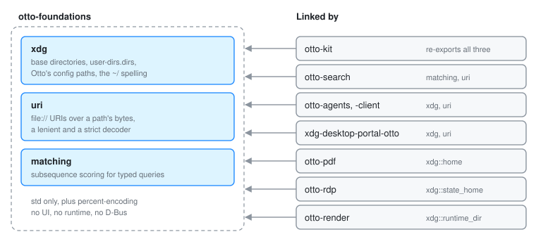

# otto-foundations

`components/otto-foundations/` holds the small rules that several Otto
programs have to agree on: where the XDG directories are, how a path becomes
a `file://` URI and back, how typed text is scored against a name, how a
desktop entry's keys are read and set, and what the login name is. It has
no UI, no async runtime and no D-Bus. Its one dependency is
`percent-encoding`.

It sits in the **foundation** layer (see [Architecture Rules](architecture.md))
and depends on no other workspace crate.

| Module | What it does |
|--------|--------------|
| `xdg` | The XDG base directories (`config_home`, `data_home`, `state_home`, `cache_home`, `runtime_dir`, `data_dirs`, `config_dirs`), `home`, Otto's config paths, the user's folders from `user-dirs.dirs` (`user_dirs`, `user_dir`, `parse_user_dirs`), and the `~/…` spelling of a path (`tilde`, `tilde_in`) |
| `uri` | `file://` URIs over a path's bytes: `path_to_uri`, `path_to_glib_uri` (the thumbnail standard's form), `uri_to_path`, `encode_path`, and two decoders: a lenient `decode_path` and a strict `try_decode_path` |
| `matching` | Subsequence scoring for typed queries (`score`, `positions`, `word_positions`), shared by the launcher, every toolkit list and file search |
| `desktop_file` | The `[Desktop Entry]` group of a desktop entry's text: `value` and `entries` read it, `with_value` sets a key and keeps every other line. The greeter's sessions, Settings' startup and autostart entries and the portal's program names use it |
| `user` | The login name (`login_name`): `$USER`, then `$LOGNAME` |

## Who links it

otto-kit re-exports every module (`otto_kit::xdg`, `otto_kit::uri`,
`otto_kit::matching`, `otto_kit::desktop_file`, `otto_kit::user`), and
toolkit apps import them from there. Crates
that do not link the toolkit depend on otto-foundations directly:

- `otto-search` scores names with `matching`, and makes and reads the
  index's `file:` URLs with `uri`.
- `otto-agents-client` and `otto-agents` take the runtime directory, the
  base directories and `tilde` from `xdg`, and file URIs from `uri`.
- `xdg-desktop-portal-otto` finds the Pictures folder with
  `xdg::user_dir`, hands out screenshot URIs with `uri::path_to_uri`, and
  names a screencast's program from its desktop entry with `desktop_file`.
- `otto-msg` redacts the login name, from `user::login_name`, in a bug
  report.
- `otto-pdf` (`xdg::home`, for `~/.local/lib/otto/libpdfium.so`), `otto-rdp`
  (`xdg::state_home`, for its TLS identity) and the compositor's
  `otto-render` (`xdg::runtime_dir`, for its debug hooks) use `xdg`.

Before this crate existed otto-kit depended on otto-search, a crate with
zbus and tokio, only for name matching. The portal and the agents crates
each carried their own copies of these helpers, and the copies did not
always behave the same way.

## The rules

- An XDG variable is used only when it holds an absolute path. A relative
  value is invalid under the spec, and an empty one is how a shell spells
  "unset". In either case the usual folder under the home folder is used.
  `runtime_dir` has no such fallback. It returns `None` instead of making up
  a directory that nothing cleans up.
- A `user-dirs.dirs` entry is `$HOME`, `$HOME/<rest>` or an absolute path.
  Any other value is skipped, a relative path included.
- `desktop_file` reads only the `[Desktop Entry]` group, so a
  `[Desktop Action …]` group's `Exec` is never taken for the entry's. Of a
  key given twice it takes the first, and values come back as written:
  escapes and `Exec` quoting are the caller's to undo.
- `login_name` treats an empty variable as unset, so an empty `USER` falls
  through to `LOGNAME`.
- `cargo run -p otto-arch` keeps these here: source rules flag a hand-rolled
  XDG or `user-dirs.dirs` lookup, a read of `USER`, `LOGNAME` or a locale
  variable, and a `[Desktop Entry]` loop anywhere else.
- `decode_path` treats a `%` that is not followed by two hex digits as a
  literal `%`, because file names contain them. `try_decode_path` returns
  `None` for one; use it on a wire where both ends are Otto's. Neither
  decoder takes a sign as a hex digit, so `%+f` is not an escape.

## Adding to it

A helper belongs here when a program that does not link otto-kit needs it,
and it needs only the standard library. A helper that draws, talks D-Bus or
needs a runtime belongs somewhere else: otto-kit, otto-dbus or the crate
that uses it.

## See also

[XDG specifications](xdg-specifications.md), [otto-kit](otto-kit.md),
[otto-dbus](otto-dbus.md).
