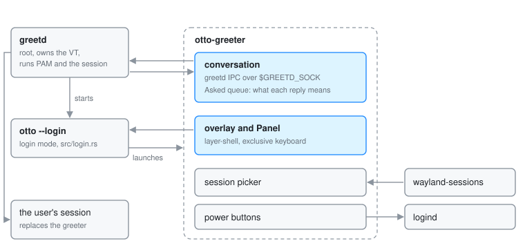

# otto-greeter

otto-greeter is Otto's login screen. greetd runs `otto --login`, a compositor
in login mode, and that compositor launches `otto-greeter` in place of the
usual autostart entries. The greeter draws the shared password panel on a
fullscreen overlay and drives the login conversation with greetd. It lives in
`components/otto-greeter/` and sits in the **app** layer of
`architecture.toml`. It runs as one process for the length of a login, and
greetd replaces it with the user's session once the login succeeds.

The greeter never links PAM. greetd runs as root, owns the VT, runs the PAM
stack and execs the session; the greeter only relays its questions and the
user's answers. It uses `otto-auth-ui` without the `pam` feature.

## Modules

| Module | What it does |
|--------|--------------|
| `main.rs` | The client: the layer surface, input, the session picker, the power buttons and the conversation state machine. |
| `greetd.rs` | The greetd IPC client: a native-endian `u32` length prefix and a JSON payload each way over `$GREETD_SOCK` (`greetd-ipc(7)`). Without the variable, a mock backend that accepts the password `otto`. |
| `session.rs` | Finds the sessions to offer in `/usr/share/wayland-sessions` and `/usr/local/share/wayland-sessions`, and picks the preselected one. |
| `examples/fake_greetd.rs` | A stand-in greetd daemon on a unix socket, with scenarios for a password, a fingerprint, two factors and a locked account. |

## How it runs

The greeter is an otto-kit app on a `wlr-layer-shell` overlay surface anchored
to every edge, with exclusive keyboard interactivity. The greetd socket is one
of the event loop's file descriptors, so the loop sleeps until greetd speaks,
the user acts, a transition needs a frame or the minute turns.

1. The panel opens on the username field, suggesting the account in
   `/etc/passwd` with the lowest UID a person could log into. Submitting it sends `create_session`, and the panel
   shows that user's name and avatar.
2. Each `auth_message` from greetd becomes the panel's prompt. A `secret` one
   masks the field, a `visible` one echoes it, and `info` and `error` messages
   become the status line. `pam_fprintd`'s messages show the fingerprint mark,
   with a way back to the password field.
3. Answers go out as `post_auth_message_response`, in `Zeroizing` buffers
   that also wipe the serialised frame.
4. On `success` the greeter sends `start_session` with the selected session's
   command and `XDG_SESSION_TYPE=wayland`. After a recognised fingerprint it
   first lets the mark finish. greetd then replaces the process; a greeter
   still alive a few seconds later reports that the session did not start.
5. An error, or Escape, cancels the conversation with `cancel_session` and
   returns to an empty username field, showing the error if there was one.

greetd answers every request with the same three responses, so the greeter
keeps a queue of what it asked. A `success` counts as a login only when it
answers `create_session` or an answer to a prompt, never a cancellation, and a
reply to a conversation already abandoned changes nothing.

The session picker cycles through the discovered sessions.
`OTTO_GREETER_SESSION` replaces discovery with one command, and
`OTTO_GREETER_DEFAULT_SESSION`, set in greetd's config, picks the one offered
first. The power buttons ask logind through `otto-auth-ui`.

## Who starts it

The compositor in login mode (`src/login.rs`) drives only the primary output,
shows no dock or switcher, and launches exactly one client: `[login]
greeter_command`, or `OTTO_GREETER_COMMAND`.

## Dependencies

`otto-auth-ui` (the panel, the user lookup, the power calls), `otto-kit`,
`smithay-client-toolkit` and `wayland-protocols-wlr` for the surface, `serde`
and `serde_json` for the wire format, `zeroize` for the answers.

## Going deeper

- [Login mode spec](../../specs/login-mode.md) and the user guide
  [Login greeter](../user/login-greeter.md).
- [otto-auth-ui](otto-auth-ui.md) for the panel.
- Running it nested, against the mock or `fake_greetd`, is in
  [AGENTS.md](../../components/otto-greeter/AGENTS.md).
