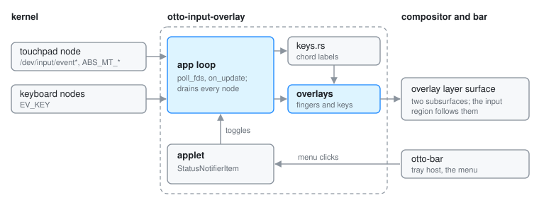

# otto-input-overlay: touchpad and key overlays for recordings

otto-input-overlay draws two small overlays for screen recordings: one circle
per finger on the touchpad, and the keys being pressed, chords included. It
lives in `components/otto-input-overlay/` and sits in the `app` layer of
`architecture.toml`. It is a standalone otto-kit app, started by hand when
recording, with a top-bar applet that switches each overlay on and off and
quits it. Nothing in the session starts it.

## Why it reads evdev

Neither overlay can be fed from Wayland. libinput turns touchpad contacts into
pointer motion and gestures before any protocol carries them, and `wl_touch`
is for touchscreens. Keys reach only the focused window. So the app opens the
kernel's `/dev/input/event*` nodes itself and reads raw events, which needs
read access to them (the `input` group, or sudo).

## Modules

| Module | What it does |
|--------|--------------|
| `main.rs` | Options, device discovery, the evdev reads, the surfaces, dragging, and drawing both overlays. |
| `keys.rs` | Turns evdev keycodes into chord labels (`Super+Shift+K`, or symbols with `--key-style symbols`) and times how long a label lingers. |
| `indicator.rs` | The applet: a `StatusNotifierItem` with a three-entry `com.canonical.dbusmenu`. |

## How it runs

**Devices.** With no device argument, the first entry in
`/proc/bus/input/devices` whose name contains "touchpad" is the touchpad;
keyboards are always found there. Each node is opened non-blocking, and the
touchpad's axis ranges come from `EVIOCGABS`, which also sets the overlay's
default aspect ratio. Without a touchpad, only the key overlay is shown.

**Event loop.** The nodes' file descriptors are handed to otto-kit's runner
through `App::poll_fds`, so the app thread wakes when one is readable.
`on_update` drains every node on every pass, overlay on or off, and applies
multitouch slots (`ABS_MT_*`) and key presses. `idle_timeout` wakes it again
when a key label is due to fade.

**Surfaces.** One transparent `wlr-layer-shell` surface on the overlay layer,
anchored to all four edges with an exclusive zone of -1, so it covers the
whole output, top bar included, and stays above fullscreen windows. It never
moves and takes no keyboard. The two overlays are subsurfaces of it, with
empty input regions; the parent's input region follows where they are, so a
press on an overlay drags it and a click beside it reaches the window below.
`--position`, `--margin`, `--width` and `--height` place and size them.

**Labels.** Keys are labelled from the physical keycode on a US layout, not
from the active keymap, so the overlay shows which keys were pressed whatever
layout is set.

**Colours.** `--colors` and `--bg` take hex values or otto-kit theme tokens
(`accent`, `fill-primary`, `material-popup` and the like), resolved against
the live theme at start. The default finger colour is the accent.

**Applet.** `indicator.rs` runs on tokio, owns
`org.kde.StatusNotifierItem-<pid>-1` and registers with
`org.kde.StatusNotifierWatcher`. It registers again whenever the watcher's
name gets a new owner, so a bar that starts later or restarts still shows it.
A menu click sets a flag in `Toggles` and wakes the app loop, which applies
it.

## Dependencies

`otto-kit` for the runner, layer and subsurface surfaces, typography and the
theme. `libc` for the ioctl and non-blocking reads, `zbus` on tokio for the
applet. The applet is hosted by [otto-bar](otto-bar.md), or by any other
StatusNotifierItem host.

## Going deeper

- The full option list is the doc comment at the top of
  [`src/main.rs`](../../components/otto-input-overlay/src/main.rs).
- Build, run and test notes: [AGENTS.md](../../components/otto-input-overlay/AGENTS.md).
