# otto-kit library

**See also:** [otto-kit](otto-kit.md)

This page is a catalogue of the UI components in
`components/otto-kit/src/components/`, one section each, with a picture of
it. Every component draws onto a bare Skia `&Canvas`: none of them owns a
connection, an event loop or a surface. That is what lets the compositor
draw the same titlebars and menus as the apps do.

They come in the two shapes described under Components in
[otto-kit](otto-kit.md):

- **Stateless `Renderable` builders.** A value is built with `with_*` calls
  and paints itself with `render(canvas)`: `Label`, `Icon`, `Button`,
  `Toolbar`, `Titlebar`.
- **Retained state plus an immediate-mode renderer.** The caller owns the
  state (sometimes just a `bool` or an `f32`, sometimes a struct such as
  `TextInputState`) and hands it to a draw function on every frame, feeding
  pointer and key events back into the state. Most of the form controls are
  free functions of this kind (`toggle::draw`, `slider::draw`,
  `dropdown::field::draw`) with a hit-test helper beside them.

The pictures are drawn offscreen at scale 2 in the light palette, on the
window background, by an example with no compositor involved. To draw them
again after a component changes how it looks:

```sh
cargo run -p otto-kit --example component_library -- docs/developer/images/otto-kit/
```

"Used by" lists the workspace crates that call a component outside tests and
examples, as found at their call sites. `otto` is the compositor.

## Text and images

### Label

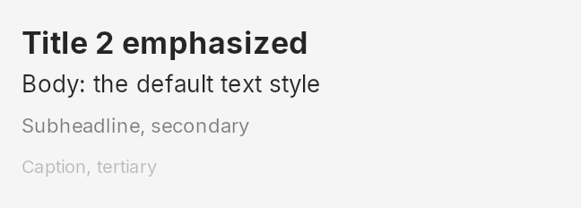

One line of text in a named text style and colour. It is the building block
nearly every other component sets its text with, so a label, a slider's
readout and a menu row all share the same type scale from
`typography::styles`.

- **Shape:** `Renderable` builder. `Label::new(text).with_style(..).with_color(..)`, placed with `at`, `centered_on` or `centered_at`.
- **Types:** `Label` (`LabelBuilder` is the same type), `TextAlign`.
- **Source:** [`label/`](../../components/otto-kit/src/components/label/)
- **Used by:** otto (`TextAlign` only), otto-files, otto-media-kit, otto-peek, otto-preview, otto-settings. Inside otto-kit, most components draw their text with it.

### Icon

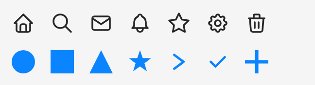

Two icon builders. `Icon` draws one of the stroked or filled SVG icons kept in
`components/otto-kit/resources/icons/` by name, at any size and colour.
`GeometricIcon` draws a handful of shapes (circle, star, check, chevrons…)
from code. Interface glyphs from the Solar set and theme icons are not this
component: they come from `icons::solar_icon` and the `icons` lookups.

- **Shape:** `Renderable` builder. `Icon::new("search").with_size(24.0).with_color(..)`.
- **Types:** `Icon`, `GeometricIcon`, `IconShape`, `IconStyle`, `list_icons()`.
- **Source:** [`icon/`](../../components/otto-kit/src/components/icon/)
- **Used by:** otto-files. Inside otto-kit, `Button` and the menu item renderer draw with it.

### Avatar

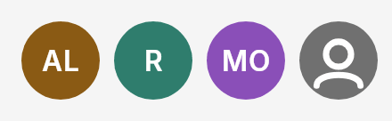

A person's picture in a circle, or, without one, their initials on a ground
colour picked from their name, so the same name always gets the same colour.
A name with no letters gets a neutral silhouette. Use it wherever an account
is shown.

- **Shape:** draw function. `avatar::draw(canvas, rect, picture, name)`.
- **Types:** `draw`, `initials`, `ground_color`.
- **Source:** [`avatar/`](../../components/otto-kit/src/components/avatar/)
- **Used by:** otto-auth-ui, otto-settings.

## Containers

### Frame and Stack

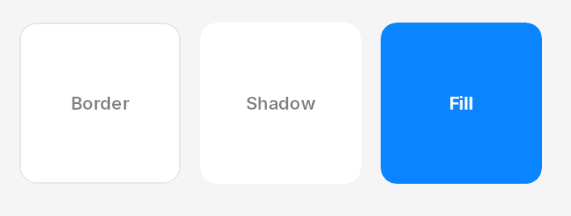

`Frame` is a rectangle with a background, corner radius, border, shadow and
padding, and an optional draw function for its content. `Stack` lays children
out in a row or a column with a gap and an alignment. Both implement the
`Container` trait, so stacks nest.

- **Shape:** builder, retained. `FrameBuilder::new(w, h).with_*(..).build()`, then `Container::render(&mut self, canvas)`.
- **Types:** `Frame`, `FrameBuilder`, `Stack`, `StackDirection`, `StackAlignment`, `Container`, `EdgeInsets`, `CornerRadius`, `Border`, `BoxShadow`, `LayoutConstraints`.
- **Source:** [`container/`](../../components/otto-kit/src/components/container/)
- **Used by:** no crate yet; `examples/containers.rs` shows it.

### Toolbar

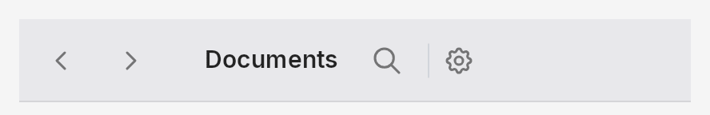

A horizontal bar with a leading and a trailing `ToolbarGroup`, each a row of
`Renderable` items with optional separators and fixed spaces between them.
The trailing group is placed a fixed 200 points in from the trailing edge
rather than measured, which is why it sits mid-bar in the picture.

- **Shape:** `Renderable` builder. `Toolbar::new().with_width(..).with_leading(group).with_trailing(group)`.
- **Types:** `Toolbar`, `ToolbarGroup`.
- **Source:** [`toolbar/`](../../components/otto-kit/src/components/toolbar/)
- **Used by:** otto-preview.

### Scroll

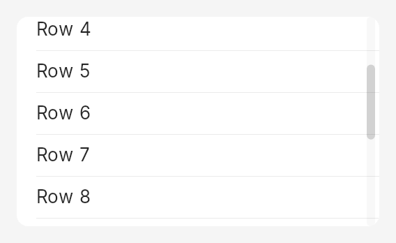

Everything that scrolls. `ScrollState` is one axis's viewport, content length,
offset and overlay scrollbar; `ScrollRenderer::draw` clips to the viewport,
draws the visible part of the content through a closure and paints the
scrollbar. `ScrollView` adds the physics (wheel, drag, fling, overscroll), and
`ScrollPane` scrolls by moving subsurfaces instead of repainting, together
with the row, grid and justified layouts that go with it. See
[Scroll Panes](scroll-pane.md).

- **Shape:** state plus renderer. `ScrollRenderer::draw(canvas, &state, theme, |canvas, visible| ..)`.
- **Types:** `ScrollState`, `ScrollView`, `ScrollRenderer`, `ScrollPane`, `ScrollGroup`, `ScrollContent`, `ScrollSurfaces`, `RowLayout`, `GridLayout`, `JustifiedLayout`, `Axis`.
- **Source:** [`scroll/`](../../components/otto-kit/src/components/scroll/)
- **Used by:** otto-agents-kit, otto-canvas, otto-emoji, otto-files, otto-launcher, otto-peek, otto-preview, otto-settings, otto-stash. Inside otto-kit, the item list's rows use `RowLayout`.

## Controls

### Button

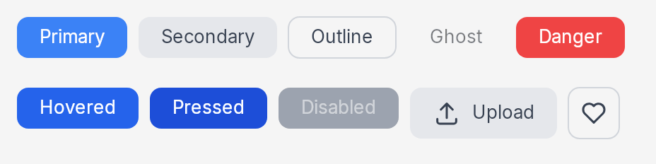

A general button with a label, an icon or both, in five variants (primary,
secondary, outline, ghost, danger) and four states. Its colours are fixed in
the component rather than taken from the theme, so it does not follow the
accent or dark mode. For a dialog's buttons use the push button below.

- **Shape:** `Renderable` builder. `Button::new("Save").secondary().with_state(..)`, or `Button::icon("search").ghost()`.
- **Types:** `Button`, `ButtonVariant`, `ButtonState`, `IconPosition`.
- **Source:** [`button/`](../../components/otto-kit/src/components/button/)
- **Used by:** no crate; the examples and toolbars in `examples/` use it.

### Push button

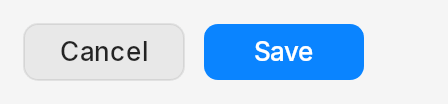

The button Otto's own dialogs and Settings rows use: a quiet fill with a
hairline edge, or the accent for the one button Return presses. It darkens
while held and acts on release, and it has no hover look. The caller says
whether it is held.

- **Shape:** draw function. `push_button::draw(canvas, rect, label, PushButton::new(Role::Default), theme)`; `push_button::width(label)` sizes it.
- **Types:** `PushButton`, `Role`, `draw`, `width`, `HEIGHT`, `MIN_WIDTH`.
- **Source:** [`push_button.rs`](../../components/otto-kit/src/components/push_button.rs)
- **Used by:** otto-preview.

### Toggle

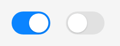

An on/off switch. The caller owns the value and, for an animated flip, the
knob's position along the track, which `Flip` interpolates over
`FLIP_DURATION`.

- **Shape:** draw function. `toggle::draw(canvas, rect, toggle::knob_fraction_for(on), interaction, theme)`, with `toggle::hit_test`.
- **Types:** `draw`, `hit_test`, `knob_fraction_for`, `Flip`, `ToggleInteraction`, `WIDTH`, `HEIGHT`.
- **Source:** [`toggle/`](../../components/otto-kit/src/components/toggle/)
- **Used by:** otto-settings.

### Slider

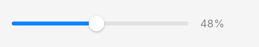

A continuous value on a track, with an optional readout string the caller
formats. The value stays with the caller; `SliderDrag` is the small state
that turns a press and drag into new values.

- **Shape:** draw function plus a drag state. `slider::draw(canvas, rect, value, min, max, readout, interaction, theme)`.
- **Types:** `draw`, `value_at`, `hit_test_knob`, `hit_test_track`, `SliderDrag`, `SliderResponse`, `SliderInteraction`.
- **Source:** [`slider/`](../../components/otto-kit/src/components/slider/)
- **Used by:** otto-files.

### Segmented control

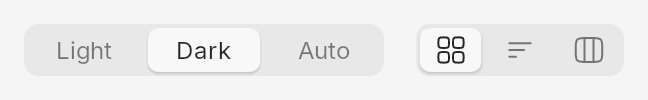

A row of mutually exclusive choices on one track, the chosen one raised on a
pill. Segments are words or Solar glyphs. Use it for a small, fixed set of
modes, such as a view switcher.

- **Shape:** draw function. `segmented::draw(canvas, rect, &segments, selected, interaction, theme)`, with `segment_at` for hits.
- **Types:** `Segment`, `SegmentedInteraction`, `draw`, `segment_at`, `segment_rect`, `HEIGHT`.
- **Source:** [`segmented/`](../../components/otto-kit/src/components/segmented/)
- **Used by:** otto-files.

### Text input

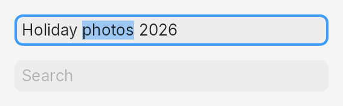

A single-line editable field: value, caret, selection, placeholder, password
masking and dictation marks. It is the model for the retained-state shape.
The host translates its key and pointer events into `on_key`,
`on_pointer_down`, `on_pointer_drag` and `on_pointer_up`, each answering what
changed.

- **Shape:** state plus renderer. `TextInput` bundles `TextInputState` and `TextInputStyle` and draws with `render_at(canvas, w, h)` or as a `Renderable`.
- **Types:** `TextInput`, `TextInputState`, `TextInputRenderer`, `TextInputStyle`, `TextInputKey`, `KeyMods`, `TextInputResponse`, `key_for`.
- **Source:** [`text_input/`](../../components/otto-kit/src/components/text_input/)
- **Used by:** otto, otto-agents-kit, otto-canvas, otto-emoji, otto-files, otto-launcher, otto-preview, otto-settings. Inside otto-kit, attachments and the item list take their text styles from it.

### Selectable text

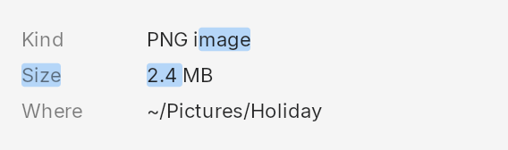

Read-only text that can be selected and copied. A panel lays its facts out as
`TextRun`s and hands its presses to one `TextSelection`, which counts double
and triple clicks itself, lets a drag run from one run to the next, and
answers what to copy.

- **Shape:** state plus renderer. `selection.draw_highlight(canvas, &runs, colour)`, then `run.draw(canvas)` for each run.
- **Types:** `TextRun`, `TextSelection`, `TextPos`.
- **Source:** [`selectable_text.rs`](../../components/otto-kit/src/components/selectable_text.rs)
- **Used by:** otto-files.

### Dropdown

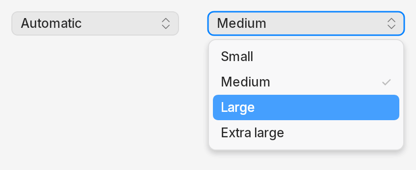

A pop-up button. The field is a plain draw function that the compositor
could draw as well. `DropdownMenu` is the client half: it opens a context
menu popup against the window's surface, marks the chosen value and routes
the choice back to the field that opened it.

- **Shape:** draw function for the field; `DropdownMenu` owns the popup.
- **Types:** `field::draw`, `field::draw_with_icon`, `field::hit_test`, `DropdownInteraction`, `Placement`, `DropdownMenu`.
- **Source:** [`dropdown/`](../../components/otto-kit/src/components/dropdown/)
- **Used by:** otto-files, otto-preview, otto-settings.

### Colour picker

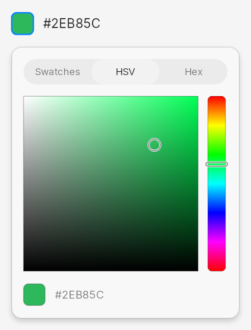

A colour well that opens a panel with three modes: preset swatches, an HSV
square with a hue strip, and a hex field. The well and the panel are draw
functions; `ColorPickerPopup` owns the popup surface the panel opens in.

- **Shape:** draw functions plus a popup owner. `well::draw(canvas, rect, colour, interaction, theme)`, `panel::draw(..)`.
- **Types:** `well::draw`, `well::measure`, `WellInteraction`, `panel::draw`, `panel::panel_size`, `Mode`, `Swatch`, `HexField`, `ColorPickerPopup`, `hsv`.
- **Source:** [`color_picker/`](../../components/otto-kit/src/components/color_picker/)
- **Used by:** otto-settings.

## Collections

### List

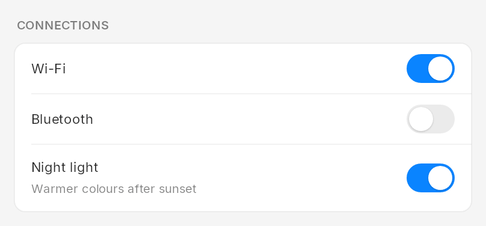

The grouped list card a settings pane is built from: an optional section
title, then rows with a label and an optional detail line, divided by
hairlines. Each row's trailing slot is drawn by the caller, so it can hold a
toggle, a slider, a value or nothing.

- **Shape:** draw function over a layout. `ListLayout::compute(&rows, has_title, x, y, width)`, then `list::draw(canvas, &layout, &rows, title, theme, background, |canvas, index, rect| ..)`.
- **Types:** `ListLayout`, `ListRow`, `draw`, `trailing_rect`, `default_card_background`, `ROW_HEIGHT`.
- **Source:** [`list/`](../../components/otto-kit/src/components/list/)
- **Used by:** no crate yet; `examples/list_gallery.rs` shows it.

### Source list

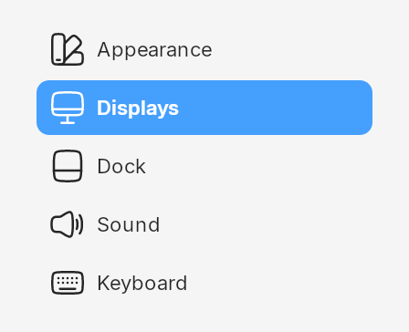

A sidebar of places or sections with an icon and a label each, the selected
one on the accent. The caller draws the icons, in the tint the list hands it.

- **Shape:** draw function over a layout. `SourceListLayout::compute(count, x, y, width)`, then `source_list::draw(canvas, &layout, &items, selected, theme, |canvas, index, rect, tint| ..)`.
- **Types:** `SourceListItem`, `SourceListLayout`, `draw`, `icon_rect`, `item_tint`.
- **Source:** [`source_list/`](../../components/otto-kit/src/components/source_list/)
- **Used by:** no crate yet; `examples/sidebar_window.rs` and `examples/list_gallery.rs` show it.

### Selection list

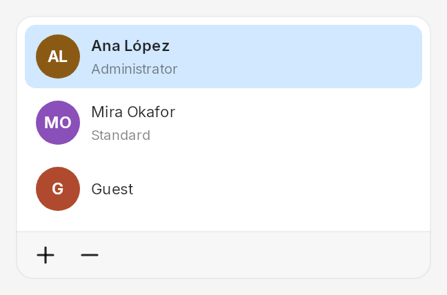

A card of items with a title and an optional subtitle, one of them selected,
and a footer with add and remove buttons. The caller draws each item's
leading picture, an avatar in the Users pane.

- **Shape:** draw function over a layout. `SelectionListLayout::compute(count, bounds)`, `selection_list::draw(..)`, and `layout.hit(x, y)` answering an item, add or remove.
- **Types:** `SelectionListItem`, `SelectionListLayout`, `SelectionListState`, `SelectionListHit`, `draw`, `leading_rect`.
- **Source:** [`selection_list/`](../../components/otto-kit/src/components/selection_list/)
- **Used by:** otto-settings.

### Item list

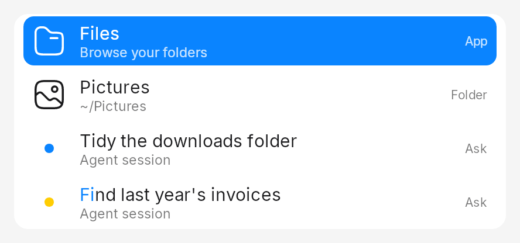

The rows of a searchable list, as the launcher draws them: an icon, an
activity dot or a checkbox, a title with an optional second line, and a badge
naming the source. Typed characters are marked in the titles, and `rank`
orders items against a query.

- **Shape:** data plus draw function. `rows::paint_item_rows_styled(canvas, band, &items, labels, width, dark, &icons, &RowStyle { .. })`.
- **Types:** `item::Item`, `item::Activity`, `item::rank`, `rows::paint_item_rows`, `rows::RowStyle`, `rows::RowIcons`, `rows::field_style`.
- **Source:** [`item_list/`](../../components/otto-kit/src/components/item_list/)
- **Used by:** otto-settings (its sidebar search), and through otto-agents-kit's re-export, otto-launcher and otto-canvas.

## Menus

### Menu bar

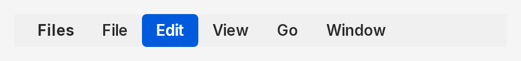

A strip of menu titles, each a label, an icon or both, with hover and active
highlights. The renderer returns each item's bounds for hit testing.

- **Shape:** state plus renderer. `MenuBarRenderer::render(canvas, &state, &style, width)`.
- **Types:** `MenuBarState`, `MenuBarItem`, `MenuBarIcon`, `MenuBarStyle`, `MenuBarRenderer`.
- **Source:** [`menu_bar/`](../../components/otto-kit/src/components/menu_bar/)
- **Used by:** otto-bar.

### Menu item

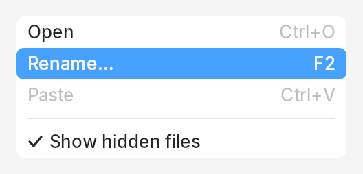

One row of a menu: an action with an optional shortcut, icon or check, a
submenu, or a separator. It is the data every menu is made of; the context
menu and the dropdown build their rows from it.

- **Shape:** data plus renderer. `MenuItem::action(label).with_shortcut(..)`, drawn by `MenuItemRenderer::render` or a `MenuItemGroup`.
- **Types:** `MenuItem`, `MenuItemKind`, `MenuItemIcon`, `VisualState` (`MenuItemState`), `MenuItemStyle`, `MenuItemRenderer`, `MenuItemGroup`.
- **Source:** [`menu_item/`](../../components/otto-kit/src/components/menu_item/)
- **Used by:** otto, otto-bar, otto-files. Inside otto-kit, the context menu and the dropdown.

### Context menu

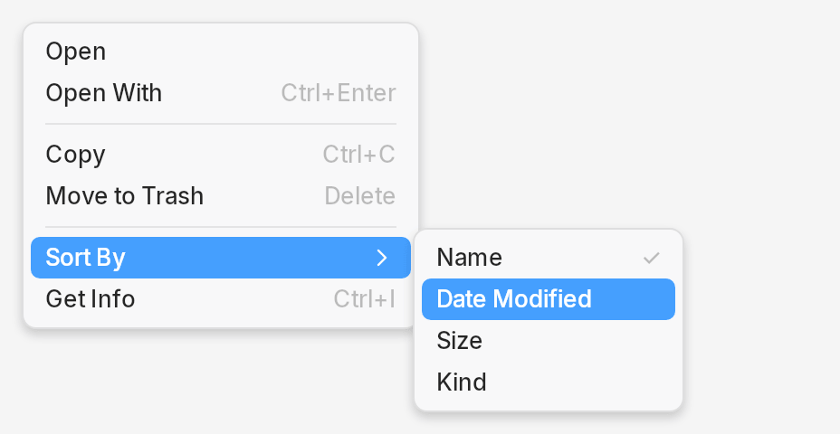

A popup menu with separators, shortcuts, submenus to any depth, keyboard
navigation and a scrolling cap for long lists. `ContextMenuRenderer` is the
drawing half and is what the compositor draws the dock's menus with;
`ContextMenu` is the client half that puts it on xdg popups and owns the
pointer while it is open.

- **Shape:** state plus renderer. `ContextMenuRenderer::render_depth(canvas, &items, selected, &style, w, h, scroll)`; `ContextMenu` for a live popup.
- **Types:** `ContextMenu`, `ContextMenuState`, `ContextMenuStyle`, `ContextMenuRenderer`, `MenuRefresh`.
- **Source:** [`context_menu/`](../../components/otto-kit/src/components/context_menu/)
- **Used by:** otto, otto-bar, otto-files. Inside otto-kit, the dropdown.

## Window chrome

### Titlebar

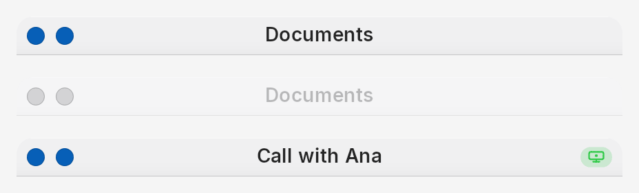

A window's title strip and its controls. `WindowDecoration` is the whole bar
for a variant (a floating window, or a tile's normal, minimal or hidden bar),
active or not, light or dark, with its hit testing; the compositor draws
server-side decorations with it and apps draw their own. `Titlebar` is the
lower-level builder with leading, title and control groups. `WindowControls`
are the round window buttons, with the zoom dot shown only when the desktop
is configured for it, and `SharingIndicator` is the badge a window wears
while it is being shared.

- **Shape:** builders. `WindowDecoration::new(title, width).with_active(..).draw(canvas)`; `Titlebar`, `WindowControls` and `SharingIndicator` are `Renderable`. `WindowControlsState` tracks hover and press.
- **Types:** `WindowDecoration`, `DecorationVariant`, `Titlebar`, `TitlebarGroup`, `TitlebarMaterial`, `WindowControls`, `WindowControl`, `WindowControlsState`, `SharingIndicator`.
- **Source:** [`titlebar/`](../../components/otto-kit/src/components/titlebar/)
- **Used by:** otto, otto-files, otto-preview, otto-settings. Inside otto-kit, `Window`.

### Window

No picture: a window is a surface, not a drawing. `Window` wraps a toplevel
(or a layer-shell surface) with a draw callback, the lay-rs layer behind it,
pointer events, frame pacing, rounded corners and frost. `window::resize`
answers which edge a point is on and which cursor it shows, for windows that
draw their own decoration.

- **Shape:** client object, not a canvas component.
- **Types:** `Window`, `resize`, `ApplicationWindow`, `WindowLayout`.
- **Source:** [`window/`](../../components/otto-kit/src/components/window/)
- **Used by:** otto-files, otto-preview, otto-settings. `ApplicationWindow` is not used outside its module.

### Layer and layers

No picture: neither draws anything of its own. `Layer` is a rectangle with a
draw closure and an optional `otto_surface_style_v1` augmentation, and
`LayerSurface` puts one on a Wayland subsurface. `LayerFrame` and `LayerStack`
in `layers/` wrap lay-rs layers in the scene graph as a frame and a
row-or-column stack; `Renderable::to_layer` builds a `LayerFrame`.

- **Shape:** client objects.
- **Types:** `Layer`, `LayerSurface` (`layer/`); `LayerFrame`, `LayerStack`, `StackDirection`, `StackAlignment` (`layers/`).
- **Source:** [`layer/`](../../components/otto-kit/src/components/layer/), [`layers/`](../../components/otto-kit/src/components/layers/)
- **Used by:** no crate. The `Layer` otto-files uses is `surfaces::layer_shell::Layer`, a different type.

## Ask and stash

### Attachments

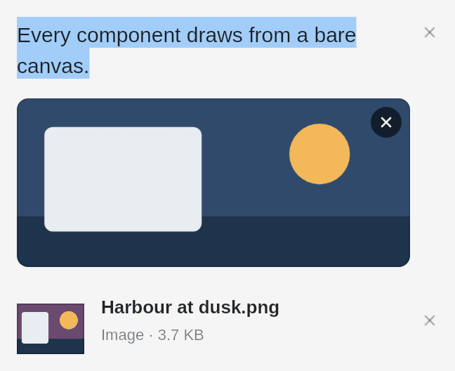

A list of things handed to Ask: selected text drawn as itself, a screen
region as its picture, a picture file as its thumbnail under its name, and
any other file as its icon, name, kind and size. The same list is the
otto-stash card, the files attached to a request in Ask, and the files that
went with one in its log. It never makes thumbnails itself: the app asks
`thumbnails_wanted` and hands each one in.

- **Shape:** state plus renderer. `AttachmentList::layout(&items, Options { .. }, theme)`, then `paint(canvas, &layout, theme, hovered)`; the layout answers `item_at` and `remove_at`.
- **Types:** `Attachment`, `AttachmentList`, `Layout`, `Options`, `stash_dir`.
- **Source:** [`attachments.rs`](../../components/otto-kit/src/components/attachments.rs)
- **Used by:** otto-agents-kit, otto-launcher, otto-stash.

### Stashed

No picture: it is a model. `Stashed` mirrors what otto-stash holds for an
app that shows it, as Ask does, on a thread of its own that reports through a
file descriptor the app polls. The app asks otto-stash for every change
(strike, remove, sent), so the card and the app never disagree, and draws the
items with the attachments list.

- **Shape:** client object.
- **Types:** `Stashed`, `Items`.
- **Source:** [`stashed.rs`](../../components/otto-kit/src/components/stashed.rs)
- **Used by:** otto-launcher, otto-stash.
