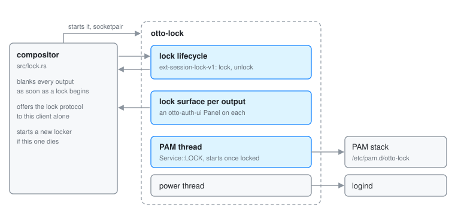

# otto-lock

otto-lock is Otto's screen locker. It takes the lock with
`ext-session-lock-v1`, draws the shared password panel on every output,
authenticates the session's own user against PAM, and only then gives the
session back. It lives in `components/otto-lock/` and sits in the **app**
layer of `architecture.toml`. It runs as one process for the length of a lock,
started by the compositor when the session locks.

The lock itself lives in the compositor. The locker only proves who is at the
keyboard: nothing in it can unlock a session it did not lock, and a locker
that crashes leaves the screen blank, never the desktop. How the compositor
side behaves (the blank, restarts, suspend, inhibitors and grabs) is on
[Permissions](permissions.md#the-lock-screen) and in `src/lock.rs`.

## Parts

| Part | What it does |
|------|--------------|
| `src/main.rs` | The whole client: the lock lifecycle, one lock surface and panel per output, keyboard and pointer input, the PAM attempt, the power buttons and the clock. |
| `otto-lock.pam` | The PAM stack the packages install as `/etc/pam.d/otto-lock`: `pam_fprintd` as `sufficient`, then the system's login stack. |
| `examples/lock_cycle.rs` | Locks, waits, and unlocks with no PAM, to exercise the protocol lifecycle. |

## How it runs

1. The compositor starts the locker on a socketpair (`WAYLAND_SOCKET`) marked
   as its locker, the only client offered `ext_session_lock_manager_v1`. The
   command is `[lock] locker_command`, or `OTTO_LOCKER_COMMAND`.
2. On start the locker asks for the lock at once. The compositor blanks every
   output before it answers.
3. It creates a lock surface for each output, follows outputs as they come and
   go, and builds an `otto-auth-ui` panel on each with the session picker
   hidden and the power buttons offered.
4. Only after `locked` arrives does it start authenticating, so a fingerprint
   reader cannot unlock a desktop that is still on screen. The PAM attempt runs
   `Service::LOCK` from `otto-auth-ui` on a thread of its own: the
   `otto-lock` service, else `system-auth`, else `login`.
   `OTTO_LOCK_PAM_SERVICE` names another service.
5. PAM's prompts and messages drive the panel. A wrong answer shows PAM's
   reason and starts the next attempt after a short floor, so a stack that
   cannot run at all does not spin. PAM's own delay is what makes a wrong
   password cost time.
6. On success the locker unlocks and exits. After a recognised fingerprint it
   first lets the mark finish, bounded by a short timeout.

If the compositor answers `finished` instead of `locked`, something else holds
the lock, and the locker exits. If the locker dies, the compositor starts a new
one, which takes over the standing lock.

Between events the loop sleeps. It wakes for PAM, for input, for a transition
or the fingerprint mark, and once a minute for the clock. Painting waits for
the compositor's frame callbacks, bounded by `otto-auth-ui`'s
`frame_in_flight`.

## Dependencies

`otto-auth-ui` with its `pam` feature (the panel, the PAM conversation and the
logind power calls), `otto-kit` for the session-lock surfaces, drawing and
i18n, `smithay-client-toolkit` and `wayland-protocols` for the protocol.

## Going deeper

- [Lock screen spec](../../specs/lock-screen.md) and the user guide
  [Lock screen](../user/lock-screen.md).
- [otto-auth-ui](otto-auth-ui.md) for the panel and the PAM thread.
- Testing an uninstalled build in a nested compositor is in
  [AGENTS.md](../../components/otto-lock/AGENTS.md).
