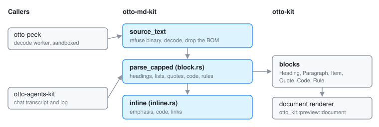

# otto-md-kit

otto-md-kit is Otto's Markdown parser, in `components/otto-md-kit/`. It takes
a `&str` and returns the block vocabulary the toolkit's document renderer
draws (`otto_kit::preview::document`), so a `.md` file reads as a document
rather than as its source. It never produces HTML. It sits in the **kit**
layer of `architecture.toml`. It is a library with no process, thread or
runtime of its own: it runs wherever its caller runs, inside Peek's sandboxed
decode worker or on an app's UI thread.

## Modules

| Module | What it does |
|--------|--------------|
| `lib.rs` | The entry points `parse_capped` and `source_text`, the input caps, and the re-exported `Block`, `Span` and `SpanStyle` |
| `block.rs` | `parse`: the block structure, line by line with one line of lookahead for setext headings. Headings, paragraphs, list items, quotes, code blocks and rules |
| `inline.rs` | `inline`: the styled spans inside a block (emphasis, code, links), in one left-to-right pass with no backtracking |

## What it reads, and what it flattens

It is a reading parser, not a conforming one. Anything it does not recognise
ends up as a paragraph of its own source text, which still reads. A few
choices are deliberate:

- **YAML front matter is dropped**, so a document opens on its title rather
  than on a block of keys.
- **A table is drawn as a code block.** Aligning columns means measuring text,
  and the parser has no fonts. The pipe-separated source lines up in a
  monospaced face.
- **An image is drawn as its alt text**, marked as a link. The parser is given
  text only and cannot open the file an image names.
- **An unclosed `**` stays literal** rather than swallowing the rest of the
  document.

`source_text` does what every host reading a `.md` from disk needs first: it
refuses bytes with a NUL in the first 4 KiB, decodes UTF-8 or falls back to
Latin-1, and drops a byte-order mark. `parse_capped` cuts a document at a
block count and says whether it did, so the host can tell the reader the
document was truncated.

## Untrusted input

The text is untrusted: it comes from any file Peek is pointed at. Three caps
in `lib.rs` keep one hostile document from turning into one hostile layout:
`MAX_BLOCKS`, `MAX_LINE_BYTES` for a line inside a code block or table, and
`MAX_INDENT` for nested lists. `inline.rs` also caps the length of a link
destination. The crate touches no files, no network and no runtime, which is
what lets it run inside a worker that holds a single descriptor.

## Who links it

- **otto-peek**, in `src/decode/markdown.rs`. The decode worker reads the file
  under its own byte budget, calls `source_text` and `parse_capped`, and sends
  the blocks to the host as a `Document` payload. See
  [File Previews](file-previews.md).
- **otto-agents-kit**, whose chat transcript and log lay out and paint an
  agent's Markdown answers with `parse_capped`. See [Agents](agents.md).

Its only dependency is `otto-kit`, for the block vocabulary. The drawing,
wrapping and scrolling of a document are the toolkit's, so there is no
Markdown-aware drawing code in either crate.

## Going deeper

- `cargo run -p otto-md-kit --example markdown_window -- README.md` draws a
  file in a window, with scrolling and clickable links. With no path it shows
  a built-in sample.
- Spec: [Peek](../../specs/peek.md).
- Build and test notes: [AGENTS.md](../../components/otto-md-kit/AGENTS.md).
