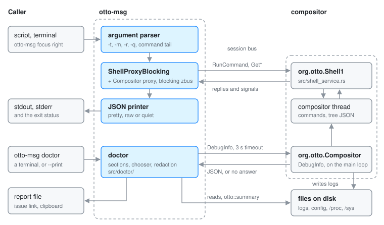

# otto-msg

**User guide:** [Scripting Otto](../user/scripting.md)\
**Specs:** [Window Tiling](../../specs/tiling.md)

`components/otto-msg/` is a command-line tool that runs i3-syntax commands
against Otto, prints the window tree, workspaces, outputs and inputs as JSON,
and follows events. It is a client of the compositor's `org.otto.Shell1`
D-Bus service and has no Wayland connection of its own. Each invocation is a
short-lived process that makes one call (or one subscription) on the session
bus and exits. It sits in the **app** layer of `architecture.toml`; nothing
depends on it, and the Otto plugin's skills call it.

The whole tool is `src/main.rs`: argument parsing, one call per message type,
and JSON printing. The command grammar and the JSON shapes are i3's, so a
script written for `i3-msg` or `swaymsg` ports with a rename.

## Message types

`-t` picks the message type. Both the underscored and the hyphenated
spellings are accepted (`get_tree`, `get-tree`).

| `-t` | Call on `org.otto.Shell1` | Output |
|------|---------------------------|--------|
| `run_command` (default) | `RunCommand(s) → a(bs)` | one `{"success": …}` object per `;`-separated command, with `error` on the ones that failed |
| `get_tree` | `GetTree() → s` | the tree, i3's `GET_TREE` shape |
| `get_workspaces` | `GetWorkspaces() → s` | i3's `GET_WORKSPACES` shape |
| `get_outputs` | `GetOutputs() → s` | i3's `GET_OUTPUTS` shape |
| `get_inputs` | `GetInputs() → s` | sway's `GET_INPUTS` shape |
| `subscribe` | the interface's signals | each matching event's JSON payload |

The getters answer with a JSON string. otto-msg parses it and pretty-prints
it (or prints it on one line with `-r`); a string that is not JSON is passed
through as it came.

## How it runs

- It connects to the session bus with blocking zbus and builds a
  `ShellProxyBlocking` from [otto-dbus](otto-dbus.md). It talks to whichever
  Otto owns `org.otto.Shell1`.
- Options end at the first word that is not an option, so
  `otto-msg resize shrink width -10 ppt` reads `-10` as part of the command.
  The parser is hand-written for that reason.
- For `run_command`, the reply goes to stdout as JSON and each failure's
  message also goes to stderr. The exit status is non-zero if any command
  failed, so `-q` (print nothing) still answers through the exit status.
- `subscribe` takes a JSON array of event names, or bare names. It listens to
  every signal on the proxy and maps `WorkspaceChanged` to `workspace` and
  `WindowChanged` to `window`; those two are the names it accepts. Without
  `-m` it prints the first matching event and exits; with `-m` it keeps
  printing.

## Who it talks to

| Peer | How |
|------|-----|
| Compositor | `org.otto.Shell1` at `/org/otto/Shell1`, served by `src/shell_service.rs`. Each call is handed to the compositor thread over a calloop channel and answered on a oneshot |
| Command parser | `src/shell/commands.rs` and `src/workspaces/tiling/command.rs` in the compositor, behind `RunCommand` |
| otto-dbus | the `ShellProxyBlocking` proxy and the interface definition |

Its only dependencies are zbus, `otto-dbus` and `serde_json`.

## Going deeper

- [Shell D-Bus API](shell-dbus-api.md) is the wire contract: every method,
  the command language, the JSON shapes, the signals and the errors. A change
  to the commands or the JSON goes there and into the user guide,
  [Scripting](../user/scripting.md).
- [specs/tiling.md](../../specs/tiling.md) and [Tiling plan](tiling-plan.md)
  hold the behaviour the commands drive.
- [components/otto-msg/AGENTS.md](../../components/otto-msg/AGENTS.md) has the
  build and test notes. `cargo test -p otto-msg` covers argument parsing; the
  commands themselves are tested in the compositor with
  `cargo test --features headless --test tiling_scripting`.
