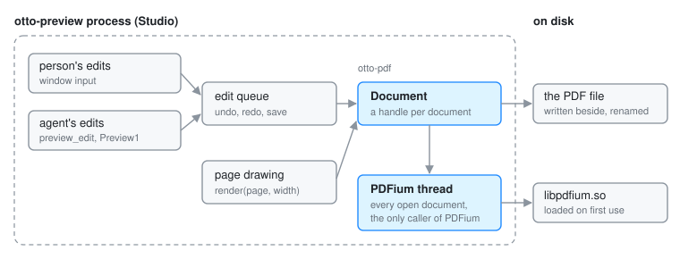

# otto-pdf

otto-pdf fills a PDF's form and marks it up, in `components/otto-pdf/`. It
reads a document's form fields and annotations in the page's own coordinates,
applies edits to them (a field's value, an annotation added, moved,
recoloured or removed), draws pages as they are with the edits in, and saves
over the file. The work is PDFium's. It sits in the **service** layer of
`architecture.toml`: no toolkit, no Wayland, no Skia. It is a library with no
process of its own, but it starts one thread, the only one that ever enters
PDFium. Its one user is Studio (`otto-preview`).

Previewing a PDF does not go through this crate. Peek and Studio draw a page
they are only showing with a rasteriser program run inside the sandboxed
decode worker; see [File Previews](file-previews.md). otto-pdf comes in once a
PDF is open for editing.

## Modules

| Module | What it does |
|--------|--------------|
| `lib.rs` | The public types: `Rect`, `Page`, `Field` and `FieldKind`, `Annotation` and `AnnotKind`, `Snapshot`, `Edit`, `NewAnnotation`, `Error`; the bounds every edit is checked against; `available()` and `open()` |
| `worker.rs` | The thread that owns PDFium, the `Document` handle other threads hold, and the atomic save |
| `engine.rs` | One open document on that thread: reading fields and annotations, applying edits, rendering, saving. Holds the raw PDFium handles, none of which leave the thread |
| `geometry.rs` | Turning a page's bottom-up user space into the shown page's top-left space and back, crop box and `/Rotate` included |
| `library.rs` | Finding `libpdfium.so`, loading and initialising it once per process |
| `bindings.rs` | The PDFium functions the engine calls, hand-written against the chromium/8086 headers and resolved at run time |

## How it runs

**Loading.** PDFium is never linked. `library::load` opens `libpdfium.so`
with `libloading` the first time something asks, trying `$OTTO_PDFIUM`, the
executable's directory, `<exe dir>/../lib/otto/`, `/usr/lib/otto/`,
`/usr/local/lib/otto/`, `~/.local/lib/otto/` and then the system loader. The
first candidate that loads and has every function wins, and the answer, a
failure included, is kept for the life of the process. A system without
PDFium runs everything except the editing; `otto_pdf::available()` says
which. `scripts/packaging/fetch-pdfium.sh` fetches the pinned build.

**One thread.** PDFium keeps global state and is not safe to enter from two
threads. The first `Document::open` starts a thread named `otto-pdf` that
holds every open document by id. A `Document` is a handle: each call sends
that thread a closure over a channel and waits for the answer. Dropping the
handle closes the document there.

**The calls.** `open` (or `open_bytes`, with an optional password) reads the
document into a `Snapshot`: its pages, every form widget and every other
annotation, in page order. `apply` takes a batch of `Edit`s, makes them and
returns the new snapshot. A field is filled through PDFium's form-fill
environment, which draws its new appearance, so the value shows in any PDF
reader. `render` draws one page as the document is in memory, unsaved edits
included, as opaque RGBA at a given width. Each edit is checked first against
the bounds in `lib.rs` (`MAX_COORD`, `MAX_TEXT_LEN`, `MAX_IMAGE_SIDE` and the
rest), since the caller may be an agent.

**Saving.** `save` writes the document beside its file with
`O_NOFOLLOW | O_CLOEXEC`, syncs it and renames it over the old one, keeping
the old file's permissions. A signed document is saved by appending the
changes, so its signatures still cover the bytes they signed; any other is
written afresh. `save_to` writes a copy elsewhere the same way.

**Coordinates.** Everything in the public API is in PDF points from the
top-left corner of the page as shown: its crop box, turned by `/Rotate`. A
rect from here lands on the rasterised page with no further conversion. Only
the engine converts to PDFium's bottom-up space.

## Who links it

Studio, through `components/otto-preview/src/edit_queue.rs`. Every edit,
undo, redo and save of an open PDF waits in that queue and runs one at a
time on a thread of its own, which calls into a shared `Document`. The
person's edits and an agent's (`preview_edit`, over Studio's MCP server) go
through the same queue. See [otto-preview](otto-preview.md).

otto-pdf depends on `otto-foundations` for the home folder in the library
search, plus `libloading`, `libc` and `tracing`.

## Going deeper

- Spec: [Studio](../../specs/preview-app.md), *Form and markup*.
- The tests write their own PDFs (`src/tests/writer.rs`) and skip, saying so,
  when PDFium cannot be loaded. Build and test notes:
  [AGENTS.md](../../components/otto-pdf/AGENTS.md).
