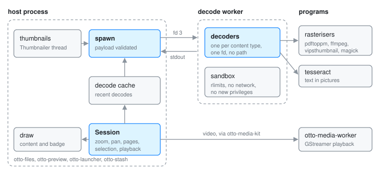

# otto-peek

otto-peek is Peek, the preview that opens when you press Space on a file, in
`components/otto-peek/`. It is a library the file views embed, not a service
they call: a host draws the preview into a subsurface of its own window, so
Peek has no window and no process of its own. What does run apart is the
decoder. Every untrusted file is parsed in a sandboxed decode worker, which
is the host's own binary run again with `--decode-worker`. The crate also
holds the shared thumbnail lookup and a background thumbnailer for apps that
show files. It sits in the **kit** layer of `architecture.toml`.

The decode worker, the payload, the decoders, the sandbox, thumbnails and
the Peek panel in Files are described in depth in
[File Previews](file-previews.md). Text recognised in pictures has its own
page, [Text in Pictures](peek-ocr.md). This page is the map of the crate.

## Modules

| Module | What it does |
|--------|--------------|
| `lib.rs` | `run_worker_if_requested`, which every host calls first thing in `main`; `thumbnail` and `generate_thumbnail` |
| `session.rs` | `Session`, the preview a host drives: zoom, pan, pages, word selection, links and video playback. Hosts hand it rects in their own coordinates |
| `draw.rs` | Paints a `Session`'s content and badge, the same in every host |
| `opening.rs` | The opening animation's geometry: the card grows out of the file's rect |
| `spawn.rs` | The host side of a decode: open the file, start a contained worker, enforce the deadline |
| `payload.rs` | The wire format between worker and host, and its validation |
| `decode/` | The decoders, one per kind (image, PDF, Markdown, text, listing, media), plus `external.rs` for programs run over the file. They run only inside the worker |
| `sandbox.rs` | The worker's containment, and `--sandbox-selftest` |
| `decode_cache.rs` | Recent decodes, so opening a file again skips the worker |
| `ocr.rs`, `ocrcache.rs`, `badge.rs` | Text in pictures: the recogniser, the words kept between runs, the corner badge |
| `thumbcache.rs`, `thumbnailer.rs` | The freedesktop thumbnail cache, and a thread that makes thumbnails off the UI thread |
| `config.rs` | The `[peek]` section of `~/.config/otto/files.toml` |
| `imagesize.rs` | A picture's size from its header, for layout before any decode |

## How it runs

- **In the host.** A host builds a `Session` from a decoded preview, feeds it
  pointer and key input, and paints it with `draw`. The drawing half is
  `otto_kit::preview`, which is canvas-pure. A decode blocks while its worker
  runs, so hosts call it off their UI thread.
- **The decode worker.** `spawn` runs `current_exe() --decode-worker` with a
  cleared environment, the file on fd 3 and nothing else open, reads one
  payload from its stdout and kills it past a deadline. The worker never
  learns a path and has no Wayland or bus connection. `sandbox.rs` caps its
  memory, CPU, writes and descriptors and takes away the network, but does not
  stop it reading other files; the module says why.
- **Programs.** No PDF, video or HEIF library is linked. The worker runs the
  first program it finds: `pdftoppm`, `pdftocairo`, `mutool` or `gs` for PDF
  pages; `ffmpegthumbnailer` or `ffmpeg` for a video's poster frame;
  `vipsthumbnail` or `magick` for HEIF. Text recognition runs `tesseract` or
  the command set in `[peek]`.
- **Playback.** A video in a session plays through `otto-media-kit`'s
  `Player`, which runs GStreamer in the separate `otto-media-worker`. See
  [otto-media-kit](otto-media-kit.md).
- **Files on disk.** Thumbnails are read from the shared cache under
  `$XDG_CACHE_HOME/thumbnails/`, consulting Otto's own failure markers under
  `thumbnails/fail/`. Words read from pictures are kept under
  `$XDG_CACHE_HOME/otto/ocr/`.

## Who links it

- **otto-files** embeds the session in the file browser, the file picker and
  the desk. See [Files](otto-files.md).
- **otto-preview** (Studio) gives one file a window of its own around the same
  `Session`. See [otto-preview](otto-preview.md).
- **otto-launcher** and **otto-stash** use the thumbnail cache and the
  `Thumbnailer`.

Each of these calls `otto_peek::run_worker_if_requested()` as the first line
of `main`. Without it the worker would start a second copy of the host.

otto-peek depends on `otto-kit` for the preview vocabulary and drawing,
[otto-md-kit](otto-md-kit.md) for Markdown, `otto-media-kit` without its
default features for playback, and `skia-safe` for image codecs and SVG.

## The `otto-peek` binary

The crate's binary is the worker for its own runs and a previewer with no
display: `--describe PATH` prints what the decoders made of a file,
`--render OUT.png PATH` draws it through the same `otto_kit::preview::draw` a
host uses, `--filmstrip OUT.png PATH` samples the opening animation, and
`--sandbox-selftest` reports which containment measures hold on this machine.

## Going deeper

- [File Previews](file-previews.md), [Text in Pictures](peek-ocr.md).
- Specs: [Peek](../../specs/peek.md), [Peek OCR](../../specs/peek-ocr.md).
- Build and test notes: [AGENTS.md](../../components/otto-peek/AGENTS.md).
