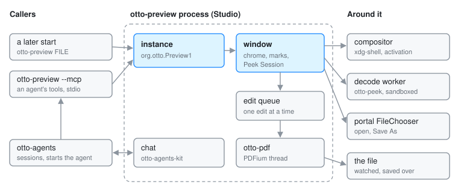

# otto-preview

otto-preview is the app people know as **Studio**, in
`components/otto-preview/`. It shows one file in a window of its own, drawn
exactly as Peek draws it over the file list, because it wraps the same Peek
session. Beside the document it can host an agent chat, and it fills and
marks up PDFs, saving into the file. The program, its app id and its bus name
are `otto-preview`; the desktop entry, the top bar and the dock call it
Studio. It sits in the **app** layer of `architecture.toml`. It runs as one
process per session that serves every Studio window, plus a short-lived
`otto-preview --mcp` process for each agent that uses its document tools.

## Modules

| Module | What it does |
|--------|--------------|
| `main.rs` | Arguments (`--chat`, `--session URI`, a path), the `--mcp` branch, and the hand-off to a running instance |
| `instance.rs` | `org.otto.Preview1`: opening files, and the document tools an agent reaches through `--mcp` |
| `app.rs` | The window, its input, and the work it sends off the UI thread: decodes, pages, the text layer, recognition |
| `viewer.rs`, `content.rs` | What the window shows around and under the Peek `Session`, drawn with `otto_peek::draw` |
| `chrome.rs`, `sidebar.rs`, `cursors.rs` | The titlebar and toolbar, the pages sidebar, the pen and bin cursors |
| `commands.rs`, `shortcuts.rs` | The one list of commands the menus, keys and shortcuts sheet all read, and the sheet itself |
| `marks.rs` | Marks the person draws to point at something and the agent draws to point back, in the document's own coordinates |
| `editing.rs`, `edit_queue.rs`, `signature.rs` | Filling a PDF's form and marking it up through otto-pdf; the queue every edit, undo, redo and save waits in; the person's kept signature |
| `chat.rs` | The chat panel beside the document, around otto-agents-kit's conversation and log |
| `mcp.rs`, `pdf_tools.rs` | `otto-preview --mcp`, the MCP server an agent starts, and the JSON form of the PDF's fields and annotations |
| `versions.rs` | Copies of the file kept while an agent works on it |
| `confirm.rs`, `file_dialog.rs`, `picking.rs` | The unsaved-changes questions, the portal's open and save dialogs, and the empty window shown when Studio starts with no file |

## How it runs

- **One instance.** The first start claims `org.otto.Preview1` on the session
  bus. A later start calls `Open` on it with the path and its xdg-activation
  token, then exits. The running instance opens the file in a new window, or
  brings forward the window already showing it. Started with no file, Studio
  opens an empty window, exports it with xdg-foreign, and asks the desktop
  portal's `FileChooser` for a file with that window as the parent.
- **The window.** An otto-kit app on an xdg toplevel. Its content is an
  `otto_peek::session::Session`, so zoom, pan, pages, selection and playback
  behave as they do in Peek. Decodes, page rasterising, the PDF text layer
  and text recognition run on blocking tasks of a tokio runtime and wake the
  UI loop when they land. The file's folder is watched, and the window shows
  the file again when it changes on disk.
- **The decoder.** Untrusted bytes are parsed in Peek's sandboxed decode
  worker, which is this binary run again. `otto_peek::run_worker_if_requested()`
  is the first call in `main`, before `--mcp` and before any thread. See
  [otto-peek](otto-peek.md).
- **PDF editing.** When PDFium is present, an open PDF is also opened through
  [otto-pdf](otto-pdf.md). Every edit, undo, redo and save goes through
  `edit_queue.rs` on a thread of its own, one at a time, and pages are drawn
  from the document in memory so unsaved changes show. Save As goes through
  the portal's `FileChooser`.
- **The chat.** The panel uses otto-agents-kit's `Ask` and `ChatView`, which
  talk to the `otto-agents` service. A session started from Studio carries the
  file as its subject, and `_meta.otto.mcpServers` naming this program with
  `--mcp`, so the agent gets the document tools. See [Agents](agents.md).
- **The MCP server.** `otto-preview --mcp` speaks MCP over stdio, with the
  document's path in `OTTO_PREVIEW_DOC`. It holds no state and never touches
  the display: each `preview_*` tool (info, render, marks, draw, clear,
  fields, annotations, edit, reload, versions, revert) is one call to the
  running instance over `org.otto.Preview1`.
- **Files it keeps.** Versions of a file, once a chat about it has started, under
  `$XDG_STATE_HOME/otto-preview/versions/`. The person's signature, as
  strokes, in `$XDG_DATA_HOME/otto/signature.json`. Text recognition follows
  the `[peek]` section of `~/.config/otto/files.toml`, which Files reads too.

## What it depends on

`otto-kit` for the window and drawing, `otto-peek` for the session and the
decoder, `otto-media-kit` without default features for playback,
`otto-pdf` for editing, and `otto-agents-kit` (with dictation) and
`otto-agents-client` for the chat. Nothing links Studio. It is launched from
its desktop entry, by `xdg-open`, and by the agent UIs when a session is
about a file.

## Going deeper

- Spec: [Studio](../../specs/preview-app.md), with
  [Peek](../../specs/peek.md) for what the content does.
- [File Previews](file-previews.md) for the decoder and the drawing it shares
  with Files.
- Build and test notes: [AGENTS.md](../../components/otto-preview/AGENTS.md).
