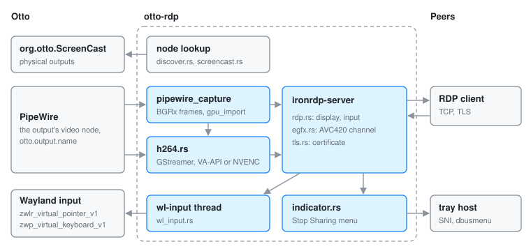

# otto-rdp

`components/otto-rdp/` serves one Otto output over RDP and injects the remote
client's mouse and keyboard back into it. It captures a virtual output's
PipeWire stream, or a physical output through `org.otto.ScreenCast`, encodes
it to H.264 on the GPU (or sends bitmaps) and speaks RDP with
`ironrdp-server`. It is a standalone process that runs next to Otto on its
Wayland socket; the compositor does not start it and knows nothing about RDP.
It sits in the **app** layer of `architecture.toml`, and nothing depends on it.

[RDP bridge for virtual outputs](rdp-virtual-output.md) explains the bridge in
depth: the compositor-side support it relies on, the command line, client
quirks and the current limitations. This page is the structural overview.

## Modules

| Module | What it does |
|--------|--------------|
| `main.rs` | Parses the options, resolves the PipeWire node, starts the input thread, chooses the video path and builds the RDP server |
| `discover.rs` | Finds a virtual output's PipeWire node by its `otto.output.name` property |
| `screencast.rs` | Gets a physical output's node from `org.otto.ScreenCast`: `CreateSession`, `RecordMonitor`, `Start`, then the stream's `PipeWireNode` |
| `pipewire_capture.rs` | PipeWire consumer for the bitmap path and for NVENC: maps shared-memory and linear dmabuf frames, repacks them as BGRx and fans them out on a broadcast channel |
| `gpu_import.rs` | Reads back tiled dmabufs the CPU cannot map: imports them into EGL on the render node and reads them with `glReadPixels` |
| `h264.rs` | The GStreamer encoder: `pipewiresrc` into `vah264enc` with VA-API, or captured frames through `appsrc` into `nvh264enc` |
| `egfx.rs` | The EGFX graphics-pipeline driver: pushes encoded access units to the client as AVC420 frames |
| `rdp.rs` | The `ironrdp-server` glue: the display handler and the input forwarder |
| `wl_input.rs` | The Wayland client that injects input through `zwlr_virtual_pointer_v1` and `zwp_virtual_keyboard_v1` |
| `tls.rs` | The self-signed certificate, generated once and kept under the XDG state directory |
| `indicator.rs` | The tray indicator shown while a client is served, with its Stop Sharing menu |

## How it runs

One process, on a multi-threaded tokio runtime, with a few dedicated threads:

- **Startup.** The node comes from `--node`, from `org.otto.ScreenCast` for
  `--connector`, or from PipeWire discovery by output name (default
  `virtual-1`). Then the `wl-input` thread connects to Otto's Wayland socket,
  finds the output through xdg-output and reports its pixel size; the RDP
  server starts only once it knows that size.
- **Video, H.264 (default).** The EGFX driver runs from startup. Once a client
  has negotiated its desktop size and advertised AVC, a GStreamer pipeline is
  built on the blocking pool. The encoder is `OTTO_RDP_H264_ENCODER` if set,
  otherwise `vah264enc`, else `nvh264enc`. With VA-API the pipeline reads the
  PipeWire node itself; NVENC is fed frames from `pipewire_capture`.
- **Video, bitmap.** With `--bitmap`, or when the client advertises AVC as
  disabled, `pipewire_capture` runs on its own thread and the display handler
  sends full-frame bitmaps that ironrdp compresses.
- **Input.** `rdp.rs` maps RDP mouse and keyboard events back into native
  output pixels and sends them over a channel to the `wl-input` thread, which
  issues virtual-pointer and virtual-keyboard requests.
- **Indicator.** While a client is connected, `indicator.rs` publishes a
  StatusNotifierItem on its own session-bus connection. Stop Sharing quits
  the whole server, not only the current client.

## Who it talks to

| Peer | How |
|------|-----|
| Compositor | Wayland: `zwlr_virtual_pointer_v1` bound to the output, `zwp_virtual_keyboard_v1`, xdg-output. D-Bus: `org.otto.ScreenCast` for physical outputs, through the [otto-dbus](otto-dbus.md) proxies |
| PipeWire | the output's video node, consumed directly or by `pipewiresrc` |
| GStreamer | the H.264 encode graph; a hardware encoder is required for the H.264 path |
| EGL and GL | the render node, for reading back tiled dmabufs |
| RDP client | TCP, `127.0.0.1:3389` by default; TLS with a self-signed certificate unless `--no-tls`. There is no authentication |
| Tray host | `org.kde.StatusNotifierItem` and `com.canonical.dbusmenu`, registered with the StatusNotifierWatcher |

It links `otto-dbus` and `otto-foundations` (for `xdg::state_home`). GStreamer
and PipeWire are banned crates in `deny.toml`, and otto-rdp is one of the
listed wrappers. GStreamer raises its toolchain to Rust 1.96.

## Going deeper

- [RDP bridge for virtual outputs](rdp-virtual-output.md): the design, the
  compositor-side support, running it and its limitations.
- [Remote-desktop indicator](remote-desktop-indicator.md): the
  StatusNotifierItem and dbusmenu contract.
- [Screenshare](screenshare.md): `org.otto.ScreenCast` and the PipeWire streams.
- [specs/rdp-bridge.md](../../specs/rdp-bridge.md), and the user guide
  [Remote Desktop](../user/remote-desktop.md).
- [components/otto-rdp/AGENTS.md](../../components/otto-rdp/AGENTS.md) for the
  environment variables, `run-rdp.sh`, and the tests
  (`cargo test -p otto-rdp`, `cargo test --features headless --test rdp_bridge`).
