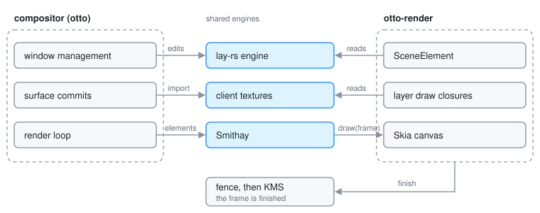

# The Render Stack

`otto-render` is the part of the compositor that turns a scene into pixels. It
holds the Skia renderer that sits on top of Smithay's GL and Vulkan renderers,
the plumbing under it (EGL contexts, client buffers as Skia images, GPU fences),
and the render elements that hand Otto's scene graph to Smithay, either whole
or one subtree per KMS plane. It is a library linked only by the compositor and
runs on the compositor's thread. It decides how to draw. It never decides what
is on screen: windows, workspaces, input and configuration all stay in the
compositor, which hands the renderer what it needs.

The general pipeline (scene graph, render elements, damage, presentation) is
explained in [Rendering](rendering.md), and the tree itself in
[The Scene Graph](scene-graph.md). This page is about the crate as a unit.

## The model

Three ideas shape the crate.

**Skia on Smithay's buffers.** Smithay owns renderers, buffers, swapchains,
damage tracking and submission. `SkiaRenderer` wraps Smithay's GL renderer and,
for every frame, wraps the bound framebuffer as a Skia surface. On the udev
backend the same role can be played by Skia on Vulkan
([The Vulkan Renderer](vulkan-renderer.md)). Every frame, whichever renderer
made it, hands its render elements a Skia canvas, so one element
implementation and one copy of the drawing code serve GL and Vulkan alike.

**The scene is one element.** `SceneElement` holds a reference to the lay-rs
engine and draws the whole layer tree, or one output's part of it, into that
canvas. `SceneDmabufElement` draws one subtree into a buffer of its own that
the display hardware can scan out directly. Both are ordinary Smithay render
elements, so Smithay's damage tracker and plane assignment treat them like any
other.

**Below the compositor, by construction.** The crate cannot name the
compositor. Anything the renderer needs from it comes in as data or as a
function.

## Start to finish: a window repaints

Follow one client update to the screen on the udev backend.

1. **The client commits a buffer.** The compositor's commit handling asks the
   backend to import it. The import goes through the renderer: a dmabuf
   becomes a GPU texture, a shared-memory buffer is uploaded, and either way
   the result can be read as a Skia image. A synchronized subsurface whose
   buffer became current with its parent's commit is imported in the same step,
   or a video inside it would never get a texture.
2. **The texture is filed by surface.** The compositor stores the surface's
   texture in the renderer's texture store, keyed by the Wayland surface. The
   window's layer in the scene has a draw closure that looks the texture up
   there when it paints. Nothing is drawn yet; the layer is just marked as
   changed.
3. **The scene ticks.** When the render loop runs, `SceneElement` advances the
   lay-rs engine by the time since the last tick, then collects the engine's
   damage as separate rectangles cut to the output. Damage that falls on
   another workspace, off this output, simply drops out.
4. **Plane buffers render first.** When the output uses planes, the compositor
   points each plane element at its subtree and asks it to render. A plane
   element repaints only when damage lies under its subtree, and draws into the
   next free slot of its own small swapchain, so the GPU never writes a buffer
   the display is still scanning. The slot is exported as a dmabuf.
5. **Smithay walks the list.** The compositor builds the output's element list
   (scene or plane elements, cursor, debug overlays) and gives it to Smithay.
   Smithay decides which elements go on hardware planes and which have to be
   composited, and works out the damaged region of the buffer it is about to
   draw into.
6. **Skia draws the rest.** For each composited element Smithay calls `draw`
   with a frame. The scene element takes the frame's Skia canvas and walks the
   layer tree once per damage rectangle, each pass clipped to its rectangle,
   so untouched subtrees are skipped. The window's draw closure now reads its
   texture and paints it.
7. **The frame is fenced.** Finishing the frame flushes Skia and inserts a GPU
   fence. Smithay exports the fence to KMS as an in-fence where the driver
   supports it, so the display waits for the GPU without the CPU waiting at
   all. The atomic commit goes out.

How often this loop runs, and why an idle desktop reaches zero frames, is
[Render Loop](render_loop.md). Which subtrees become planes is
[DRM Planes](drm_plane.md).

## Boundaries

- **One thread.** All of it runs on the compositor's thread. GL contexts are
  current per thread, and Skia surfaces and plane slots are tied to the thread
  that made them, so nothing here is handed to another thread. When a second
  GPU's renderer runs in between, each GL entry point makes its own context
  current again before touching GL.
- **From the compositor, in.** A shared handle to the lay-rs engine, the
  textures of client surfaces, which subtree each plane element draws and
  where, and settings as functions. Occlusion culling is the example: the
  scene element calls a function the compositor gave it once per frame, so a
  configuration reload applies on the next frame without the renderer reading
  configuration.
- **To Smithay, out.** Render elements with their geometry and damage, and
  from each frame a sync point.
- **To the display.** Plane buffers as dmabufs, kept alive by Smithay until
  KMS is done scanning them, and GPU fences as file descriptors.
- **Which renderer.** The udev backend is generic over a renderer API that
  names everything it needs (multi-GPU support, buffer import and export,
  Skia frames). The compositor picks GL or Vulkan once at startup. winit and
  X11 use the GL renderer directly.

## Decisions

- **Its own crate.** The render stack used to be modules inside the
  compositor, kept below window management by an architecture rule. As a
  crate the compiler holds that boundary and no rule is needed
  ([Architecture Rules](architecture.md)). The compositor re-exports its
  modules under their old names, so compositor code still reaches them there.
- **Settings are passed in, not read.** Following from the above: the crate
  has no configuration to read, so the compositor hands over a function that
  answers each frame.
- **One pass per damage rectangle.** Joining the rectangles into one clip
  region looked cheaper, but on this render target a multi-rectangle region
  becomes a path clip, and Skia clipped some draws to the region and others
  to its bounding box. That wiped pixels in the box's corners. A plain
  rectangle clips the same way for every draw, and the number of passes is
  capped: past a handful, one bounding box is cheaper.
- **Frost is blurred whole.** A blurred backdrop reads the pixels beneath it.
  A pass that covered only part of a frosted shape would blur last frame's
  frost into itself and leave a seam. So every pass that touches such a shape
  grows to cover it, and passes that then overlap are merged.
- **Debug hooks cost nothing in a release build.** The file-driven toggles
  check the filesystem on hot paths, so they are compiled in only with the
  development features; otherwise they are constants and fold away
  ([Debug Action Hook](debug-action-hook.md)).

## Limits and direction

- Plane scanout runs on GL only. On Vulkan every output composites into the
  primary plane until its plane buffers are fenced for scanout; see
  [The Vulkan Renderer](vulkan-renderer.md) and the
  [Vulkan Renderer Plan](vulkan-renderer-plan.md).
- The crate has only been built with the udev backend's support enabled, since
  the plane path and its dmabufs are udev code.
- Plane behaviour is specified in
  [`specs/plane-scanout.md`](../../specs/plane-scanout.md).

## See also

- [Rendering](rendering.md): scene graph to render elements to screen
- [Render Loop](render_loop.md): when a frame happens, and damage tracking
- [The Scene Graph](scene-graph.md): the tree the renderer draws
- [DRM Planes](drm_plane.md): subtrees on hardware planes, and the blur problem
- [The Vulkan Renderer](vulkan-renderer.md): Skia on Vulkan
- [Architecture Rules](architecture.md): the compositor-core layer
- [`specs/plane-scanout.md`](../../specs/plane-scanout.md)
- Working notes for contributors: [`crates/otto-render/AGENTS.md`](../../crates/otto-render/AGENTS.md)
