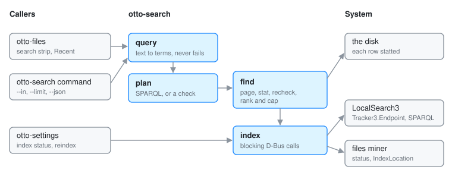

# otto-search

otto-search is Otto's file search, in `components/otto-search/`: one query
language over the desktop's file index, so the same words find the same
files in Files, in Settings and on the command line. It turns a query into
SPARQL, asks LocalSearch (TinySPARQL) over D-Bus, and checks what comes back
against the disk. It sits in the **service** layer of `architecture.toml`: no
toolkit and no Wayland, so command-line tools and daemons can link it. It is
a library plus the `otto-search` command, and runs no service of its own.

The pipeline, the SPARQL it writes, ranking, threading in Files and what
happens when the index cannot answer are described in
[File Search](file-search.md). This page is the map of the crate.

## Modules

| Module | What it does |
|--------|--------------|
| `query.rs` | `parse`: text into terms. It never fails: a token that does not parse stays a plain word and carries an `Issue` the caller can show |
| `plan.rs` | `Plan::new` resolves a query against a `Scope` (where to look) and a `Clock` (what `today` means). The plan then renders SPARQL for the index, or `admits` checks a file found some other way |
| `find.rs` | `find`: runs a plan to a ranked, capped list of files that are really there. It pages past rows the index remembers but the disk no longer has, stats each row, checks it again against the plan, and reports progress page by page |
| `index.rs` | The LocalSearch wire: `search`, `counts`, `status` and `reindex`, plus `file:` URL conversion |
| `dates.rs` | Calendar arithmetic for `modified:`, without a date crate |
| `main.rs` | The `otto-search` command |

## How it runs

Every call into the index is blocking: it builds a current-thread tokio
runtime for one round trip on the caller's thread, so callers run it off any
UI thread. It talks to these D-Bus objects on the session bus:

- `org.freedesktop.LocalSearch3` at `/org/freedesktop/Tracker3/Endpoint`,
  interface `org.freedesktop.Tracker3.Endpoint`, for queries. Rows come back
  through a pipe the call hands over. Anything the user typed goes in as a
  bound parameter, never spliced into the query text.
- The files miner at `/org/freedesktop/Tracker3/Miner/Files`, for the
  indexer's state (`Missing`, `Stopped`, `Idle`, `Indexing`, `Paused`) and
  progress.
- `org.freedesktop.LocalSearch3.Control`, for `IndexLocation` when Settings
  asks for the home folder to be indexed again.

The index is asked for paths and, for full-text queries, snippets. Size,
modification time and kind are read from the filesystem, because the index
always lags the disk a little.

## Who links it

- **otto-files** for the search strip and Recent, with its own worker thread
  and cancellation around `find`. It uses `Plan::admits` to merge in words
  read from pictures, and `dates` wherever it shows or groups a date. See
  [Files](otto-files.md) and [Text in Pictures](peek-ocr.md).
- **otto-settings**, whose Search pane shows the indexer's status and file
  count and offers a reindex.
- The **`otto-search` command**:
  `otto-search [--in DIR]... [--limit N] [--json] QUERY...`, in the same
  language as the Files strip.

It depends on [otto-foundations](otto-foundations.md) for name scoring
(`matching`, the scorer the launcher and the toolkit's lists also use) and
for the index's `file:` URLs, plus `zbus`, `tokio` and `libc`.

## Going deeper

- [File Search](file-search.md), and the [search plan](search-plan.md).
- Spec: [search language](../../specs/search-language.md). A change to the
  language updates the spec in the same change.
- `cargo test -p otto-search --test live_index -- --ignored --nocapture`
  checks every filter against the real index. Build and test notes:
  [AGENTS.md](../../components/otto-search/AGENTS.md).
