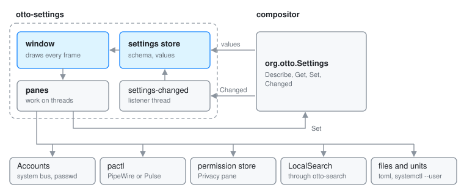

# otto-settings: the Settings app

otto-settings is the Settings window: a sidebar of panes with a search
field, and on the right the selected pane, each row bound to one setting. It
lives in `components/otto-settings/` and sits in the `app` layer of
`architecture.toml`, so nothing links it. It runs as an ordinary otto-kit
window, started from its desktop entry, the dock or the top bar
(`otto-settings --pane keyboard` from the layout menu). Most rows go to the
compositor's `org.otto.Settings` interface. The rest talk straight to the
system service or file that owns them.

## Modules

| Module | What it does |
|--------|--------------|
| `main.rs` | The app: command line, window, input, editing, dropdowns, pickers and the sheet and search subsurfaces. |
| `settings_client.rs` | The `org.otto.Settings` client and the process-wide store the draw path reads. |
| `model.rs` | Lays out every pane as rows, and holds placeholder values for rows no setting serves. |
| `panes/` | One module per pane. Some own a file, a service or a unit of their own (below). |
| `view.rs`, `widgets.rs` | Draw the window, the sidebar and the row controls. |
| `sidebar_search.rs` | The search field and its drop-down of matches, using the launcher's item list and ranking. |
| `sheet.rs` | The Users pane's dialogs, on a subsurface above the pane. |
| `discovery.rs`, `xkb_registry.rs` | The choices that depend on the machine: fonts, cursor, icon and sound themes, lock and greeter commands, and XKB layouts from `evdev.xml`. |
| `pulse.rs` | The Sound pane's mixer, through `pactl`. |
| `wallpaper_preview.rs`, `theme_preview.rs` | Previews of the wallpaper on the primary screen and of icon and cursor themes. |
| `glyphs.rs` | Sidebar glyphs drawn in code when the Solar set is not installed. |
| `preview.rs` | `--png`: renders panes offscreen, with no display. |

## How it runs

**Startup.** `main` sets the language from the desktop, then
`settings_client::connect` fetches the schema (`Describe`), the values and the
overridden set over a blocking zbus connection and fills the store. A thread
named `settings-changed` then follows the `Changed` signal, updates the store
and sets a dirty flag. The window reads the store on every frame without
touching the bus, and `on_update` turns the flag into a redraw. With no
compositor answering, the store stays offline: panes draw the placeholders in
`model.rs` and the app presents itself as read-only.

**Rows.** A row carrying a setting's identifier takes its type, range, help
text and whether it applies live or on restart from the schema, and a change
is a `Set` call. The identifiers are the compositor's
(`src/settings/schema.rs` at the repository root); the wire contract is in
[Settings D-Bus API](settings-dbus-api.md). The colour scheme and accent rows
(`theme_scheme`, `accent_color`) are settings like any other; how they reach applications is in
[Color Scheme](color-scheme-setting.md).

**Window.** One otto-kit `Window`. The pane scrolls in a `ScrollPane`, whose
content sits in subsurfaces over the window's buffer (see
[Scroll pane](scroll-pane.md)), so the search list and the Users sheet are
subsurfaces of their own stacked above them. The window publishes an
accessible tree through otto-kit (see [Accessibility](accessibility.md)).

**Threads.** The draw path must not block. Bus calls, `pactl`, `systemctl`
and file scans run on threads of their own and wake the loop when done.

## Panes that go elsewhere

| Pane | Talks to |
|------|----------|
| Users (`account.rs`) | `org.freedesktop.Accounts` on the system bus; `passwd` for password changes |
| Sound (`sound.rs`) | `pactl`, which reaches PipeWire through `pipewire-pulse` or PulseAudio |
| Privacy (`privacy.rs`) | xdg-permission-store, to list and revoke what apps were allowed (see [Permissions](permissions.md)) |
| Search (`search.rs`) | LocalSearch, through `otto-search`, and `systemctl --user` for its service (see [File search](file-search.md)) |
| Agents (`agents.rs`) | writes `agents.toml`; reads the state of the `otto-agents` units and restarts them through `systemctl --user` |
| Dictation (`dictation.rs`) | writes `dictation.toml`; switches the `otto-stt-<engine>` units (see [otto-dictate](otto-dictate.md)) |
| Appearance, desk group (`desk.rs`) | writes the `[desk]` section of `files.toml` |
| Lock & Login, startup group (`startup.rs`) | writes the `[[exec_once]]` list in `config.toml`; adds entries through the portal's file chooser |

Every file is written with `toml_edit`, one key at a time, so comments and
keys the pane does not show stay as they were. Each file has a reader
elsewhere (otto-agents, otto-files, otto-kit's dictation config, the
compositor), and their keys have to stay in step.

## Dependencies

`otto-kit` for the window, drawing, widgets, the scroll pane, the portal file
chooser, i18n and the `org.otto.Settings` proxy from
[otto-dbus](otto-dbus.md). `otto-search` for the Search pane. `sha-crypt` and
`zeroize` for the Users pane, `xcursor` for cursor previews, `chrono` to
preview clock formats the way [otto-bar](otto-bar.md) renders them.

## Going deeper

- Spec: [settings app](../../specs/settings-app.md). User guide: [Settings](../user/settings.md).
- [Settings D-Bus API](settings-dbus-api.md), [Color Scheme](color-scheme-setting.md),
  [Permissions](permissions.md), [Scroll pane](scroll-pane.md).
- Build, run and test notes, including `--pane`, `--setting` and `--png`:
  [AGENTS.md](../../components/otto-settings/AGENTS.md).
