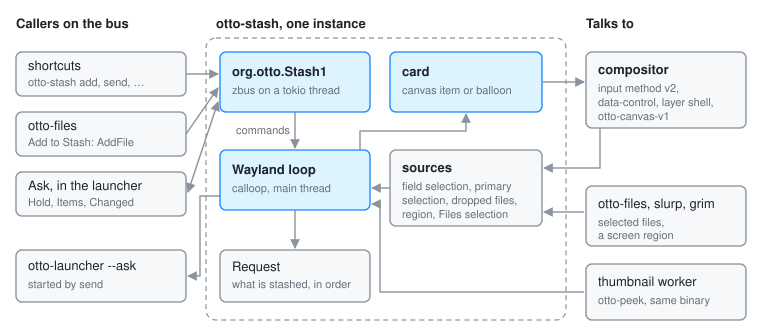

# otto-stash

`components/otto-stash/` collects things to ask an agent about (selected text,
files, a screen region) into one "Ask about…" card, then hands them to Ask
together. It is an **app** in `architecture.toml` and a proof of concept. It
runs as one long-lived process that is both a Wayland client and a D-Bus
service: the instance Otto autostarts owns `org.otto.Stash1`, and the same
binary run with a subcommand (`add`, `add-file PATH`, `add-region`, `send`,
`cancel`) calls that instance over the bus and exits. The shipped config binds
those subcommands to shortcuts.

## Modules

| Module | What it does |
|--------|--------------|
| `main` | The subcommands, the Wayland globals, the calloop event loop and the `State` that every other part reports to |
| `dbus` | `org.otto.Stash1`; asking `org.otto.Files1` for the selection in the focused Files window; reading the send shortcut's label from `org.otto.Settings` |
| `request` | What is stashed, in order, with which items are struck out; on hand-over it writes text selections to files |
| `card` | The `Card` enum: the card in the side canvas, or the floating balloon |
| `canvas` | The card as an `otto-canvas-v1` item (version 3 to 5) |
| `panel` | The balloon: a transparent layer-shell overlay with the card as a draggable subsurface |
| `balloon` | Drawing the card's contents at whatever width it is given |
| `primary` | The primary selection through wlr-data-control, for apps whose text input reports no selection |
| `region` | A screen region picked with `slurp` and captured with `grim` |
| `drop`, `invite` | Files dropped on the card, and the drop invitation that appears in the side canvas while a drag carrying files is under way |

## How it runs

- **Two threads.** The main thread runs the calloop loop over the Wayland
  socket. A one-worker tokio runtime serves `org.otto.Stash1` and hands each
  call to the loop over a channel as a `Command`; every change to the stash is
  announced back out from one task, in order, as the `Changed` signal.
- **Where items come from.** `add` reads the selection in the focused field
  through `zwp_input_method_v2`. With none there, it asks Files for the
  selection in the Files window that has the keyboard, and when no Files
  window has it, takes the primary selection. Files' own
  "Add to Stash" calls `AddFile`. `add-region` runs `slurp` and `grim` on a
  helper thread. Files dropped on the card or the invitation are taken as
  `text/uri-list`.
- **The card.** With `otto-canvas-v1` at version 3 or later the card is an item
  at the top of the side canvas (see [Side canvas](side-canvas.md#stash-card));
  otherwise it is a balloon on a layer-shell overlay. otto-stash never takes
  the keyboard, so the app in front keeps its selection and caret.
- **Thumbnails.** File thumbnails come from `otto-peek`'s thumbnailer, decoded
  in a sandboxed worker that is this same executable:
  `otto_peek::run_worker_if_requested()` is the first call in `main`.
- **Handing over.** `send` starts `otto-launcher --ask` (or the program in
  `OTTO_STASH_LAUNCHER`). Ask, through otto-kit's stashed-items view, calls
  `Hold` and the card steps aside until Ask leaves the bus; Ask lists the items
  with `Items`, follows `Changed`, can `Toggle` or `Remove` an item, and calls
  `Sent` when the request goes, which ends the stash. Items travel as file
  paths: text selections are written under
  `$XDG_RUNTIME_DIR/otto-stash/`. Closed without sending, Ask lets go and the
  card comes back.

## Dependencies

- **Workspace:** `otto-kit` (drawing, the Wayland protocol bindings, scrolling,
  the Stash, Files and Settings proxies through `otto_kit::dbus`) and
  `otto-peek` (thumbnails). The interface itself is declared in
  [otto-dbus](otto-dbus.md) (`components/otto-dbus/src/stash.rs`).
- **External:** `smithay-client-toolkit` and `wayland-client` with the
  input-method, wlr data-control and layer-shell protocols; `zbus`; `tokio`.
- **At run time:** `slurp` and `grim` for regions, and the launcher for Ask.

## Going deeper

- [Stash spec](../../specs/stash.md): the behaviour contract.
- [Side canvas](side-canvas.md#stash-card): the card and the drop invitation in
  the column.
- [otto-launcher](otto-launcher.md): how Ask shows what is stashed.
- [`components/otto-stash/AGENTS.md`](../../components/otto-stash/AGENTS.md):
  running a development build and the rules.
