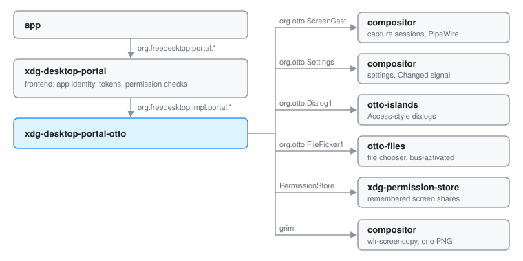

# xdg-desktop-portal-otto

Apps that want something only the desktop can give them (a screen to share, a
file to open, the dark-mode preference, a screenshot) ask xdg-desktop-portal.
That frontend is a generic freedesktop service: it checks who is asking, keeps
permission tokens, and forwards the actual work to a backend chosen per
desktop. `xdg-desktop-portal-otto` is Otto's backend. It answers five portal
interfaces (ScreenCast, Settings, Access, Screenshot and FileChooser) by
calling into the compositor and Otto's helper apps. It runs as its own
process, a user service the frontend starts on demand through D-Bus
activation under the name `org.freedesktop.impl.portal.desktop.otto`, and the
frontend picks it for sessions whose desktop name is `otto`. Every other
portal interface goes to whichever backend the frontend's configuration names.

## The model

**A broker, not a renderer.** The backend owns no window and holds no Wayland
connection. When a request needs the user, it hands the question to a process
that draws: dialogs go to otto-islands, file choosers to otto-files. When a
request needs pixels, the compositor or `grim` produces them. The backend's
job is translation: freedesktop shapes in, Otto's own D-Bus interfaces out,
and the answer packed back without losing anything.

**Fail closed.** If nobody can ask the user, the answer is no. A screencast
with no picker on the bus is refused rather than sharing a default output, an
Access dialog with no renderer is denied, and a file chooser that cannot reach
the picker reports a failure instead of an empty success.

**Hold as little state as possible.** The only live state is the ScreenCast
session table, and it is in memory. What has to survive (a share the user
already approved) travels in the portal's own `restore_data` round trip or
sits in xdg-permission-store, both owned by others.

## Start to finish: sharing a window

A browser asks to share a window. The portal ScreenCast flow is four calls,
and each one passes through the backend.

1. **CreateSession.** The app calls the frontend, which picks a request handle
   and a session handle and calls the backend's `CreateSession`. The backend
   exports a Session object at the session handle, then asks the compositor
   for a capture session over `org.otto.ScreenCast`. It records the pair
   (portal session, compositor session) in its table. If the compositor
   refuses, the Session object is removed again so nothing dangles on the bus.

2. **SelectSources.** The app says what it accepts (monitors, windows or
   both), a cursor mode and whether it wants the share remembered. The
   backend asks the compositor for its outputs and its windows, then tries to
   avoid asking the user:
   - If the app replayed `restore_data` from an earlier share, that names a
     source.
   - Otherwise any share remembered for this app id in the permission store
     names one.
   - If the named output or window still exists and matches the requested
     types, it is selected silently.

   Failing that, the backend builds one radio list of every output and every
   window and sends it to otto-islands as an Access-style dialog over
   `org.otto.Dialog1`, with a "Remember for this app" checkbox when the share
   can be remembered. Cancel answers 1. No renderer at all answers 2. The
   chosen source is only written into the session table; nothing is captured
   yet.

3. **Start.** The backend tells the compositor to record that window (or
   output) in the session and to start it. The compositor creates a PipeWire
   stream and reports its node id once the stream is ready, which the backend
   polls for briefly. The backend reads the stream's metadata (size,
   position, scale, format) and returns it to the frontend in the `streams`
   result. If the app asked for persistence, it also returns `restore_data`:
   the source's identity under the vendor name `otto`. The frontend turns that
   into a token for the app.

4. **OpenPipeWireRemote.** The backend asks the compositor for a PipeWire file
   descriptor for the session and passes it up. The frontend hands it to the
   app, which connects to the node.

From here on frames go from the compositor to PipeWire to the app. The backend
is not on that path. When the app closes the session, the frontend calls
`Close` on the Session object and the backend stops the compositor session.
If the app withdraws mid-request instead (it quit, or the user closed the
window that asked), the frontend calls `Close` on the request object and the
pending method answers "cancelled" wherever it was.

[Screen Sharing](screenshare.md) covers the compositor half: the
`org.otto.ScreenCast` service, the PipeWire streams and the GPU blit.

The other interfaces are shorter versions of the same shape:

- **Access** forwards the dialog to otto-islands field for field and returns
  the user's choices.
- **FileChooser** unpacks the options into the typed `org.otto.FilePicker1`
  request, lets otto-files run the dialog, and packs the URIs back. Closing
  the request forwards to the picker, so a dialog whose app has gone does not
  stay on screen.
- **Screenshot** asks for confirmation through the same dialog renderer, runs
  `grim` and returns a `file://` URI to the saved PNG.
- **Settings** reads each value from the compositor on request and pushes
  changes: it listens to `org.otto.Settings`' `Changed` signal and re-emits
  the portal's `SettingChanged`. See [Color Scheme](color-scheme-setting.md)
  for the keys and namespaces it serves.

## Boundaries

| Between | Crosses as | Who owns the state |
|---|---|---|
| App and frontend | `org.freedesktop.portal.*` | Frontend: app identity, restore tokens |
| Frontend and backend | `org.freedesktop.impl.portal.*`, plus Request and Session objects the backend exports at handles the frontend chooses | Backend: portal session to compositor session, and the picked source |
| Backend and compositor | `org.otto.ScreenCast` (session and stream objects), `org.otto.Settings` | Compositor: capture sessions, streams, every setting |
| Backend and otto-islands | `org.otto.Dialog1` | Islands: the dialog while it is up |
| Backend and otto-files | `org.otto.FilePicker1` | otto-files: the picker window and its navigation |
| Backend and the permission store | `org.freedesktop.impl.portal.PermissionStore`, table `screencast` | Permission store: remembered shares |
| Backend and `grim` | A child process, then a PNG on disk | The user's Pictures folder |
| Compositor and app | A PipeWire fd, passed over D-Bus through backend and frontend | PipeWire: the frames |

The backend is one process on one async runtime with one bus connection.
The compositor tears down every capture session owned by a bus name that
leaves, so a backend that exits takes its sessions with it. There is nothing
to reconcile on restart.

## Decisions

**Dialogs and the file chooser live in other processes.** The backend stays a
headless D-Bus service, and the component that opens a window is separate and
can be restarted, replaced or bus-activated on its own. The dialog contract
`org.otto.Dialog1` is modelled on the freedesktop Access interface, so the
same primitive serves the Access portal, the ScreenCast picker and the
Screenshot confirmation. See
[the Access dialog spec](../../specs/portal-access-dialog.md).

**The ScreenCast picker borrows another desktop's dialog when islands is
missing.** Refusing outright would make window sharing impossible without
otto-islands, so the picker tries the GTK, GNOME and KDE Access backends in
turn. They are named explicitly rather than looked up through the portal
configuration, because this backend implements Access itself and a lookup
could route the request back to it and deadlock. Icons are lost on that path.

**One radio list for monitors and windows.** The spec lets an app request
both types; the user should not have to care which bit was set. The picker
resolves to a single source, so `multiple` is accepted and ignored.

**Restore data carries the source, not a session.** Only the backend has to
understand the payload, so it stores the source's identity (connector name or
window id) and nothing else. Sizes and positions are looked up afresh, because
the window may have moved. Chrome depends on this: it builds a preview in one
session and re-creates the session for the real capture, which would open the
picker twice otherwise.

**Remembering for apps that never ask.** Some apps never request persistence,
so when the user leaves "Remember" ticked the backend writes a permission-store
entry of the frontend's own shape under an id of its own. Settings › Privacy
lists both kinds and can forget them ([Permissions](permissions.md)). Apps
with the empty app id are never remembered this way: every unsandboxed
program shares that id, and remembering for it would let any of them share
the screen unasked.

**The `version` property is lowercase.** The impl portal spec spells it that
way. Under the name `Version` the frontend reads 0 and silently gates off
everything added after interface version 1, including the cursor-mode
binding and the restore round trip.

**The bus name is taken, not waited for.** The session bus outlives the
graphical session, so a backend from an earlier login would keep the name
forever. The backend exports every interface first, claims the name with
replacement allowed in both directions, and exits when a newer instance takes
it over.

**Screenshots shell out to `grim`.** `grim` already speaks the compositor's
wlr-screencopy support, so the portal needed no new capture path. The
confirmation dialog is skipped only when the frontend says it checked the
app's `screenshot` permission and the request is not interactive.

## Limits and direction

- ScreenCast shares one source per session, supports the hidden and embedded
  cursor modes but not metadata, and the picker is a text list with app icons,
  no live thumbnails. See the [screenshare spec](../../specs/screenshare.md).
- Screenshot captures every output into one PNG. Capturing inside the
  compositor, single-output and window selection, and the colour picker are
  in the [Screenshot Portal Plan](screenshot-plan.md).
- FileChooser carries `choices` over the wire, but the picker does not render
  them yet ([file picker spec](../../specs/file-picker.md)).
- Access and Screenshot have one renderer, otto-islands, and deny without it.
  The spec's set of registered renderers, with a choice between them, is not
  built.

## See also

- [Screen Sharing](screenshare.md): the compositor side of ScreenCast
- [Permissions](permissions.md): what sandboxed apps can reach, and Settings › Privacy
- [Color Scheme](color-scheme-setting.md): the Settings portal's keys and the relay
- [Screenshot Portal Plan](screenshot-plan.md)
- [Settings D-Bus API](settings-dbus-api.md), [XDG Specifications](xdg-specifications.md)
- Specs: [screenshare](../../specs/screenshare.md), [portal Access dialog](../../specs/portal-access-dialog.md), [file picker](../../specs/file-picker.md)
- The impl ScreenCast contract this backend keeps: [ScreenCast backend spec](../../components/xdg-desktop-portal-otto/ScreenCast-backend-spec.md)
- Working notes for contributors: [AGENTS.md](../../components/xdg-desktop-portal-otto/AGENTS.md)
